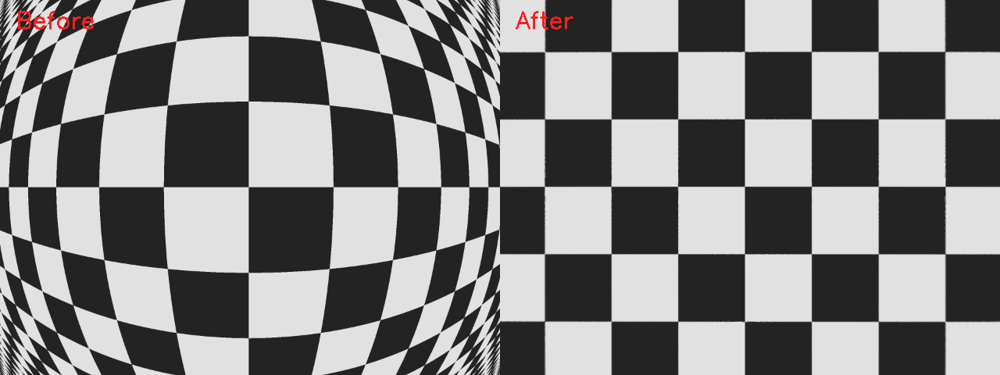

# 実行した検証

このフォルダは開発時の動作確認用です。通常の校正・補正には `main.py` だけを使います。
`verify_synthetic.py` は本体をimportせず、利用者と同じコマンドを実行し、保存されたJSONと画像を調べます。

2026-10-09にWindows / Python 3.12.14 / OpenCV 4.14.0 / NumPy 2.5.3で確認しました。
実行結果の数値は [verification.json](verification.json) に保存しています。

## JPGからの校正と補正

960×720画素の魚眼カメラを仮定して、平らなチェッカーボードを異なる姿勢で描画しました。
交点の座標だけを校正関数へ渡す方式ではなく、実際にJPGとして保存してから検出しています。
乱数シードは42。OpenCVと検出器のバージョンが変わると、結果は多少変わります。

| 確認項目 | 結果 |
| --- | ---: |
| 校正用JPG | 24枚 |
| 全交点を検出できた画像 | 21枚 |
| 校正の再投影RMS | 0.1656px |
| 校正に使わなかった姿勢の投影RMS（既知の投影との比較） | 0.7013px |
| 焦点距離の相対誤差の最大値 | 0.1473% |
| 既知の交点の直線からのずれ: 補正前 | 0.7986px |
| 既知の交点の直線からのずれ: 補正後 | 0.0048px |
| 補正画像から再検出した交点の直線からのずれ | 0.1088px |

画像12・19・20では全交点を検出できず、校正から除外しました。
直線からのずれは、盤の各行・列に最もよく合う直線を求め、その線への距離のRMSです。

以下は、歪みが見やすいように画面全体を覆う格子を描いた比較です。
**左が補正前、右が推定した係数での補正後**です。校正には上記の別の盤画像を使いました。



実機レンズへのモデルの適合性は未検証です。
本番では同じ撮影設定で校正し、校正に使わなかった実写でも直線や交点を確認してください。
本体では画像ごとの詳細な誤差計算を省き、OpenCVが返す全体の再投影RMSを保存します。

## 入力チェック

次の入力・形式チェック13件も、実際のコマンドから確認します。

- 写真がない、対応外の拡張子、マス寸法が0、検出画像が9枚の場合の案内。
- 校正と補正対象の解像度違い、校正写真内の解像度混在の拒否。
- `balance` が負、1超、NaNの場合の拒否。
- 入力画像への上書き、JPGへの出力の拒否。
- 日本語パスで8bit PNGを保存・読込し、画素値を保持。
- 16bit PNGの入力を拒否。

コマンドのヘルプと `--balance 1` での画像出力も実行しました。
Ruffの構文・未使用名・インポート順・行長チェックが通っています。

## 再現する

親フォルダのREADMEに従って環境を用意した後、**親フォルダから**実行します。

```powershell
.\.venv\Scripts\python.exe tests\verify_synthetic.py --out tests\demo_new
```

`--out` を省くと `tests/demo/` に保存します。既に画像がある場合は新しい保存先を指定してください。
この作業で作った実データは `tests/demo_final/` にあります。
写真や大きな生成データはGitの管理対象から外し、スクリプト・結果JSON・比較画像を残しています。

2026-10-12の構成変更後も、移動した `main.py` をコマンドで実行して同じ検証を通しました。
校正用24枚中21枚の検出、再投影RMS 0.1656pxと入力チェック13件を再確認しました。
最新の配置での生成データは `tests/demo_flat_20261012/` に保存しています（Git管理対象外）。
