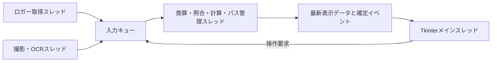
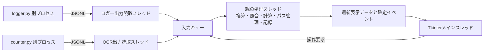
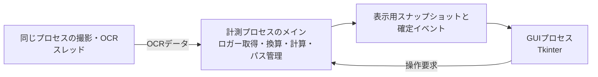
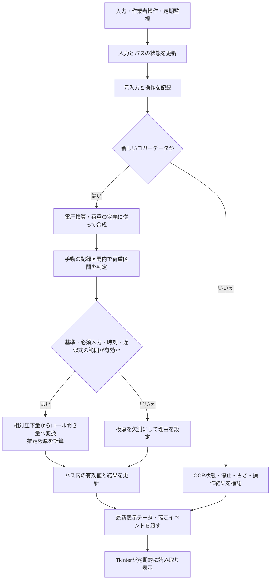
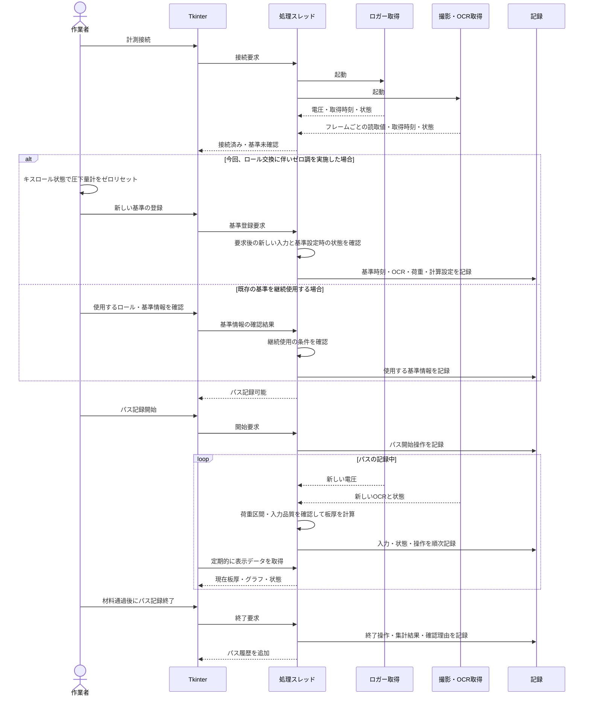

# パスごとの推定板厚表示：構成案と運用の検討

2026-11-11時点の設計メモ。B案を基本方針として、追加ヒアリング内容とユーザーによるロガーの実機確認結果を反映した。この設計作業では実行コードを変更せず、応答時間も測定していない。以下の周期・集計方法は、試作で比較するための案である。

次回訪問で確認する質問と、既知・未確認の区別は[現場ヒアリング票](FIELD_CHECKLIST.md)にまとめる。

## 1. 目的と前提

工場の作業者が、圧延中の推定板厚とパスごとの結果をTkinterの画面で確認し、操作に活用する。

- 材料を圧延機に1度通過させることを1パスとする。
- パスの記録開始・終了を作業者が操作する案は許容されているが、作業を急ぐ運用に合うかは未確認。
- ゼロ調は圧下量計のゼロリセットを指し、ロール交換時にキスロール状態で実施する。その後は相対圧下量を読み、距離はmmで扱う。電源断などを含む基準の保持条件は未確認。
- ミル剛性には過去データの式 `y = 0.0002x^2 - 0.0785x + 140.84` を暫定使用する。ユーザーから板幅依存の式ではないかとの補足があり、xは板幅の可能性がある。測定当時の条件に不確かさがあるとの共有があり、再測定後の置換も検討する。x・yの定義、単位、適用範囲は元資料で確認する。
- OP・DRはそれぞれ片側荷重。両側を同じ力の単位に揃え、合計荷重を `F_OP + F_DR` として扱う。近似式の剛性が全体荷重に対応する定義かは確認する。
- 100ms／20msはロガーアプリの収集設定で、実機動作とCSV出力が確認されている。Pythonの現在値読取周期と所要時間は別に測る。
- 許容遅延は未確定。実際に使ってもらい、欠測・誤読と応答時間を見ながら調整する。
- 現行コードは検証資産として扱い、構成をそのまま維持することを条件にしない。
- 指定がなければ温度を下げないよう、できるだけ早く圧延したいとの聞き取りがある。操作を増やす案は現場で確認する。
- 停止時はロールが惰性で回転するため、入側・出側のカメラモニターで材料位置を確認している。停止操作・速度ゼロ・材料通過完了を同じ意味として扱わない。
- 実際の板厚は最終パスの1パス前と圧延後に、ノギスまたはマイクロメータで3箇所を測り平均している。測定位置・温度条件・対象パスとの対応は未確認。
- 圧下量の決定には前回の依頼時の結果も参照する。照合条件や記録形式は未確認。
- ベテラン以外の職員からはパスごとの板厚・周速・荷重を見たいという希望がある。長い材料の複数位置、左右、入側・出側の比較は将来の候補として聞き取っている。今回の最小タスクは板厚の可視化とする。

**B案で取得・処理・表示を分ける。パス操作とゼロ基準の運用は、ベテランの作業を確認してから決める。OCRは、取得した各フレームを単独で判定する方式を次の検証方針とする。**

### 初期の到達点と段階

| 段階 | 到達点 |
| --- | --- |
| 先行検証 | OCRのフレーム単独判定と、ロガー・カウンターの処理時間・実周期を確認する |
| 最小タスク | 暫定式で求めた現在の推定板厚をmmで表示し、パスごとの厚さ推移・履歴を確認できる。欠測・古さを示し、使用した入力・基準・式を記録する |
| 次の段階 | 取得済み信号を使って周速・合計荷重・OP／DR荷重を表示し、板厚と見比べる。周速信号の意味・単位を先に確認する |
| 将来の候補 | 長手方向の位置に対応した複数点の評価、左右の板厚、入側・出側の比較。必要な計測情報と比較方法を確認してから対象を選ぶ |

荷重入力は最小タスクの板厚計算に必要であり、OP／DRを個別に記録する。作業者向けの周速・荷重グラフを追加することは、その後の段階に分ける。初期の厚さグラフの横軸は経過時間とし、材料の位置を直接表す値とは扱わない。

暫定式での数値表示・応答性の確認と、実際の板厚に対する精度の評価を分けて記録する。初期の完了条件に、左右の板厚や入出側の比較を含めない。

## 2. 既存コードで分かっていること

| 対象 | 現在の役割・動作 | 設計への影響 |
| --- | --- | --- |
| `logger.py` | NR-600の現在電圧をCHごとに順番に取得し、JSONLに出す。作業ツリーの設定は取得後0.2秒待機 | ロガーアプリの収集設定100ms／20msでの実機動作・CSV出力はユーザーが確認済み。Pythonの読取所要時間と実周期を追加測定する |
| `counter.py` | 取得した各フレームで固定42箇所の7セグ判定を行い、その後、同一値が3フレーム続くと確定。結果のJSONLは未確定時も毎回出る | OCR処理を3フレームごとに省略しているわけではない。連続一致を外す主な効果は確定待ちの削減で、画像取得・OCR自体の負荷は別に測る |
| `camera_sdk.py` | 東芝テリーの最新バッファ画像を取得。同一画像IDを重複して渡さない | 同じ画像を繰り返し読んで安定判定することを防いでいる。最新画像を使う方針も活用できる |
| `camera_calibration.py` | 点の校正と設定値の出力 | 通常操作から分けた校正ツールとして残せる |
| `main.py` | 取得子プロセス2つと出力読取スレッド2つを起動。電圧換算・OCRとの照合・CSV出力 | パス判定・推定板厚計算・GUIは未実装。CSV出力処理を、そのままGUIのイベント処理に移さない |

設計前に押さえる点は次のとおり。

1. **最新OCRとの照合であり、厳密な同時計測ではない。** ロガーの各CHを読み終えた時刻と、カメラ画像を読み込んだ時刻を比較している。CH間の読取時間差、計器の表示更新、撮影・転送の遅れは、この差だけでは分からない。
2. **入力が更新されたときの処理と、無更新時の監視を分ける必要がある。** 現状はロガーの新しい行が来たときだけCSVに結果が出る。GUIでは入力が止まっても定期的に古さを判定し、表示状態を変える。
3. **待ち行列が満杯になると、取得側まで待たされ得る。** 現在は共有の64件FIFOに入りきるまで読取スレッドが待つ。パイプ内に滞留した時間は、親が行を読み出した時刻だけでは検出できない。
4. **必要な信号の欠測と、参考信号の欠測を区別する。** 現状の `voltage_status` は設定された全CHをまとめた状態。板厚計算に使わない信号の欠測で、荷重と圧下量が有効な板厚まで欠測にしない設計にする。
5. **停止時間の整合が必要。** `logger.py` は `Stop()` 後に10秒待つが、親は子の終了を5秒で打ち切る。通常停止でも強制終了され得る。10秒待機の理由を実機・仕様で確認して、親の待ち時間と揃える。
6. **圧下量の符号に制約がある。** 現在のOCRは `0.000`〜`999.999` の数字だけを読み、負号には対応しない。キスロールのゼロから開いたときに負数になる計器なら、読取仕様の変更が必要。

READMEには初期8CH・換算値未設定の説明があるが、現在のコードはCH1・2・3・6・7の5CHと換算点が設定されている。また、READMEからリンクされている `../rolling-gauge-meter/README.md` はこの作業ツリーに存在しない。装置仕様は、そのリンク先を確認済みと扱わない。

## 3. 構成の3案

プロセス数はPythonアプリだけを数える。WAVE LOGGER PROなどの外部アプリは含めない。どの案でも、Tkinterのウィジェット操作はGUIのメインスレッドに集め、計測値・パス状態の更新は1箇所に集める。

### 案A：1プロセスにまとめ、取得をスレッドに分ける



- アプリの流れを1つのスクリプトで読みやすく、JSONのプロセス間通信も不要。
- COMオブジェクトはロガー担当スレッド内で初期化・生成・使用・解放する。既存のCOMオブジェクトを別スレッドに渡さない。
- 取得関数が止まったとき、Pythonのスレッドを外から安全に強制終了する手段がない。SDKやCOM拡張の動作によっては、他の処理への影響も実測が必要。
- 機器呼出しの停止方法・タイムアウトが確認できており、コードを1箇所で追うことを特に優先する場合に向く。

Tkinterのイベント処理は短く保つ必要があり、長い処理は別スレッドなどに移すことが公式文書でも説明されている。[PythonのTkinter文書](https://docs.python.org/3.13/library/tkinter.html#threading-model)

COMを使うスレッドごとの初期化と、STAでのスレッド所有・メッセージ処理の条件も考慮する。[MicrosoftのCOM初期化文書](https://learn.microsoft.com/en-us/windows/win32/learnwin32/initializing-the-com-library)

### 案B：取得を個別プロセスに分け、親アプリで処理する（第一候補）



- COMとカメラSDKを別々に終了・監視できる。取得の片側が止まっても、親の画面で原因と欠測を示せる。
- 機器を単体で確認でき、既存の取得・OCR・校正とテストを活用しやすい。
- 親は計器固有の呼出しから離れ、「入力→換算→状態確認→計算→パス集計」の順序で書ける。
- JSONL、出力読取、起動・停止管理が必要。全体の処理箇所は案Aより増える。
- 子プロセスの強制終了は、機器の停止を保証しない。通常停止を優先し、停止確認が取れなければ画面に残す。

ロガーの基本動作はユーザーが実機で確認済み。B案ではこれを活用し、実周期・処理時間と、カメラ取得の負荷を個別に確認する。プロセス分離によって応答時間が短くなると保証するものではない。

### 案C：計測・計算を1プロセスにまとめ、GUIだけ別プロセスにする



- 計測とパス判断が同じ場所にあり、GUIは結果表示と操作に集中できる。
- 例えば1つの `app.py` にGUIと計測用の起動関数を置き、標準の `multiprocessing` のキューで渡す構成にできる。Windowsでは `spawn` とメイン処理の起動保護を考慮する。
- 計測側のCOM呼出しが止まると、そのプロセスの計算・パス処理も止まる。GUI側で最終更新時刻を監視する。
- ロガーとOCRの障害は同じ計測プロセスの障害になる。機器別の強制終了には向かない。
- 機器動作が十分確認でき、計測側を1つの流れとして保守したい段階で再検討する価値がある。

| 比較点 | 案A | 案B | 案C |
| --- | --- | --- | --- |
| Pythonプロセス数 | 1 | 3 | 2 |
| 処理を追う場所 | 1つにまとめやすい | 親と取得2つ | GUIと計測 |
| 機器ごとの終了・切り分け | 難しい | しやすい | 難しい |
| GUIと計測状態の分離 | スレッド間 | 親のスレッド間 | プロセス間 |
| 既存の単体検証の活用 | 取得処理の組替えが必要 | 活用しやすい | 取得処理の組替えが必要 |
| 選びどころ | 機器呼出しが安定し、構造の小ささを優先 | 現在の実機検証から作業者向け試作へ進む | 機器が安定し、計測処理を集約したい |

## 4. パスを区切る運用

### 検証用の仮案：「手動の記録開始・終了＋荷重による圧延区間の抽出」

手動操作は試作の区切り方として使えるが、温度低下を避けて急ぐ実作業で毎パス2回の操作ができるかは未確認。以下を確定仕様とせず、作業者・補助者の役割とパス間の作業を確認する。負担が大きければ、材料単位で記録を開始し、荷重などからパス候補を付けて後で確認する運用を比較する。

1. 作業者が、材料を通す前に「パス記録開始」を押す。
2. アプリはそのパスの入力を記録する。画面には「材料待ち」と表示する。
3. 荷重が立ち上がった区間で、推定板厚を表示・集計する。
4. 荷重が下がったら「圧延荷重なし」と表示する。パスの記録は続ける。
5. 材料の通過後に、作業者が「パス記録終了」を押す。
6. 圧延中の有効な板厚から結果を作り、履歴に追加する。

この操作なら、噛み込みの瞬間に合わせてボタンを押す必要がない。途中の一時停止や荷重低下でパスを分割せずに済む。1つの記録内に複数の圧延区間が出た場合も自動で別パスにせず、履歴に確認理由を残す。

荷重の判定は、入り側の閾値を `P_on`、抜け側を `P_off` とし、`P_on > P_off` にする。さらに、条件が短時間続くことを確認して、ノイズで切り替わることを防ぐ。閾値・確認時間は、無負荷、キスロール、噛み込み、通過中、抜け、途中停止の実測波形から決める。入力欠測の時間を、条件が継続した時間として数えない。

キスロール時にも荷重が出るため、荷重だけで材料通過と判断しない。基準情報と作業区間を確認してから判定する。ゼロ調はロール交換時の作業として扱う。

### ほかの運用との比較

| 運用 | 良い点 | 注意点・採用条件 |
| --- | --- | --- |
| 手動開始・終了だけ | 最も早く試せる。パスの意味を人が判断できる | 材料待ちや通過後の値を集計に入れない工夫が必要 |
| 手動開始・終了＋荷重で集計区間を選ぶ | 圧延中の値に絞れ、試作を検証しやすい | 毎パスの操作負担は未確認。押し忘れ・二重操作も確認する |
| 材料単位で記録し、パス候補を付ける | パスごとの操作を減らせる | 材料・依頼の切替え、候補の訂正方法を決める。自動判定精度の検証が必要 |
| 作業者が次パスを準備し、荷重で自動開始・終了 | 通過ごとの操作負担を減らせる | 途中停止と材料の抜けの区別を、実際の運用で検証してから採用 |
| 材料検出信号・既存PLCの通過信号を使う | 通過の意味に近い情報が得られる | 信号が実際に取得可能で、その意味と遅延を確認できる場合に比較する |

速度は「動いているか」の補助にはなるが、停止指令後の惰性回転や、同じ材料が噛み込んだまま停止する場合がある。材料位置は入側・出側のモニターで確認する現行運用を聞き取る。現在の速度設定は正の値だけを扱い、方向信号も未確認なので、逆転をパス区切りの前提にしない。材料位置確認用の既存カメラと、計器OCR用カメラの役割も分けて確認する。

## 5. 案Bでの処理フロー



最初はロガーの新しいデータ1件につき、板厚の計算・集計を1回行う。OCRが同じロガー値に対して何度更新されても、パス集計に同じ荷重データを重複追加しない。

処理スレッドだけが、現在の入力、基準、パス番号、集計を変更する。GUIは操作要求を送って処理結果を表示し、独自にパス番号やゼロ基準を書き換えない。

### データの渡し方

| 用途 | 渡し方 | 遅れ・満杯・欠測への対応 |
| --- | --- | --- |
| 入力・パス判定・記録 | 順序を保つ有限サイズの入力キュー | データを黙って捨てない。取得元時刻からの遅れや満杯を検知し、推定表示を欠測・パスを要確認にする。記録を継続・停止する条件は、依頼された記録要件を確認して決める |
| 大きな数値表示・短いグラフ系列 | 最新の表示データに上書き | 古い画面更新を省略して、現在の値に追いつく。元データは処理側に保持・記録する |
| パス確定・エラー・基準確認結果 | 順序を保つイベント通知 | 最新1件への上書き対象にしない。パス履歴や停止理由を失わない |
| 作業者操作 | 処理側への要求 | 開始済みの再開始などは受理せず、現在の状態を表示する |

「最新値だけ残す」を入力全体に適用すると、短い荷重変化や欠測を失う。画面更新の省略と、判定用データの省略を区別する。ただし、現在値の定期読取そのものは、読取間に起きた短い現象を取得できない。この限界はキューを残しても解決しない。

グラフは保存した履歴から作る。欠測区間には線を引かず、古い板厚を現在値として描き続けない。GUI自身でも最終入力・最終処理時刻を監視し、処理スレッドが止まった場合に更新停止を示す。

## 6. 操作と計測のシーケンス



ゼロ調は圧下量計のゼロリセットを指し、ロール交換時にキスロール状態で実施することが確認できている。上図の基準登録・継続確認の具体的な操作と、手動のパス操作はヒアリング後に確定する。通常運転では既存の基準を継続使用する流れとし、アプリ起動のたびにゼロ調を要求しない。

GUIでの基準登録は、現行手順で設定された基準を確認・記録する操作とする。新しくゼロリセットを行った場合には、要求より前の待ち行列に残っていたゼロを確認に使わない。既存基準を継続使用する場合、現在のOCRが0.000であることを要求しない。ロール交換や計器の電源断などを含む基準の有効条件を確認し、どの基準を使用するかを記録する。

ハードウェア側でゼロリセット済みなら、GUIで毎パス別のオフセットを引いて再びゼロにしない。基準時の荷重による補正が必要かどうかは、計算モデルの基準定義として決める。パス間で基準を維持し、再ゼロリセット・装置再設定・基準の連続性が確認できない再接続では、基準情報を確認し直す。基準情報の確認と、現場での基準設定作業のやり直しは区別する。

手動パスの状態は「未記録→記録中→未記録」とし、その内側に「材料待ち／圧延区間／荷重なし」を持つ。入力品質はこれと別に「有効／未確定／欠測／古い／設定範囲外」を持つ。OCR欠測だけでパスを終了しない。

アプリの計測終了時は、記録中のパスを通常完了と区別して閉じる。ロガーの記録停止まで連動させるかは、100ms／20msの記録要件と終了条件を確認して決める。現在のスクリプトは終了時にロガーへ `Stop()` を送る。GUI上で長い `wait()` や `join()` を行わず、終了状況を定期確認する。停止未確認を通常終了として表示しない。ここで扱うアプリ・ロガーの終了と、圧延機の停止操作は別である。

## 7. 板厚計算で先に定義すること

計算式の詳細より先に、次の入力の意味を確定する。これらは正しい板厚を表示できるかに直接関わる。

| 項目 | 決める内容 |
| --- | --- |
| 相対圧下量 | ロールを開くと表示が増えるか減るか。表示単位は本当にmmか。負数・桁あふれがあるか |
| ロール開き量 | キスロール基準から開く向きを正にした内部のmm値。OCR表示とは名前を分ける |
| 圧延荷重 | OP・DRは片側荷重で確認済み。合計は同じ単位に揃えた `F_OP + F_DR`。近似式が全体荷重に対応するかと、ゼロ・符号の校正条件を確認する |
| 荷重単位 | 現在の `ton` が何を表すかを確認し、剛性式と同じ力の単位に揃える。単位のラベル変更だけで済ませない |
| 基準荷重 | ゼロリセット時のキスロール荷重を、測定済みの式がどう扱っているか |
| 多項式 | 暫定式は `y = 0.0002x^2 - 0.0785x + 140.84`。xは板幅の可能性がある。元グラフの軸名・単位、測定した範囲、全体剛性か片側剛性かを確認する |
| 適用条件 | 対象ミル・ロール条件など、測定済みの近似式を適用できる条件 |

無負荷ロールギャップを `s`、荷重を `F`、ミル剛性を `M` とした基本形は `h = s + F / M`。ミルの弾性変形を荷重と剛性から扱う考え方は、[JFEの板厚制御の説明](https://www.jfe-21st-cf.or.jp/chapter_3/3b_3.html)を参照。

ただし、**今回のキスロール基準からの相対値を、そのままこの `s` に代入できるとはまだ確定していない。** 基準時に荷重がかかっていれば、その状態の弾性変形とゼロの定義を反映する。基準補正は現場の校正方法に合わせ、根拠なく `F0` を引くだけの処理を加えない。

ユーザーから、近似式は板幅依存ではないかとの補足があった。板幅がロールの弾性変形を通じてゲージメータモデルに影響することは、[板幅等を考慮したゲージメータモデルの研究](https://www.sciencedirect.com/science/article/pii/S1005885007600760)でも扱われている。ただし、この一般的な性質だけで今回の式のxが板幅だとは確定しない。

元資料でx＝板幅 `b`、y＝全体荷重に対するミル剛性 `M` と確認できた場合は、`M(b) = 0.0002b^2 - 0.0785b + 140.84` として扱う。材料条件の板幅から剛性を求め、その剛性と合計荷重・ロール開き量を板厚計算へ渡す。この場合、求めたい板厚を近似式に再入力する反復計算は必要ない。

式へ入れる板幅の単位と定義（入側・出側、実測値・呼び寸法など）、測定した板幅の範囲を確認する。適用する板幅を材料条件として指定・記録する案とし、板幅の自動計測を初期要件に追加しない。板厚依存の式と仮定した解法は、元資料を確認するまで設計へ組み込まない。

計算は入力と設定から板厚・状態を返す1つの関数にまとめ、COM、カメラ、Tkinter、ファイル書込みを含めない。範囲外・剛性が非正・計算不能は欠測にし、0mmに置き換えたり、境界値に丸めて有効値扱いしたりしない。

暫定式の係数は1箇所で設定し、使用した式と適用条件を計測記録に残す。再測定後はその設定を置き換え、過去の記録がどの式による結果だったかを失わないようにする。初期から複数モデルを切り替える仕組みは作らない。

左右荷重を別々に取得できることから、左右の板厚もそれぞれ求められるとは決めない。現在確認できている入力は圧下量1表示と荷重2点であり、左右のギャップや剛性の扱いは未確認。片側荷重だけを全体用の式へ代入した値を、左右板厚として表示しない。

## 8. 応答性の測り方と試作時の調整

画面更新周期と、実際の変化が画面に出るまでの遅延は別に測る。

| 項目 | 現状または試作案 | 確認すること |
| --- | --- | --- |
| ロガーの設定周期 | ロガーアプリの収集設定100ms／20msでの実機動作・CSV出力は確認済み | 対象CH・試験条件を記録し、Pythonの現在値読取とは別に扱う |
| Pythonのロガー処理 | 指定CHを逐次取得し、JSONL出力後に待機 | 状態取得・全CH読取・出力の時間、読取開始間隔、CH間時間差、出力滞留を実測 |
| OCR | 現行の連続一致条件を外し、取得した各フレームを単独判定する検証方針 | 実FPS、画像待ち・変換・OCR・出力の時間、値が動く間の欠測率と誤読率 |
| 数値表示 | 試作は `after(50)`〜`after(100)` 程度を候補にする | 処理負荷と体感。指定間隔どおり実行される保証とは扱わない |
| グラフ | 試作は100〜200ms程度でまとめて更新する案 | 数値の応答を妨げないか。毎回全履歴を描き直さない |
| 時刻差・古さの許容値 | 現状150ms・入力停止1秒は検証値として扱う | 片側遅延、読取不能、取得停止を区別し、実測と操作に必要な時間から再設定 |

### 1フレームごとの判定

現在も各取得フレームで `recognize_display()` を実行し、JSONLを1行出している。3フレーム同値は、その読取値を出力の数値として採用する条件であり、OCRを行う頻度の条件ではない。

次の検証では連続一致を必須にせず、各フレームで7セグの数字を判定する。現行コードなら `STABLE_FRAMES = 1` で比較できる。この文書更新では値を変更していない。白飛び・曖昧な点灯・不正な桁パターンを欠測にする判定は維持する。1フレーム内で数字の切替え途中が別の正しい数字に見える可能性もあるため、読取成功率だけでなく既知の表示との一致も確認する。

連続一致待ちをなくすと、取得・OCRの主要処理量は大きく変えずに確定待ちを減らせる。例えば30fpsでの3フレーム一致には最初の観測から約67ms必要だが、単独フレーム判定でも計器の表示更新・撮影・転送・次のロガー取得・描画の遅れは残る。FPSは実測する。

東芝テリー側は最新バッファを読む方式なので、「取得した各フレームを処理する」と「カメラが生成した全フレームを処理する」は異なる。処理が追いつかなければ途中の画像を飛ばし得る。受領件数・実処理FPSと、取得できる場合は画像IDの欠番も確認する。

### 100ms／20msの記録と現在値の取得を分ける

100ms／20msはロガーアプリの収集設定であることと、CSVを出力できることが確認できた。収集記録はまずこの既存経路を使い、Pythonは板厚を可視化するための現在値の取得・OCR照合を担当する。ロガーアプリの収集周期、Pythonの現在値読取間隔、親への出力間隔、GUI表示周期を分けて記録する。

現在のループは概ね「状態取得＋全CH読取＋JSON化・出力＋設定した待ち時間」の順なので、仮に待ち時間を20msにしても、実際の読取開始間隔は20msより長くなる。各回の開始間隔と終了までの時間を記録して確かめる。

Pythonで同じ収集波形を全件取得し直すことは、最小タスクの要件へ加えない。まずロガーアプリのCSVと、Pythonで表示に使った入力・OCR・時刻の記録を区別して残す。必要なら保存された波形と照合して精度・遅延を検証する。CSV出力が可能なことから、そのファイルの追記をリアルタイム取得手段にできるとはまだ判断しない。

### 処理時間の出力方針（未実装）

`print()` での計測結果表示は有効だが、標準出力は親が読むJSONL専用のため、診断の文章を混ぜると連携を壊す。診断は切替え可能にし、標準エラーへ1秒ごとに件数・平均・最大などを要約する案とする。詳細比較が必要な検証時だけ、各回の数値を別ファイルへ記録して中央値・95パーセンタイル・最大値を集計する。

| 対象 | 最初に測る区間・件数 | 分かること |
| --- | --- | --- |
| ロガー | 状態取得、全CHの読取開始〜終了、JSON化・標準出力のflush完了、次の読取開始まで | COMの所要時間、CH一巡の時間幅、出力の詰まり、実周期。必要ならCH別時間を追加 |
| カメラ | 画像要求〜受領、BGR変換、画像解放 | 次画像待ちと画像転送・変換のコスト。SDK内で分けて計測する必要がある |
| OCR | `recognize_display()` の開始〜終了、JSON化・出力、受領間隔、読取不能件数 | 認識処理の時間と実処理FPS、欠測の割合 |
| 親・GUI | 子の取得時刻〜親受領、計算完了、表示更新 | パイプ・キューの滞留と、作業者が見るまでの遅れ |

区間の経過時間は標準ライブラリの `time.perf_counter_ns()` の差をmsに換算して測れる。これは待ち時間を含む経過時間であり、CPU使用率そのものではない。[Pythonの計測時計](https://docs.python.org/3.13/library/time.html#time.perf_counter_ns)

現在のカメラ取得関数の外側を測るだけでは、画像待ちとBGR変換が混ざる。最初は取得全体・OCR・出力・実周期を測り、取得が重ければSDK内の待ちと変換を分ける。長い画像待ちだけを見てOCRが高負荷だと判断しない。

毎フレームのコンソール出力やファイル書込み自体も時間を使う。詳細の `--segment-scores` は通常の負荷比較では無効にし、診断の有無・出力先を記録する。詳細ログを有効にした試験だけから通常時の性能を決めない。CPU・メモリはOS側でも確認し、WAVE LOGGER PRO・カメラSDKなど別プロセスの負荷と区別する。

比較は、同じPC・CH・カメラ設定・出力先で「ロガー単体→カウンター単体→両方＋親の処理→GUI併用」の順に行う。起動や終了時の待機は通常運転の処理時間から分け、設定値・継続時間・出力件数・欠測数・実周期・処理時間を試験ごとに残す。

### 記録する時刻

- 取得子側：ロガーのCH一括読取開始・終了、画像受領、OCR処理完了の単調増加時刻。
- 親側：入力受領、計算完了、GUIで表示を更新した時刻。
- 人が記録を読むためのUTC日時も別に残す。

時刻差・タイムアウトには、同じPCの `time.monotonic_ns()` などを使う。単調増加時計はシステム日時の修正の影響を受けず、Python 3.13の対象環境では同一PCのプロセス間で差を取れる。[Pythonの時刻文書](https://docs.python.org/3.13/library/time.html#time.monotonic)

照合では、入力同士の取得時刻差に加え、現在から見た両入力それぞれの古さと、ロガーのCH読取に要した時間も確認する。古い2つの入力は、時刻差だけが小さくても有効にしない。OCRが未確定・読取不能になった事実を、最後の確定値で隠さない。

PC内の時刻計測では、計器の変化から画像受領までの遅れは分からない。計器とGUIを同じ動画に収めるなどして、表示変化の差も測る。入力からGUI更新までの遅延は中央値・95パーセンタイル・最大値で整理し、長時間運転で遅れが積み上がらないことも確認する。

カメラ固有の時刻を使う場合も意味を確認する。東芝テリーのFAQで説明されている画像情報のTimestampは送出時刻であり、そのまま露光時刻やPCの時計との同期を保証する情報ではない。[東芝テリーのTimestamp FAQ](https://www.webcom.toshiba.co.jp/faq/teli_en/?c=2&fid=1516&i=0&pid=&typ=1)

## 9. 作業者の画面と保存

最小タスクの通常画面は次の情報に絞る。

- 現在の推定板厚を大きくmmで表示し、「材料待ち」「圧延中」「OCR未確定」「入力停止」などを文字でも示す。
- 現在パスの厚さ推移。欠測は途切れとして表示する。
- パス履歴に、パス番号、代表厚さ、有効データ数、欠測・確認理由を表示する。
- 「接続」「基準確認」「パス記録開始／終了」「計測終了」の操作。

パスの代表厚さの集計方法は未確定とする。前案の中央値は比較候補だが、現行の3箇所の実測平均と、パス全体の時系列の中央値・平均は対象も重みも違う。必要なのが通過中の厚さ・次パス判断用の代表値・最終の実測との照合値のどれかを聞き取ってから決める。先端・尾端を外す範囲や実測位置・温度条件との対応も確認する。運転中は暫定値、終了後は確定値と明示する。有効値がなければ集計不能とし、入力不足を十分なデータと同じ結果にしない。

荷重、OCRのmm値、入力の古さなどは詳細表示に置く。校正座標・多項式係数は、作業者がパスごとに編集する画面から分ける。

職員から希望のあった周速・荷重の作業者向け表示は、板厚表示の動作を確認した次の段階で追加する。現行の `rolling_speed` 信号がロール周速を表すか、材料の速度を表すかは設備の定義で確認する。荷重の左右差は観測できる入力として扱い、左右の板厚差と同一視しない。入側・出側の板厚比較には、対応する板厚の情報と同じ材料部分を比べる方法の確認が必要になる。

前回の依頼時の結果を参照しているため、現在の材料・依頼と記録したパスを結び付ける識別方法を決める。最初に必要なのは対象を取り違えないことと、現行記録のどの項目を参照するかの把握である。履歴検索や自動の圧下量提案の要否は、実際の記録と判断手順を確認してから決める。

保存は、入力・操作を順に残すJSONLと、パス集計CSVを基本案にする。開始時には換算点、係数、単位、適用範囲、ゼロ基準、区間判定条件も記録し、後から同じ入力・操作・設定を再生できるようにする。映像の常時保存は初期の必須条件にしない。

最初の試作では処理側で少量ずつ記録し、書込み時間も測る。記録が処理を遅らせる場合に限り、書込みを別スレッドにする。保存失敗は明示し、通常完了したパスとして扱わない。

出側板厚CHで推定値を検証する場合、厚さ計がロール出口から離れていれば材料の移動時間がある。PC上で同時刻の値という理由だけで、同じ材料位置の板厚として比較しない。

## 10. 実装・検証の進め方

1. **現場の前提を確認する。** ベテランの1材料分の作業を見て、板厚で判断する場面、パスの区切り、操作の余裕、ゼロ調の手順と基準の保持条件、実測・過去記録との対応を確認する。計器の向き・負号、荷重と近似式の単位・全体剛性との対応は設備・計測担当者にも確認する。
2. **先行できる負荷・周期検証を行う。** ロガーアプリの100ms／20ms収集設定での実機基本動作確認は完了済みとして、Pythonの実周期・処理時間・滞留・停止時間を記録する。カウンターは各フレーム単独の判定で、取得・OCR・出力の時間と誤読・欠測を比較する。
3. **案Bの小さなTkinter試作を作る。** ヒアリングで選んだ記録開始・終了の方法、荷重による区間選択、現在値、グラフ、履歴、保存に絞る。既存基準を継続する通常運転と、新しい基準の登録を分ける。
4. **記録を再生して境界条件を確認する。** ゼロの0.000、負方向、噛み込み、途中停止、短い荷重低下、OCR未確定、入力停止、遅延、操作の重複、終了途中を確認する。
5. **現場で調整する。** 作業者が操作変更を判断できるか、押し忘れや画面の見落としがないかを確認し、必要なら半自動のパス判定へ進む。

案Bの初期実装では、`main.py` にGUI・入力の受け口・処理の流れ・計算関数を置き、`logger.py` と `counter.py` は単体で動く取得スクリプトとして残す。`camera_sdk.py` と `camera_calibration.py` も役割を保つ。継承階層、汎用イベント基盤、機器プラグイン、データベースを先に作らない。GUIと処理の同居で読みにくくなった場合に、実際のまとまりを見て分割する。

### 初回の設計検討時の確認記録

ルートと題材のREADME、AGENTS.md、5つの実行スクリプト、既存テストを確認した。実機の計器・NR-600・カメラは起動していない。

実行場所：`scraps/logger-ocr-live`

```powershell
.\.venv\Scripts\python.exe -m unittest discover -s tests -v
```

結果：60件中59件成功、1件失敗。`test_standalone_without_arguments_reads_default_eight_channels` が8CHを期待する一方、現在の `logger.py` の `CHANNEL_NUMBERS` は `[1, 2, 3, 6, 7]`。設定変更とテストの期待値の不一致であり、今回の設計検討では変更していない。これらは模擬入力のテストで、実機の応答性・精度を確認した結果ではない。
