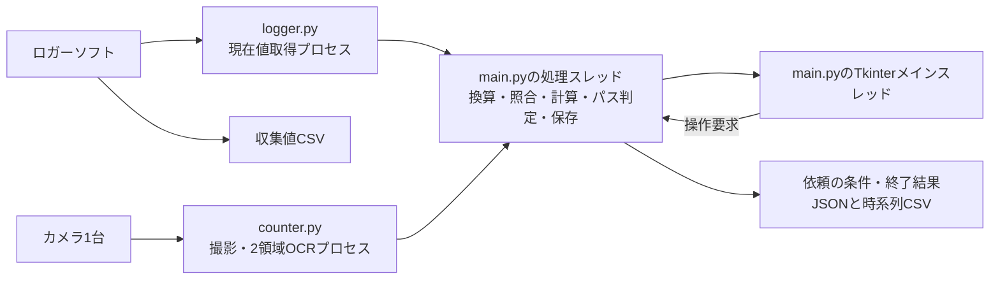
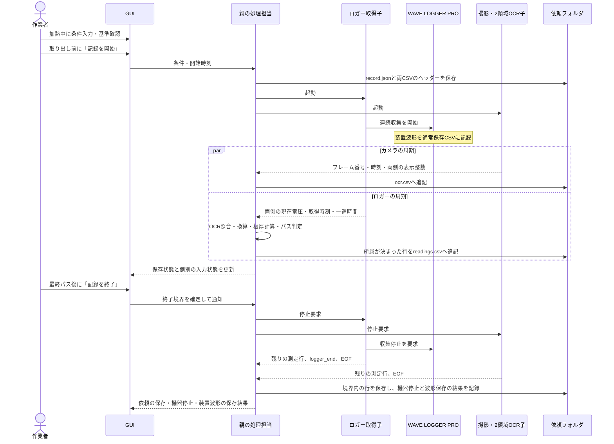

# 圧延データの可視化・保存：採用仕様

本体の仕様をこの文書で管理する。現行コードの動作・実装状況・導入設定は[README](README.md)、係数特定スクリプトは[別要件](COEFFICIENT_FIT.md)を参照する。

## 1. 目的と範囲

OP／DR両側の推定板厚・荷重を圧延中に確認し、パス内の推移を保存する。

対象は最大18m、最大50m/minの圧延。圧延中から取得済みの結果を表示し、次パスの設定前に直前パスの結果を確認できることを目標にする。

- 圧下量計はOP側・DR側に各1台。BG505LMCF 1台で両方を撮影する。
- 圧延依頼ごとの記録名、初期板厚mm、板幅mmを開始前に入力する。
- WAVE LOGGER PROは装置の周期で収集した波形を通常保存CSVにする。本体は自分で読んだ現在電圧、受け取った画像ごとのOCR結果、照合・計算結果と条件を保存する。
- 実測値の入力・記録・比較、合否判定、TMB自動集計、材料台帳、履歴検索、機械の自動制御、TR100との連携は対象外とする。

## 2. 記録単位

1依頼につき1回計測し、同じ初期板厚・板幅で行う一連のパスを記録する。依頼番号や名前を記録名にし、開始日時を付けて保存する。中断してやり直す場合も新しい記録を作る。

```text
依頼名_20261117_143000/
  record.json
  readings.csv
  ocr.csv
```

保存フォルダ名にはPCのローカル時刻を使い、記録内の暦時刻はUTC、経過時間はPCの単調時刻で表す。保存先はリポジトリ外に設定する。空の記録名・ファイル名に使えない文字・既存保存先との重複はエラーにし、既存記録を上書きしない。記録中は入力条件・係数・基準を変更しない。

初期板厚は開始条件として保存する。板厚式へは直接代入しない。板幅は記録内で固定し、板幅補正係数kbへ使う。

## 3. 構成と担当



Pythonは3プロセス。親アプリはGUIメイン1本、入力読取2本、処理1本の4スレッドとする。処理担当だけが条件・パス番号・計算結果を更新する。GUIは表示と操作要求を担当し、機器アクセス・保存・長い終了待ちを行わない。

`camera_sdk.py` と `camera_calibration.py` を撮影・校正に使う。保存専用スレッド、独立GUIプロセス、DB、Webサーバー、自動再起動は設けない。

### 取得子と親の間

同じPC上の専用パイプを各子に1組使う。通信はUTF-8のJSON Lines（1行1オブジェクト）。記録開始時に親が子の標準入力へ機器設定を1行渡す。子は設定を読み終えてから同じ入力を停止監視へ引き継ぐ。標準出力には測定行（`type` が `sample`）を取得順に書き、1行ずつフラッシュする。入力元はパイプで識別する。単体起動ではスクリプト先頭の設定を使い、同じ形式で出力し、Ctrl+Cで終了する。

| 子 | 親が最初に渡す設定 | 子が返す1件 |
| --- | --- | --- |
| ロガー | `ucf_path`（設定ファイルの絶対パス）、`device_id`、`op_ch`・`dr_ch`（`U1_CH2` のような物理CH名）、`period_us`（読取開始間隔） | OP・DRの生電圧をVで返す。最後のCHを読み終えたときのPCのUTCと単調時刻、最初のCHの読取開始からの所要時間も付ける |
| OCR | `camera_index`、`frame_size_px`（幅・高さ）、`reflection`、`op_points_px`・`dr_points_px`、`sample_radius_px`・`sample_length_radius_px`、`thresholds` | 画像受取直後・OCR前のPC単調時刻、pytelicamの `ImageData.block_id` と `ImageData.timestamp`、同じ画像から読んだ各側の表示整数（0〜999999）を返す |

校正点は向き補正後の画像の左上を原点とする `[x,y]`。各側で左から6桁、各桁は上・右上・右下・下・左下・左上・中央の順に7点を並べる。未校正の側は点列も返す表示値も `null` とする。`reflection` は `none`・`horizontal`・`vertical`・`both` のいずれか。長手方向の半径が `null` のときは正方形を使う。赤画素率方式の `thresholds` には実際に使う `red_min`、`red_margin`、`white_min`、`off_fraction`、`on_fraction` を入れる。

ロガーとOCRのメッセージ例を、各1行ずつ示す。時刻の `*_us` は整数マイクロ秒、`mono_us` は同じPCの `time.monotonic_ns() // 1000`。UTCは `YYYY-MM-DDTHH:MM:SS.ffffffZ` とする。

```jsonl
{"type":"sample","utc":"2026-11-17T05:30:00.100000Z","mono_us":5100000,"scan_us":2000,"op_v":2.0,"dr_v":2.2}
{"type":"sample","mono_us":5090000,"block_id":12,"camera_ticks":780000,"op_count":0,"dr_count":null}
```

上のキーを各測定行の必須項目とする。欠測は該当側の電圧または表示整数に `null` を入れる。例のOCRはOPがゼロ、DRが読取不能という1枚の画像である。不正な型・非有限値・範囲外の表示整数・負の所要時間・必須キーの欠落は受信異常として通知する。診断は標準エラーに出す。

親は各子の標準入力を閉じて停止を要求する。ロガー子は収集停止処理の後、WAVE LOGGER PROで確認できた波形保存結果を、最後に1行だけ返してフラッシュする。波形の確認方法と3つの状態は第8節に定める。

```jsonl
{"type":"logger_end","logger_csv_status":"unconfirmed","logger_csv_files":[]}
```

親はこの行を終了結果として扱い、CSVの行数や入力更新の判定から除く。各子は取得を正常に終えて機器の停止・解放を確認したら終了コード0、起動・取得・停止に失敗したら非ゼロで終了する。ロガーの正常終了には `logger_end` が1件必要。種類が不明な行、OCRからの終了メッセージ、`logger_end` の重複やその後のロガー測定行は受信異常とする。

親の読取スレッド2本は測定行を共通の有限FIFOに入れる。終了行・EOF・異常の通知とGUIの終了要求は、測定FIFOが満杯でも届く別の経路で処理担当を起こす。終了通知が先に届いても、受け取った対象行をすべて処理してから依頼を閉じる。

### GUIと処理担当の間

同一プロセス内はPythonの値を直接渡す。GUIは操作順に要求を渡す。開始要求には操作時のUTCと単調時刻、記録名・初期板厚・板幅と確認した基準を添える。終了操作はその場で第4節の終了境界を確定する。停止未確認の機器を作業者が確認したときは、対象の依頼と機器を添えて通知する。処理担当は最新の数値・グラフ・状態を渡し、GUIは描画時に最新分を読む。パス確定・終了・異常の通知は発生順に受け取る。

## 4. 操作と収集の開始・終了

1. **炉で加熱中**は、作業者が記録名・初期板厚・板幅を入力する。画面に使用ロールと直近のゼロ基準を示し、交換・再設定がなければ確認だけで使えるようにする。変更があれば今回の基準を指定する。入力を済ませて待っている間はロガー収集も撮影も開始しない。
2. **炉から取り出す少し前**に「記録を開始」を押す。親は記録名、有限で正の初期板厚・板幅、機器を開くのに必要な設定を検証する。設定JSONと両CSVのヘッダーを保存してから取得子を起動する。ロガー子がWAVE LOGGER PROに収集開始を要求し、OCR子が撮影を開始する。圧延機の操作は作業者が行う。
3. 起動中も届いた入力から記録する。両入力の初回受信と保存開始を確認したら「記録中」と表示し、荷重・OCRの有効性は側別に示す。例えばDRだけ読めないときは「記録中・DR読取不能」と表示する。作業者は炉から取り出す前にこの画面を確認できる。
4. 圧延中から最終パスまでは、パス間も収集・撮影を続ける。パスの開始・終了は荷重で判定し、ボタン操作を求めない。
5. **最終パス後**に「記録を終了」を押す。両取得子に停止を要求し、依頼ファイルの保存、機器の停止、波形CSVの保存結果をそれぞれ表示する。終了処理中も次の依頼条件を入力できる。次の取得は前回の終了処理が済み、機器停止を確認してから開始する。起動中や記録中にウィンドウの×を押した場合も同じ停止処理を通す。

記録終了時にカメラのストリームを停止・解放する。長く使用しないときは作業者が給電を切る。パスごとの電源操作、自動給電制御、待機タイマーは設けない。通常運用で保存するのはOCR結果とし、誤読の検証や校正で元画像が必要なときだけ短く撮影・保存する。

### 記録に含める行

記録範囲は `開始時刻 ≤ 取得時刻 < 終了時刻`。電圧にはCH読取完了時刻、OCRには画像のPC受取時刻を使う。片方だけ届いた時間帯も記録する。終了ボタン、ウィンドウの×、中断を必要とする異常のうち、親で最初に受け付けたものが終了境界を決める。停止中の異常は終了結果に追記し、境界は動かさない。

終了境界は依頼ごとに1個のロックで保護する。GUIの終了操作または異常を受け付けたスレッドは、ロック内で現在の単調時刻とUTCを読んで未確定の境界を設定し、ロックを解放して処理担当に通知する。処理担当も同じロックで各測定行の採否を決める。境界が既知なら上の範囲を適用する。未確定の間は、開始時刻以上で、ロック内で読んだ現在時刻より古い行だけを採用する。同じマイクロ秒の行はロックを解放し、時計が進んでから再判定する。これで終了と同時刻の行を先に確定する競合を防げる。

採用した行だけをOCR照合、パス判定、表示、CSV追記へ渡す。終了通知より遅く届いた境界内の行にも同じ規則を使う。パイプ操作、計算、ファイル書込みはロックの外で行う。

### 1依頼のシーケンス



## 5. 入力・時刻・品質

- 電圧は `GetCurrentData()` でOP／DRの荷重CHを順に読む。校正2点の電圧区間（両端を含む）で線形換算し、係数と同じ荷重単位を使う。範囲外は荷重を欠測にする。ロガーソフトのCSVとは取得周期・件数が異なるため、ライブ計算に渡した生電圧を各行に残す。
- 両側ともロールを開く方向をSの正方向とする。各側の有効開き量区間は幅1000 mm未満に設定し、`(表示整数 + 1000000 × k) / 1000` mm（kは整数）のうち区間に入る値をSとする。例えば区間が−1〜10 mmなら表示999999は−0.001 mmに対応する。該当値がなければその側を `gap_range` とする。
- 各子は取得順に出力する。同じ子の `mono_us` が逆行した場合や親の受信時刻より未来の場合は受信異常とする。処理担当がロガー入力を取り出した時点で、すでに入力FIFOから取り出したOCRのうち、ロガーの取得時刻以前で最新の1フレームを両側に使う。後着OCRで確定行を変更しない。
- 照合・記録境界・パス判定には単調時刻を使う。入力の古さはロガー行を処理し始めた時刻から各取得時刻を引く。古さ、ロガーのCH一巡時間、OCRとの時刻差は、それぞれの上限を超えたら該当入力を計算に使えない。端点は許容する。これらはPCで観測した時刻である。
- 片側OCRが読めない場合は、その側を欠測にし、有効な側は表示する。古い有効値で欠測を隠さない。0は有効値、欠測はCSVの空欄と状態列で区別する。

照合の自動テストでは、取得順と到着順が逆になる場合を扱う。例えばロガーの取得時刻が100ms、受信済みのOCRの取得時刻が90msと180msで、どちらも許容時間差内なら、90msのフレームを選ぶ。180msのフレームしかなければ欠測とし、100msのフレームも届いていればそれを選ぶ。

電圧取得と描画の目標間隔は初期値100msとする。電圧は処理時間を含めた読取開始間隔を使い、OCRはカメラから受け取ったフレームごとに判定する。ロガーCSVの周期とは独立に設定する。実周期・OCR実FPS・遅延を測り、必要な細かさと負荷から調整する。

## 6. 板厚計算

各側i（OP／DR）に、同じ関数形を適用する。

```text
h_i = S_i + Sm_i(P_i) - Sm_i(P0_i)
M_i = M0_i × kb_i
M0_i = C1_i + C2_i × Sm_i
kb_i = C3_i + C4_i × (b/1000) + C5_i × (b/1000)^2
P_i = kb_i × (C1_i×Sm_i + C2_i×Sm_i^2/2)
```

| 項目 | 定義 |
| --- | --- |
| h_i | 該当側の推定板厚mm |
| S_i | 該当側のP0_iでゼロ設定した基準からのロール開き量mm |
| P_i・P0_i | 該当側の圧延荷重・ゼロ基準荷重。P0_iの公称値は各7トンで、実際に設定した基準値を使う |
| b | 記録開始前に入力した板幅mm。P_i・P0_iのSm計算に同じbとkb_iを使う |
| C1_i〜C5_i | 片側荷重を使った実圧延データから特定する係数。側別に設定し、同じ値を使う場合も適用先を記録する |
| M0_i・M_i | 基準幅の剛性と板幅補正後の剛性。荷重の伸びに対する微分 |

C1の単位は力/mm、C2は力/mm²。b/1000は1000mmに対する比で、kb・C3〜C5は無次元とする。基準幅ではkb＝1に正規化する。係数の求め方は[係数特定要件](COEFFICIENT_FIT.md)に従う。

### 使える係数と範囲

依頼開始時に、使用ロール・ゼロ基準・荷重単位と、側別のP0を係数特定時の条件と照合する。対応を確認できない側のモデルは未設定とする。C3〜C5がすべて数値なら板幅補正式を使う。3個とも `null` でモデルの幅範囲が `[基準幅, 基準幅]` なら、基準幅に限り `kb=1` とする。一部だけが `null` の係数は不正とする。

係数ファイルの `model.width_range_mm` と `model.load_range` は、当てはめた全測定点の幅・荷重それぞれの最小値と最大値である。本体の設定には、側ごとに精度を確認した組合せを `validated_ranges` として別に持つ。各要素はモデルの範囲内の幅区間と荷重区間の1組。幅が1種類なら幅区間の両端を同じ値にする。中間幅を含む一帯で使う場合は、その幅区間に共通して使える荷重区間を確認して1組にする。

その行の板幅bと現在荷重Pが**同じ組**の両区間に入れば計算する。両端を含め、組と組の間を自動で補間しない。例えば600 mmで荷重10〜20、1000 mmで45〜55を確認した場合、600 mm・荷重55は `model_range` となる。荷重区間は現在荷重Pに適用する。P0はゼロ設定時の値との一致と、下の式が成立することを確認する。

### 数値計算

C1＞0の枝で、係数特定スクリプトと同じ等価式を使う。Rを現在荷重とゼロ基準荷重のそれぞれで求めると、近い2つの伸びを引く際の桁落ちを避けられる（側の添字を省略）。

```text
R(q) = sqrt(C1^2 + 2×C2×q/kb)
h = S + ((P - P0)/kb) × (2 / (R(P) + R(P0)))
```

C2＝0でもこの式を使え、`h = S + (P - P0)/(kb×C1)` となる。P＝P0のときはh＝S。必要な係数・基準・確認済み範囲が未設定なら `not_set`、確認済み範囲の外なら `model_range` とする。係数の組が不正、非有限値、C1≦0、kb≦0、PまたはP0で根号内が0以下（剛性が非正）の場合は `model_invalid` とする。その側の板厚は空欄にし、有効な荷重・Sは保存する。

推定誤差の目標は±0.05mm、上限目安は絶対誤差0.1mm未満とする。係数を求めた点での誤差に加え、別の圧延パスで同じ側・位置の実測板厚と比較して適用範囲を決める。評価は実験で行う。

## 7. パス判定・可視化

両側の有効な荷重の合計をLとする。記録開始時はパス外。開始閾値は終了閾値より大きくする。候補の先頭から現在行まで、条件を満たすロガー行が連続し、その取得時刻の差が継続時間以上になれば判定が成立する。継続時間が0なら最初の該当行で成立する。パス番号は依頼内で1から付ける。

| 現在の状態 | 候補にする行 | 成立時の境界と行の所属 | 候補が途切れたとき |
| --- | --- | --- | --- |
| パス外 | L ≥ `start_load` | `start_hold_us` に達したら新しいパスを開始。候補の最初の行を先端とし、そこから全行に新しい番号を付ける | 候補の保留行は番号なし |
| パス内 | L ≤ `end_load` | `end_hold_us` に達したらパスを終了。候補の最初の低荷重行を尾端として含め、それより後の確認待ちの行は番号なし | 候補の保留行は現在のパス番号 |

閾値条件を外れた行、片側でも荷重が欠測した行、直前のロガー行との間隔が `max_sample_gap_us` を超えた箇所で、候補の継続時間をリセットする。間隔が上限と等しければ連続とする。間が空いた後の有効行は、その行から新たに判定する。欠測中は確定済みのパス内外を維持する。荷重が有効ならOCR欠測中も判定を進める。

保留するのは開始・終了の候補行だけ。所属が決まった行から取得順でCSVに追記し、グラフと履歴にも同じ先端・尾端を使う。保留中も現在値は表示する。記録終了で未成立の候補は表の「途切れたとき」と同じ扱いにする。この時点でパス内なら最後の対象行までその番号を付け、`end.interrupted_pass` に残す。実波形で閾値・継続時間・許容する行間隔を決め、短い再試行やパス間の抜けを識別できるか確かめる。

通常画面は記録名、パス番号、OP／DR板厚・荷重、入力と保存の状態、現在パスの板厚グラフ、パス番号・開始終了・状態の履歴、記録操作を固定配置する。板厚は小数3桁とmmを示す。表示桁数と実際の推定精度は区別する。

グラフは経過時間を横軸にし、OP／DRを共通の板厚軸で比較する。パス終了後も曲線を保持し、次のパスの開始が確定したら先端の保持データから描き始める。欠測を線でつながず、色と線種・凡例を併用する。現在値とグラフは最新状態を描き、古い描画要求を順に再生しない。履歴・終了・エラー通知は上書きせずに受け取る。

明るい灰色の背景と濃い文字を基本にし、状態を色だけで伝えない。未算出は「—」と理由を示し、前回値を現在値欄へ残さない。入力ごとの古さと処理担当の更新時刻をGUIでも監視する。単一クリック・固定位置の標準ボタンを使い、通知で入力フォーカスを奪わない。

## 8. 保存・異常

### record.json

依頼の条件と終了結果を1個のUTF-8 JSONオブジェクトにする。記録名・開始時刻・初期板厚・板幅は必須。開始時に実際の設定を写し、未設定を許す校正・係数・判定条件はキーを残して `null` とする。範囲は両端を含む `[最小, 最大]`。記録中は設定を固定する。

| キー | 内容 |
| --- | --- |
| `name`, `start_utc`, `start_mono_us`, `initial_thickness_mm`, `width_mm` | 依頼の記録名、「記録を開始」を押したUTC・単調時刻、入力した初期板厚・板幅 |
| `logger`, `ocr` | 起動時に各子へ渡した設定オブジェクト（第3節） |
| `camera_tick_hz` | 使用カメラの `GevTimestampTickFrequency` で確認した周波数（Hz）。未確認なら `null` とし、カメラ時刻は生のtickで保存する |
| `roll`, `zero_reference`, `load_unit` | 使用ロールと確認したゼロ基準を表す文字列、OP・DR共通の荷重単位。P・P0・パス閾値はこの単位に揃える |
| `op`, `dr` | 側ごとの `calibration`（`[電圧V, 荷重]` の低・高2点）、`gap_range_mm`（有効なSの範囲）、`p0`（実際のゼロ基準荷重）、`model`、`validated_ranges` |
| 各側の `model` | 係数特定結果の `c1`〜`c5`、`reference_width_mm`、`width_range_mm`、`load_range`。今回の条件に対応するモデルがなければ `null` |
| 各側の `validated_ranges` | 第6節で採用した `width_range_mm` と `load_range` の組の配列。1組以上を設定し、未確認なら `null` |
| `timing` | 入力品質の上限 `max_age_us`（両入力の古さ）、`max_scan_us`（CH一巡時間）、`max_ocr_lag_us`（ロガーとOCRの時刻差）。監視の待ち時間 `startup_timeout_us`、`failure_timeout_us`、`stop_timeout_us`、`kill_wait_us` は下記「終了と異常」で使う |
| `pass` | `start_load`・`end_load`（合計荷重の閾値）、`start_hold_us`・`end_hold_us`（0以上の継続時間）、`max_sample_gap_us`（正の最大行間隔）。判定未設定なら `null` |
| `end` | 開始時は `null`。終了時は `utc` と `elapsed_us`（第4節で確定した境界のUTCと経過時間）、`status`、`reason`、`interrupted_pass`、機器別の `device_stop`、波形保存の `logger_csv_status` と `logger_csv_files` |

以下は基準幅限定モデルを使う `op` オブジェクトの合成例。依頼の板幅を1000 mm、荷重単位をtonとして、後のCSV例と対応させている。

```json
{
  "calibration": [[1, 0], [3, 50]],
  "gap_range_mm": [-1, 10],
  "p0": 7,
  "model": {
    "c1": 100, "c2": 0, "c3": null, "c4": null, "c5": null,
    "reference_width_mm": 1000, "width_range_mm": [1000, 1000], "load_range": [12, 55]
  },
  "validated_ranges": [{"width_range_mm": [1000, 1000], "load_range": [12, 55]}]
}
```

### ocr.csv

記録範囲内でアプリが受け取ったフレームごとに、取得順に1行書く。照合に選ばれなかったフレームも、両側とも読めなかったフレームも残す。受け取れなかった画像の行は補わない。両CSVともUTF-8（BOMなし）の固定ヘッダー、カンマ区切り、小数点は `.` とし、欠測は空欄、ゼロは `0` とする。

```csv
elapsed_us,block_id,camera_ticks,op_count,dr_count
90000,12,780000,0,
```

`elapsed_us` は画像をPCで受け取った単調時刻から `start_mono_us` を引いた値。`block_id` はカメラが付けたフレーム番号、`camera_ticks` はカメラの時計で、フレームの飛びや撮影間隔を調べるために残す。ロガーとの照合にはPC時刻を使う。

### readings.csv

記録範囲内のロガー入力1件につき1行、OP・DRを横並びにする。有限の数値を保存し、画面表示用の桁丸めはしない。

```csv
utc,elapsed_us,logger_age_us,scan_us,ocr_block_id,ocr_lag_us,pass_no,op_v,op_load,op_count,op_gap_mm,op_thickness_mm,op_status,dr_v,dr_load,dr_count,dr_gap_mm,dr_thickness_mm,dr_status
2026-11-17T05:30:00.100000Z,100000,3000,2000,12,10000,,2.0,25,0,0,0.18,ok,2.2,8,,,,unreadable
```

- `utc` はロガーの取得UTC。`elapsed_us` はロガー取得時刻から記録開始時刻を引いた値。`logger_age_us` は処理開始時のロガー入力の古さ。`scan_us` はロガーから受け取った一巡時間。
- `ocr_block_id` は選んだフレームの番号、`ocr_lag_us` はロガーとその画像のPC取得時刻の差。対応する `ocr.csv` の行は、番号と画像の経過時間（`elapsed_us - ocr_lag_us`）で特定する。許容時間超過でも番号・差・表示整数は残し、候補がなければいずれも空欄にする。処理開始時の画像の古さは `logger_age_us + ocr_lag_us` で分かる。
- `pass_no` は第7節で確定したパス内の行だけ正の整数。先端・尾端は同じ番号の最初・最後の行。空欄はパス番号を付けなかった行を表す。`record.json` の `pass` で判定の設定有無を、両側の `load` と行の時刻で荷重欠測や取得の途切れを確認できる。
- 各側の `v` は生電圧、`load` は換算荷重、`count` はOCRの表示整数、`gap_mm` は循環を解釈したS、`thickness_mm` は推定板厚。荷重とSは独立に求め、有効な途中値は残す。例ではOPの2 Vが25 tonに対応し、板厚は0＋(25−7)/100＝0.18 mm。DRは表示が読めず、荷重まで保存できた。
- 側別の `status` は板厚が求まれば `ok`。未算出なら、荷重・S・板厚の順で最初に不足した理由を1個残す。荷重では `logger_timing`（古さ・一巡時間超過）、`no_voltage`、`voltage_range`。Sでは `no_frame`、`old_frame`（古さ・時刻差超過）、`unreadable`、`gap_range`。板厚では `model_range`（適用範囲外）、`model_invalid`（モデルの設定や計算が不正）。その段階の設定不足は `not_set` とする。パス判定には両側の有効な荷重を使う。

### 終了と異常

保存先を準備できなければ機器を起動しない。一方だけ起動した後の失敗も終了境界を確定し、起動済みの子を停止する。記録中はパス終了ごとに両CSVをフラッシュする。一時欠測は行に残す。

子ごとに、起動から最初の新しい測定行までを `startup_timeout_us`、稼働後は最後の新しい測定行の取得時刻からの無更新を `failure_timeout_us` で監視する。初期値は現行の30秒と15秒。処理時点で取得からの経過が `max_age_us` 以内なら、電圧・OCR値が欠測でも更新に数える。監視期限を超えた場合、受信・保存に失敗した場合、有限FIFOの容量・滞留時間の上限に達して行を保持しきれない場合は中断する。

1. 処理担当は起動済みの両子に続けて停止を要求し、単調時計で共通の停止期限を設ける。通常の無更新監視を停止待ちに切り替える。読取スレッドは標準出力を並行して読み続け、処理担当は終了コードを確認しながらFIFOの境界内の行を処理する。
2. 停止要求から `stop_timeout_us` 以内に終了コードとEOFが揃わなければ中断とし、残存する子を強制終了する。再確認は両子共通でさらに `kill_wait_us` まで。期限後はその依頼の入力受付を打ち切り、プロセスや読取スレッドの終了待ちを終える。初期値は現行の停止待ち15秒、強制終了後5秒を引き継ぎ、実機で調整する。
3. 読取済みの対象行を処理し終えたら、第7節の規則で保留行を確定する。両CSVをフラッシュして閉じ、同じフォルダに書いた一時ファイルで `record.json` を置き換える。保存に失敗しても、書き込める場合は中断を記録する。

依頼の全対象行を保存し、受信・停止が正常に完了したら `end.status=complete`。起動・受信・保存・停止の失敗、予期しないEOF、強制終了は `interrupted` とし、`reason` に対象と原因を記す。途中で区切ったパス番号は `interrupted_pass` に残す。該当しない理由・番号は `null`。`end` が `null` のまま、または読めない記録は終了未確認とする。

`device_stop` は `logger` と `ocr` ごとに、機器停止・解放を確認できたら `confirmed`、強制終了などで確認できなければ `unconfirmed`、子を起動していなければ `not_started` を残す。停止未確認の側があればGUIに機器名を示す。作業者がその子の終了と実機の停止を現場で確かめ、GUIで確認を入力してから次の取得を許可する。

### WAVE LOGGER PROの波形CSV

ロガー子は実機で利用できる収集識別情報を開始時に控え、停止時にWAVE LOGGER PROの保存結果と照合する。第3節の `logger_end` で親へ報告し、親は `end` に記録する。分割分を含む今回の全ファイルの保存完了を特定できたら `confirmed`、ソフトが保存失敗を報告したら `failed`、完了待ち・確認手段がない・どの依頼のファイルか不明の場合は `unconfirmed` とする。`logger_csv_files` には今回の収集分として保存を確認できた絶対パスだけを並べる。`confirmed` には全件（1件以上）が必要で、他の状態では確認できた分だけ、または空配列とする。

収集停止の成功や保存先に以前からある同名ファイルは、波形保存の完了を示さない。結果がまだ分からなければロガー子は `unconfirmed` を返して終了する。終了行が欠落・不正なら親は受信異常として `interrupted` を記録し、波形は `unconfirmed`、一覧は空配列とする。ロガー未起動の場合も波形は未確認。正常な終了行で報告された波形の状態は、アプリの記録完了・機器停止の結果と独立して表示する。次の例での表示は「依頼の記録完了・ロガーCSV未確認」。

```json
{"utc":"2026-11-17T05:31:00.000000Z","elapsed_us":60000000,"status":"complete","reason":null,"interrupted_pass":null,"device_stop":{"logger":"confirmed","ocr":"confirmed"},"logger_csv_status":"unconfirmed","logger_csv_files":[]}
```

## 9. 検証と導入

本体実装時は模擬入力と模擬子プロセスで次を検証する。表の数値はテスト用とする。

| 場面 | 入力と期待結果 |
| --- | --- |
| 終了境界での競合 | 終了100 msに対し、両入力へ取得時刻99、100、101 msの行を与える。99 msの行が終了通知より遅く届く場合、100 msの行を同じ時計の刻みで終了操作より先に調べる場合、101 msの行が終了通知より先に処理担当へ届く場合とも、各CSVに残るのは99 msだけ。境界外の荷重でパス番号が変わらないことも確認する |
| パスの確定 | 開始継続200 ms、終了継続100 ms、最大行間隔100 ms。時刻0・100・120 msで開始閾値ちょうど、150 msで片側荷重欠測、200・300・400 msで再び開始閾値、450・550 msで終了閾値ちょうど。番号1が付くのは200・300・400・450 msの4行だけ。途中のOCR欠測で結果は変わらない |
| 途切れた終了候補 | 同じ条件でパス1の途中に終了閾値以下の行が150 ms間隔で2行届き、そこで記録を終了する。2行ともパス1に残り、`interrupted_pass=1`。通常の操作・保存・停止が成功すれば依頼は `complete` |
| 板厚の適用条件 | 第8節のOP例で0.18 mm、幅だけを900 mmに変えれば `model_range`。第6節の600 mm・荷重55でも `model_range`。確認済み範囲が `null` なら `not_set`。いずれも有効な荷重とSは残る |
| 停止期限 | 停止要求後も片方の子が出力を閉じずに動き続けたら、期限内に届いた対象行を可能な限り保存し、`interrupted` とその機器の停止未確認を示す。他方の正常停止は保持する |
| 波形保存の報告 | 2分割を確認した終了行なら、両ファイルの絶対パスを記録する。波形保存失敗を報告した正常終了なら `complete` と `failed` を併記する。ロガーが終了行を返さずEOFになれば `interrupted` と `unconfirmed`。終了行は測定件数に含めない |

導入時の設定項目は[READMEの導入設定](README.md#導入設定)で一元管理する。実験で決めるものは係数・適用範囲、パス判定の閾値・継続時間、取得・表示・時刻許容値の調整と精度評価である。

換算用の校正・係数・確認済み範囲・パス条件が未設定でも、取得できた元入力は保存する。必要条件を欠く板厚は未算出とし、パス判定条件が未設定なら番号は空欄、画面には「判定未設定」と表示する。
