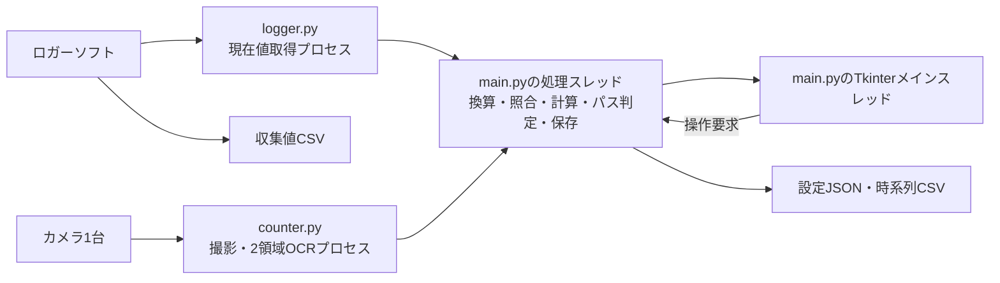

# 圧延データの可視化・保存：採用仕様

本体の仕様をこの文書で管理する。現行コードの動作・実装状況・導入設定は[README](README.md)、係数特定スクリプトは[別要件](COEFFICIENT_FIT.md)を参照する。

## 1. 目的と範囲

OP／DR両側の推定板厚・荷重を圧延中に確認し、パス内の推移を保存する。

対象は最大18m、最大50m/minの圧延。圧延中から取得済みの結果を表示し、次パスの設定前に直前パスの結果を確認できることを目標にする。

- 圧下量計はOP側・DR側に各1台。カメラ1台で両方を撮影する。
- 圧延依頼ごとの記録名、初期板厚mm、板幅mmを開始前に入力する。
- ロガーの収集値CSVはロガーソフトが保存する。本体は計算に使った入力・OCR・推定結果・条件を保存する。
- 実測値の入力・記録・比較、合否判定、TMB自動集計、材料台帳、履歴検索、機械の自動制御、TR100との連携は対象外とする。

## 2. 記録単位

1記録は、同じ初期板厚・板幅で行う一連のパスとする。依頼番号や名前を記録名にし、開始日時を付けて保存する。同じ依頼を複数回に分ける場合も、記録ごとに日時で区別する。

```text
依頼名_20261117_143000/
  settings.json
  readings.csv
```

日時は保存フォルダ名ではPCのローカル時刻、CSVではUTCを使う。保存先はリポジトリ外に設定する。空の記録名・ファイル名に使えない文字・既存保存先との重複はエラーにし、既存記録を上書きしない。記録中は入力条件・係数・基準を変更しない。

初期板厚は開始条件として保存する。板厚式へは直接代入しない。板幅は記録内で固定し、板幅補正係数kbへ使う。

## 3. 構成と担当



Pythonは3プロセス。親アプリはGUIメイン1本、入力読取2本、処理1本の4スレッドとする。処理担当だけが条件・パス番号・計算結果を更新する。GUIは表示と操作要求を担当し、機器アクセス・保存・長い終了待ちを行わない。

`camera_sdk.py` と `camera_calibration.py` を撮影・校正に使う。保存専用スレッド、独立GUIプロセス、DB、Webサーバー、自動再起動は設けない。

## 4. 操作と収集の開始・終了

1. 「計測開始」でロガー・OCRの取得を開始する。ロガー子からロガーソフトの収集開始を要求する。
2. 使用するゼロ基準を確認し、記録名・初期板厚・板幅を入力する。
3. 「記録開始」で設定を保存し、時系列の保存とパス判定を始める。
4. 「記録終了」で残入力を処理し、記録ファイルを閉じる。取得とロガーソフトの収集は続ける。
5. 「計測終了」で記録を閉じ、両取得子へ終了を要求し、ロガーソフトの収集停止と保存結果を確認する。ウィンドウの×も同じ終了経路にする。

ロガーソフトへの収集開始・停止は新アプリから行い、CSV保存処理はロガーソフト側が担当する。機械の圧延開始・停止とは別の操作とする。

圧延中の記録終了は、そのパスを中断として保存する。停止・保存の確認が取れない場合は通常完了にしない。

## 5. 入力・時刻・品質

- 電圧はOP／DR荷重の必要CHを取得し、校正した2点で換算する。係数と同じ荷重単位を使い、自動で別の力の単位へ変換しない。
- カメラ画像は1回だけ取得し、OP／DR各6桁×7点の校正位置で両方を判定する。共通のフレーム取得時刻と、側ごとの値・読取状態を1メッセージにまとめる。
- 表示整数を1000で割ってmmへ換算する。両側ともロールを開く方向をSの正方向とする。6桁の循環値から、設定した有効開き量範囲に入るSを選ぶ。選択できない場合は未算出とし、循環解釈は側ごとに独立させる。
- 新しいロガー入力ごとに、受信済みのOCRのうち、その取得時刻以前で最新の1フレームを選び、両側を1回ずつ計算する。未来のOCRを待たず、後着OCRで過去の表示結果を書き換えない。
- 時刻差・古さには同じPCの単調増加時刻を使う。両入力の古さとCH一巡の時間幅も確認する。PC上の取得時刻を、計器の表示更新や露光まで同期した時刻とは扱わない。
- 片側OCRが読めない場合は、その側を欠測にし、有効な側は表示する。古い有効値で欠測を隠さない。0は有効値、欠測はCSVの空欄と状態列で区別する。

取得・描画の初期値はそれぞれ100msとする。電圧は読取後に100ms待つ方式ではなく、処理時間を含めた読取開始間隔を目標にする。ロガーCSVの周期とは独立に設定する。実周期・OCR実FPS・遅延を測り、必要な細かさと負荷から調整する。

## 6. 板厚計算

各側i（OP／DR）に、同じ関数形を適用する。

```text
h_i = S_i + Sm_i(P_i) - Sm_i(P0_i)
M_i = M0_i × kb_i
M0_i = C1_i + C2_i × Sm_i
kb_i = C3_i + C4_i × (b/1000) + C5_i × (b/1000)^2
Sm_i(P) = [sqrt(C1_i^2 + 2×C2_i×P/kb_i) - C1_i] / C2_i
```

| 項目 | 定義 |
| --- | --- |
| h_i | 該当側の推定板厚mm |
| S_i | 該当側のP0_iでゼロ設定した基準からのロール開き量mm |
| P_i・P0_i | 該当側の圧延荷重・ゼロ基準荷重。P0_iの公称値は各7トンで、実際に設定した基準値を使う |
| b | 記録開始前に入力した板幅mm。P_i・P0_iのSm計算に同じbとkb_iを使う |
| C1_i〜C5_i | 片側荷重を使った実圧延データから特定する係数。側別に設定し、同じ値を使う場合も適用先を記録する |
| M0_i・M_i | 基準幅の剛性と板幅補正後の剛性。荷重の伸びに対する微分 |

C1の単位は力/mm、C2は力/mm²。b/1000は1000mmに対する比で、kb・C3〜C5は無次元とする。基準幅ではkb＝1に正規化する。係数・適用範囲・モデルの妥当性は[係数特定要件](COEFFICIENT_FIT.md)に従う。

実装ではC1＞0の枝について、桁落ちとC2＝0の除算を避ける等価形を使う。

```text
Sm_i(P) = (2×P/kb_i) / [sqrt(C1_i^2 + 2×C2_i×P/kb_i) + C1_i]
```

C2＝0では `Sm_i(P) = P/(kb_i×C1_i)`。係数・基準の未設定、非有限値、kb≦0、平方根の条件不成立、非正剛性、適用範囲外は該当板厚を未算出にする。元入力と理由は保存する。

推定誤差の目標は±0.05mm、上限目安は絶対誤差0.1mm未満とし、係数特定の実験で評価する。本体に実測比較や製品合否の判定は追加しない。

## 7. パス判定・可視化

記録中のOP＋DR荷重から、開始用・終了用の異なる閾値と継続時間で圧延区間を判定する。開始閾値を終了閾値より大きくする。欠測時間を継続時間に加えず、一時的なOCR欠測だけでパスを終了しない。閾値・継続時間・再試行や抜けの判定性能は実波形で確かめる。

判定前後の入力を短く保持し、判定成立時刻と採用する境界時刻を分ける。開始時に先端側の保持データを含め、終了判定後に尾端まで保存する。パス番号は記録内で1から付ける。

通常画面は記録名、パス番号、OP／DR板厚・荷重、入力と保存の状態、現在パスの板厚グラフ、パス番号・開始終了・状態の履歴、記録操作を固定配置する。板厚は小数3桁とmmを示す。表示桁数と実際の推定精度は区別する。

グラフは経過時間を横軸にし、OP／DRを共通の板厚軸で比較する。1点目から順次表示し、欠測を線でつながない。色と線種・凡例を併用する。現在値とグラフは最新状態を描き、古い描画要求を順に再生しない。履歴・終了・エラー通知は上書きせずに受け取る。

明るい灰色の背景と濃い文字を基本にし、状態を色だけで伝えない。未算出は「—」と理由を示し、前回値を現在値欄へ残さない。入力ごとの古さと処理担当の更新時刻をGUIでも監視する。単一クリック・固定位置の標準ボタンを使い、通知で入力フォーカスを奪わない。

## 8. 保存・異常

| ファイル | 内容 |
| --- | --- |
| settings.json | 記録名・開始日時、初期板厚・板幅、側別係数・基準幅・適用範囲、P0・荷重単位、CH換算、両OCR領域と側の対応、Sの有効範囲、時刻・パス判定条件 |
| readings.csv | UTC・単調増加時刻・経過時間・パス番号、使用電圧・OP／DR荷重、両OCR値・状態・フレーム取得時刻、S_OP・S_DR、両側推定板厚、入力時刻差・側別有効性・終了や異常の状態 |

時系列CSVはロガーの新規入力1件につき1行とし、選んだOCRフレームと計算結果を対応付ける。未受信・欠測は空欄と状態を残し、記録終了・重大異常は状態行として残す。計算に使わなかった全OCRフレームや全収集波形の保存は対象にしない。

入力の保存・判定は有限FIFOで順序を保つ。容量・滞留時間を監視し、満杯のまま無期限に待たない。異常通知・終了要求は入力FIFOの混雑に依存させない。

一時欠測は記録を継続し、入力停止・受信失敗・保存失敗・継続的な過負荷では計測終了へ進める。途中記録と正常終了を区別し、通常終了では残入力を受信・処理・保存してから閉じる。パス・記録終了時にフラッシュする。強制終了だけで機器停止や保存完了と判断しない。

## 9. 実装に使う値

導入時の設定項目は[READMEの導入設定](README.md#導入設定)で一元管理する。実験で決めるものは係数・適用範囲、パス判定の閾値・継続時間、取得・表示・時刻許容値の調整と精度評価である。

実験値や導入値が未設定でも元入力は保存できる。必要条件を欠く板厚は未算出、パス判定条件が未設定ならパス番号は空欄・判定未設定として保存し、値を推測して埋めない。
