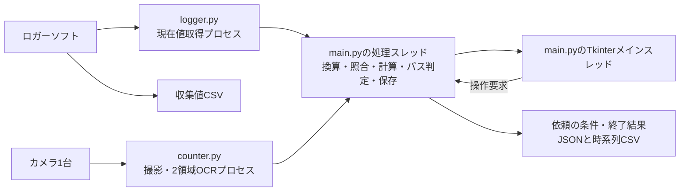
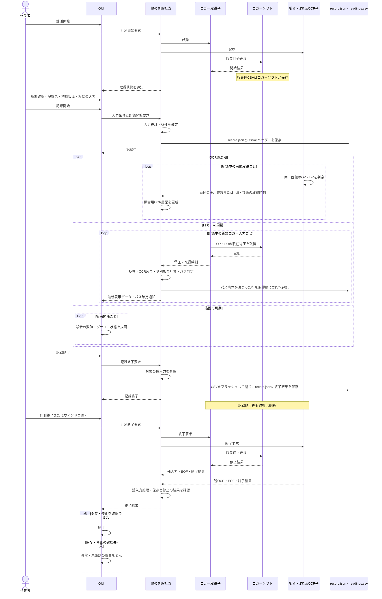

# 圧延データの可視化・保存：採用仕様

本体の仕様をこの文書で管理する。現行コードの動作・実装状況・導入設定は[README](README.md)、係数特定スクリプトは[別要件](COEFFICIENT_FIT.md)を参照する。

## 1. 目的と範囲

OP／DR両側の推定板厚・荷重を圧延中に確認し、パス内の推移を保存する。

対象は最大18m、最大50m/minの圧延。圧延中から取得済みの結果を表示し、次パスの設定前に直前パスの結果を確認できることを目標にする。

- 圧下量計はOP側・DR側に各1台。カメラ1台で両方を撮影する。
- 圧延依頼ごとの記録名、初期板厚mm、板幅mmを開始前に入力する。
- ロガーの収集値CSVはロガーソフトが保存する。本体は計算に使った入力・OCR・推定結果・条件を保存する。
- 実測値の入力・記録・比較、合否判定、TMB自動集計、材料台帳、履歴検索、機械の自動制御、TR100との連携は対象外とする。

## 2. 記録単位

1記録は、同じ初期板厚・板幅で行う一連のパスとする。依頼番号や名前を記録名にし、開始日時を付けて保存する。同じ依頼を複数回に分ける場合も、記録ごとに日時で区別する。

```text
依頼名_20261117_143000/
  record.json
  readings.csv
```

日時は保存フォルダ名ではPCのローカル時刻、CSVではUTCを使う。保存先はリポジトリ外に設定する。空の記録名・ファイル名に使えない文字・既存保存先との重複はエラーにし、既存記録を上書きしない。記録中は入力条件・係数・基準を変更しない。

初期板厚は開始条件として保存する。板厚式へは直接代入しない。板幅は記録内で固定し、板幅補正係数kbへ使う。

## 3. 構成と担当



Pythonは3プロセス。親アプリはGUIメイン1本、入力読取2本、処理1本の4スレッドとする。処理担当だけが条件・パス番号・計算結果を更新する。GUIは表示と操作要求を担当し、機器アクセス・保存・長い終了待ちを行わない。

`camera_sdk.py` と `camera_calibration.py` を撮影・校正に使う。保存専用スレッド、独立GUIプロセス、DB、Webサーバー、自動再起動は設けない。

### 取得子と親の間

同じPC上の専用パイプを各子に1組使う。通信はUTF-8のJSON Lines（1行1オブジェクト）。計測開始時に親が子の標準入力へ機器設定を1行渡し、子は取得1件ごとに標準出力へ1行書いてフラッシュする。単体起動ではスクリプト先頭の設定から同じ形式を出力し、Ctrl+Cで終了する。親はパイプで入力元を区別できる。

| 子 | 親が最初に渡す設定 | 子が返す1件 |
| --- | --- | --- |
| ロガー | `ucf_path`（設定ファイルの絶対パス）、`device_id`、`op_ch`・`dr_ch`（`U1_CH2` のような物理CH名）、`period_us`（読取開始間隔） | OP・DRの生電圧をVで返す。最後のCHを読み終えたときのPCのUTCと単調時刻、最初のCHの読取開始からの所要時間も付ける |
| OCR | `camera_index`、`frame_size_px`（幅・高さ）、`reflection`、`op_points_px`・`dr_points_px`、`sample_radius_px`・`sample_length_radius_px`、`thresholds` | フレームをPCで受け取った時点の単調時刻と、同じ画像から読んだ各側の表示整数（0〜999999）を返す |

校正点は向き補正後の画像の左上を原点とする `[x,y]`。各側で左から6桁、各桁は上・右上・右下・下・左下・左上・中央の順に7点を並べる。未校正の側は点列も返す表示値も `null` とする。`reflection` は `none`・`horizontal`・`vertical`・`both` のいずれか。長手方向の半径が `null` のときは正方形を使う。赤画素率方式の `thresholds` には実際に使う `red_min`、`red_margin`、`white_min`、`off_fraction`、`on_fraction` を入れる。

ロガーとOCRのメッセージ例を、各1行ずつ示す。時刻の `*_us` は整数マイクロ秒、`mono_us` は同じPCの `time.monotonic_ns() // 1000`。UTCは `YYYY-MM-DDTHH:MM:SS.ffffffZ` とする。

```jsonl
{"utc":"2026-11-17T05:30:00.100000Z","mono_us":5100000,"scan_us":2000,"op_v":2.0,"dr_v":2.2}
{"mono_us":5090000,"op_count":0,"dr_count":null}
```

上のキーを各メッセージの必須項目とする。欠測は該当側の電圧または表示整数に `null` を入れる。例のOCRはOPがゼロ、DRが読取不能という1枚の画像である。不正な型・非有限値・範囲外の表示整数・負の所要時間・必須キーの欠落は受信異常として通知する。診断は標準エラーに出す。

計測終了は親が標準入力を閉じて要求する。子は機器の停止・解放を確認して終了コード0を返す。親は標準出力の末尾まで読んで終了コードを確認し、非ゼロ終了・予期しないEOF・強制終了は計測の異常とする。

### GUIと処理担当の間

同一プロセス内はPythonの値を直接渡す。GUIからは計測開始・記録開始・記録終了・計測終了の要求を操作順に渡す。各操作にボタンを押したUTCと単調時刻を付け、記録開始には記録名・初期板厚・板幅と確認した基準も添える。処理担当からは最新の数値・グラフ・状態を渡し、GUIは描画時に最新分を読む。パス確定・終了・異常の通知は発生順に受け取る。

## 4. 操作と収集の開始・終了

1. 「計測開始」でロガー・OCRの取得を開始する。ロガー子からロガーソフトの収集開始を要求する。
2. 使用するゼロ基準を確認し、記録名・初期板厚・板幅を入力する。
3. 「記録開始」で設定を保存し、時系列の保存とパス判定を始める。
4. 「記録終了」でその依頼の未処理分を保存し、記録ファイルを閉じる。次の依頼を同じ計測で記録できるよう、ロガー・OCRの取得とロガーソフトの収集は続ける。
5. 「計測終了」で両取得子へ終了を要求し、残入力を処理して開いている記録を閉じる。ロガーソフトの収集停止と保存結果を確認する。ウィンドウの×も同じ終了経路にする。

ロガーソフトへの収集開始・停止は新アプリから行い、CSV保存処理はロガーソフト側が担当する。機械の圧延開始・停止とは別の操作とする。

記録する行はロガーの取得時刻で決める。同じPCの単調増加時刻で「記録開始」を押した時刻以上、「記録終了」を押した時刻未満の行をその依頼に含める。圧延中の記録終了は、そのパスを中断として保存する。停止・保存の確認が取れない場合は通常完了にしない。

### 計測・記録のシーケンス

GUIと処理担当は同じ親アプリ内の別スレッド、保存先はファイルを表す。入力読取スレッドは図では省略する。OCR取得・ロガー取得・描画はそれぞれ独立した周期で動作し、入力は有限FIFOを経由して処理担当が1件ずつ扱う。



図は正常操作の流れを示す。記録中の計測終了や重大異常では、取得子の終了処理と併せて、保存できた行までで開いている記録を中断として閉じる。片側OCR欠測は該当側の状態として保存・表示し、記録を継続する。

## 5. 入力・時刻・品質

- 電圧はOP／DR荷重の必要CHを取得し、校正した2点で換算する。係数と同じ荷重単位を使い、自動で別の力の単位へ変換しない。
- 表示整数を1000で割ってmmへ換算する。両側ともロールを開く方向をSの正方向とする。6桁の循環値から、設定した有効開き量範囲に入るSを選ぶ。選択できない場合は未算出とし、循環解釈は側ごとに独立させる。
- 各子は取得順に出力する。処理担当がロガー入力を取り出した時点で、すでに入力FIFOから取り出したOCRのうち、ロガーの取得時刻以前で最新の1フレームを両側に使う。後着OCRで確定行を変更しない。
- 照合・記録境界・パス判定には単調時刻を使う。入力の古さはロガー行を処理し始めた時刻から各取得時刻を引く。古さ、ロガーのCH一巡時間、OCRとの時刻差は、それぞれの上限を超えたら該当入力を計算に使えない。端点は許容する。これらはPCで観測した時刻である。
- 片側OCRが読めない場合は、その側を欠測にし、有効な側は表示する。古い有効値で欠測を隠さない。0は有効値、欠測はCSVの空欄と状態列で区別する。

照合の自動テストでは、取得順と到着順が逆になる場合を扱う。例えばロガーの取得時刻が100ms、受信済みのOCRの取得時刻が90msと180msで、どちらも許容時間差内なら、90msのフレームを選ぶ。180msのフレームしかなければ欠測とし、100msのフレームも届いていればそれを選ぶ。

電圧取得と描画の目標間隔は初期値100msとする。電圧は処理時間を含めた読取開始間隔を使い、OCRはカメラから受け取ったフレームごとに判定する。ロガーCSVの周期とは独立に設定する。実周期・OCR実FPS・遅延を測り、必要な細かさと負荷から調整する。

## 6. 板厚計算

各側i（OP／DR）に、同じ関数形を適用する。

```text
h_i = S_i + Sm_i(P_i) - Sm_i(P0_i)
M_i = M0_i × kb_i
M0_i = C1_i + C2_i × Sm_i
kb_i = C3_i + C4_i × (b/1000) + C5_i × (b/1000)^2
Sm_i(P) = [sqrt(C1_i^2 + 2×C2_i×P/kb_i) - C1_i] / C2_i
```

| 項目 | 定義 |
| --- | --- |
| h_i | 該当側の推定板厚mm |
| S_i | 該当側のP0_iでゼロ設定した基準からのロール開き量mm |
| P_i・P0_i | 該当側の圧延荷重・ゼロ基準荷重。P0_iの公称値は各7トンで、実際に設定した基準値を使う |
| b | 記録開始前に入力した板幅mm。P_i・P0_iのSm計算に同じbとkb_iを使う |
| C1_i〜C5_i | 片側荷重を使った実圧延データから特定する係数。側別に設定し、同じ値を使う場合も適用先を記録する |
| M0_i・M_i | 基準幅の剛性と板幅補正後の剛性。荷重の伸びに対する微分 |

C1の単位は力/mm、C2は力/mm²。b/1000は1000mmに対する比で、kb・C3〜C5は無次元とする。基準幅ではkb＝1に正規化する。係数・適用範囲・モデルの妥当性は[係数特定要件](COEFFICIENT_FIT.md)に従う。

実装ではC1＞0の枝について、桁落ちとC2＝0の除算を避ける等価形を使う。

```text
Sm_i(P) = (2×P/kb_i) / [sqrt(C1_i^2 + 2×C2_i×P/kb_i) + C1_i]
```

C2＝0では `Sm_i(P) = P/(kb_i×C1_i)`。係数・基準の未設定、非有限値、kb≦0、平方根の条件不成立、非正剛性、適用範囲外は該当板厚を未算出にする。元入力と理由は保存する。

推定誤差の目標は±0.05mm、上限目安は絶対誤差0.1mm未満とし、係数特定の実験で評価する。本体に実測比較や製品合否の判定は追加しない。

## 7. パス判定・可視化

記録中のOP＋DR荷重から、開始用・終了用の異なる閾値と継続時間で圧延区間を判定する。開始閾値を終了閾値より大きくする。欠測時間を継続時間に加えず、一時的なOCR欠測だけでパスを終了しない。閾値・継続時間・再試行や抜けの判定性能は実波形で確かめる。

判定前後の入力を短く保持し、判定成立時刻と採用する境界時刻を分ける。開始時に先端側の保持データを含め、終了判定後に尾端まで保存する。パス番号は記録内で1から付ける。境界の確定を待つ間も数値は表示し、所属が決まった行から取得順にCSVへ追記する。

通常画面は記録名、パス番号、OP／DR板厚・荷重、入力と保存の状態、現在パスの板厚グラフ、パス番号・開始終了・状態の履歴、記録操作を固定配置する。板厚は小数3桁とmmを示す。表示桁数と実際の推定精度は区別する。

グラフは経過時間を横軸にし、OP／DRを共通の板厚軸で比較する。1点目から順次表示し、欠測を線でつながない。色と線種・凡例を併用する。現在値とグラフは最新状態を描き、古い描画要求を順に再生しない。履歴・終了・エラー通知は上書きせずに受け取る。

明るい灰色の背景と濃い文字を基本にし、状態を色だけで伝えない。未算出は「—」と理由を示し、前回値を現在値欄へ残さない。入力ごとの古さと処理担当の更新時刻をGUIでも監視する。単一クリック・固定位置の標準ボタンを使い、通知で入力フォーカスを奪わない。

## 8. 保存・異常

### record.json

依頼の条件と終了結果を1個のUTF-8 JSONオブジェクトにする。記録名・開始時刻・初期板厚・板幅は必須。開始時に実際の設定を写し、未設定を許す校正・係数・判定条件はキーを残して `null` とする。範囲は両端を含む `[最小, 最大]`。記録中は設定を固定する。

| キー | 内容 |
| --- | --- |
| `measurement_start_utc` | 「計測開始」を押したUTC。同じ計測に属する複数の依頼で共通とし、ロガーソフトの収集記録と照らす手掛かりにする |
| `name`, `start_utc`, `start_mono_us`, `initial_thickness_mm`, `width_mm` | 依頼の記録名、記録開始を押したUTC・単調時刻、入力した初期板厚・板幅 |
| `logger`, `ocr` | 計測開始時に各子へ渡した設定オブジェクト（第3節） |
| `roll`, `zero_reference`, `load_unit` | 使用ロールと確認したゼロ基準を表す文字列、OP・DR共通の荷重単位。P・P0・パス閾値はこの単位に揃える |
| `op`, `dr` | 側ごとの `calibration`（`[電圧V, 荷重]` の低・高2点）、`gap_range_mm`（有効なSの範囲）、`p0`（実際のゼロ基準荷重）、`model` |
| 各側の `model` | `c1`〜`c5`、`reference_width_mm`、`width_range_mm`、`load_range`。係数特定結果から確認して転記する |
| `timing` | `max_age_us`（両入力の古さ）、`max_scan_us`（CH一巡時間）、`max_ocr_lag_us`（ロガーとOCRの時刻差）の各上限 |
| `pass` | `start_load`・`end_load`（両側合計荷重の閾値）、`start_hold_us`・`end_hold_us`（各継続時間）。判定未設定なら `pass` は `null` |
| `end` | 開始時は `null`。終了時は `utc`（終了操作または異常のUTC）、`elapsed_us`（その時点までの経過）、`status`、`reason`、`interrupted_pass` |

### readings.csv

ロガー入力1件につき1行、OP・DRを横並びにする。表計算でそのまま比較できるよう、先頭に固定ヘッダーを1回書き、以降は測定行だけを追記する。UTF-8（BOMなし）、カンマ区切り、小数点は `.`、欠測は空欄、数値のゼロは `0`。有限の数値を保存し、画面表示用の桁丸めはしない。

```csv
utc,elapsed_us,logger_age_us,scan_us,ocr_lag_us,pass_no,op_v,op_load,op_count,op_gap_mm,op_thickness_mm,op_status,dr_v,dr_load,dr_count,dr_gap_mm,dr_thickness_mm,dr_status
2026-11-17T05:30:00.100000Z,100000,3000,2000,10000,,2.0,7,0,0,0,ok,2.2,8,,,,unreadable
```

- `utc` はロガーの取得UTC。`elapsed_us` はロガー取得時刻から記録開始時刻を引いた値。`logger_age_us` は処理開始時のロガー入力の古さ。`scan_us` はロガーから受け取った一巡時間。
- `ocr_lag_us` はロガー取得時刻から選んだフレームの取得時刻を引いた値。フレームがあれば許容時間超過でも差と表示整数を残す。候補がなければ差と両側の整数は空欄。フレームの単調時刻は `start_mono_us + elapsed_us - ocr_lag_us`、処理開始時の古さは `logger_age_us + ocr_lag_us` で分かる。
- `pass_no` はパス内の行だけ正の整数。パスの先端・尾端はその番号の最初・最後の行で確認できる。番号が空欄のとき、判定未設定かパス外かは `record.json` の `pass` で区別する。
- 各側の `v` は生電圧、`load` は換算荷重、`count` はOCRの表示整数、`gap_mm` は循環を解釈したS、`thickness_mm` は推定板厚。荷重とSは独立に求め、有効な途中値は残す。例ではOPの荷重がP0と等しく、Sと板厚はともに0。DRは表示が読めず、荷重まで保存できた。
- 側別の `status` は板厚が求まれば `ok`。未算出なら、荷重・S・板厚の順で最初に不足した理由を1個残す。荷重では `logger_timing`（古さ・一巡時間超過）、`no_voltage`、`voltage_range`。Sでは `no_frame`、`old_frame`（古さ・時刻差超過）、`unreadable`、`gap_range`。板厚では `model_range`（適用範囲外）、`model_invalid`（式が成立しない）。その段階の設定不足は `not_set` とする。パス判定には両側の有効な荷重を使う。

### 終了と異常

記録開始はJSONとCSVヘッダーの保存後にGUIへ通知する。保存先の準備中に届いた対象入力もFIFOに保持する。記録終了時は、終了境界以降の最初のロガー入力または要求した停止後のロガーのEOFで、境界より前の入力を読み終えたことを確認する。対象行を順に書き、CSVをフラッシュして閉じた後に `record.json` の `end` を確定する。同じフォルダで一時ファイルを書き終えてからJSONを置き換える。

`end.status` は、その依頼の対象行を保存して記録終了できたら `complete`、記録中の計測終了・重大異常では `interrupted`。中断時は `reason` に原因を短く記す。途中で区切ったパスの番号は `interrupted_pass` に残し、該当しない理由・番号は `null`。保存失敗時も書き込める場合は中断を記録する。`end` が `null` のまま、または終了結果が読めない記録は終了未確認とする。ロガーソフトの収集値CSVは計測全体の記録であり、その停止・保存結果は計測終了時に確認する。

パス間に「記録終了」を押して正常に閉じた場合の `end` の例。

```json
{"utc":"2026-11-17T05:31:00.000000Z","elapsed_us":60000000,"status":"complete","reason":null,"interrupted_pass":null}
```

パス終了時にもCSVをフラッシュする。一時欠測は測定行に残して継続する。無更新・受信失敗・保存失敗のほか、有限FIFOの容量・滞留時間の上限に達して全行を順に扱えなくなった場合も、記録を中断して計測を終了する。原因をGUIに示し、異常通知と終了要求は入力の混雑中にも届ける。

## 9. 実装に使う値

導入時の設定項目は[READMEの導入設定](README.md#導入設定)で一元管理する。実験で決めるものは係数・適用範囲、パス判定の閾値・継続時間、取得・表示・時刻許容値の調整と精度評価である。

実験値や導入値が未設定でも元入力は保存できる。必要条件を欠く板厚は未算出、パス判定条件が未設定ならパス番号は空欄・判定未設定として保存し、値を推測して埋めない。
