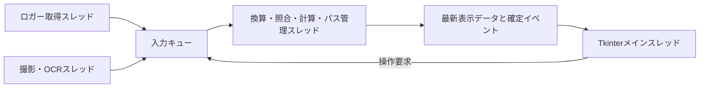
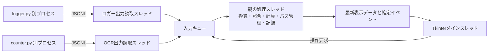
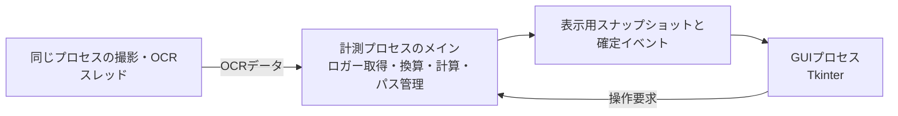
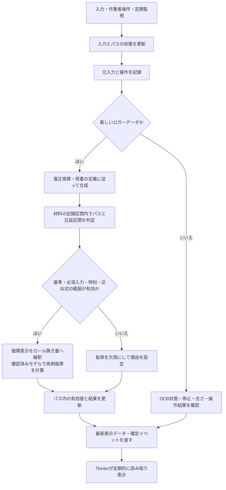
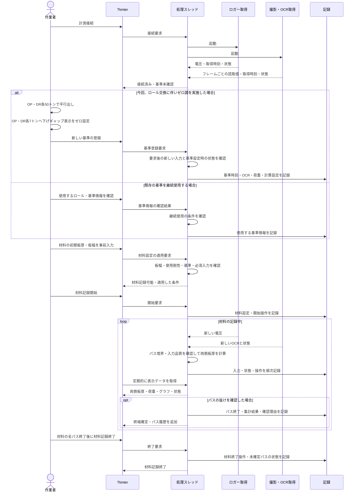
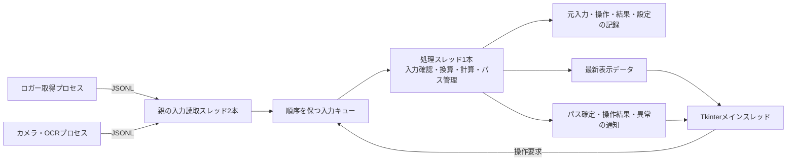

> 旧資料。現行の採用仕様は[本体仕様](../SYSTEM_PLAN.md)と[係数特定要件](../COEFFICIENT_FIT.md)、導入設定・現行手順は[README](../README.md)を参照する。この資料から現在の要件・未確認事項を拾い直さない。

# パスごとの推定板厚表示：構成案と運用の検討

この文書は過去の比較・検討の記録として残す。現在の採用仕様は[SYSTEM_PLAN.md](../SYSTEM_PLAN.md)、係数特定スクリプトは[別要件](../COEFFICIENT_FIT.md)を参照する。以下の実測登録・比較、材料ID管理、旧剛性多項式、4種類の保存ファイル、片入力だけの異常時継続は現行の採用仕様ではない。

その後、圧下量計はOP／DR各1台あり、カメラ1台で両方を読むことが確認された。以下のギャップ1表示という仮定は更新済み。採用案では撮影・OCRの子プロセス1つで同じフレームの2領域を読み、3プロセス構成を維持する。

2026-11-11に作成した設計メモへ、2026-11-17共有の[ヒアリング結果と要件整理](HEARING_ANALYSIS.md)と追加の前提を反映した。B案を基本方針とする。GUI・板厚計算・パス管理・データ管理は未実装で、以下の周期・集計方法は試作案である。現在のOCRは1フレーム判定が既定。対象は暫定的にTR300と呼び、TR100と統合・連携せず独立したシステムを構築する。

今回回答された内容と設計への影響は[ヒアリング整理](HEARING_ANALYSIS.md)、残った質問と必要資料は[現場確認票](../README.md#導入設定)にまとめる。

当時の構成再検討ではB案を選び、親の処理を1担当に集めた。今回、採用案を[SYSTEM_PLAN.md](../SYSTEM_PLAN.md)へまとめ直した。下記14章を含む過去案との差がある場合は採用案を優先する。

ロガーの収集値CSVはロガーソフトが保存する。新システムの取得間隔は表示・推定・独自パス判定に合わせて決め、既存の100ms／20msや現行コードの0.2秒待機を維持条件にしない。新システムは100msの読取開始間隔を試作候補にし、OCR・表示用入力・条件・推定結果・パスを保存する。全収集点の重複保存は初期要件にしない。

## 1. 目的と前提

工場の作業者が、圧延中の推定板厚とパスごとの結果をTkinterの画面で確認し、操作に活用する。

- 材料を圧延機に1度通過させることを1パスとする。
- 開始前に初期板厚・板幅を入力し、材料単位で記録を開始する。パスは対象設備の信号と実波形から独自に自動判定し、毎パスの手動開始・終了を前提にしない。TR100の判定方式の確認・移植は行わない。
- ゼロ調はロール交換時に1回実施し、OP／DR各50トンで平行出し後、各7トンでギャップ表示を0にする。実圧延で左右差と曲がりも確認する。電源断などを含む基準の保持条件は未確認。
- TR300のミル剛性は板幅で変わり、開始前の板幅入力から剛性を求めたい。過去式 `y = 0.0002x^2 - 0.0785x + 140.84` を暫定候補とするが、この式自体のx・y、単位、適用範囲、対象ミル・荷重定義は元資料で確認する。再測定後の置換も検討する。
- OP・DRはそれぞれ片側荷重。両側を同じ力の単位に揃え、合計荷重を `F_OP + F_DR` として扱う。近似式の剛性が全体荷重に対応する定義かは確認する。
- ロガーソフトが収集値をCSV保存する。過去の100ms／20ms設定は実機・CSV確認時の情報で、新システムの取得間隔を固定する要件ではない。表示・推定・判定から必要な間隔を選び、実周期と所要時間を測る。
- 取得した点からリアルタイムに表示し、次パスまでに結果を確認したい。具体的な許容遅延は実作業・実測で決める。
- 現行コードは検証資産として扱い、構成をそのまま維持することを条件にしない。
- 大きな圧下量で早く目標板厚へ近づけ、噛み込みが悪ければ圧下量を減らす。噛み込み後の1パス途中では変更が間に合わず、調整は噛み込み時または次パス準備時に行う。開始前の入力・準備時間は確保できる。
- 停止時はロールが惰性で回転するため、入側・出側のカメラモニターで材料位置を確認している。停止操作・速度ゼロ・材料通過完了を同じ意味として扱わない。
- 実測は最終前・最終パスの計2回、基本はOP側の長手中央付近の測りやすい1〜2点をノギスで測る。従来の3点平均の前提は撤回する。測定時の温度条件と推定位置との対応は未確認。
- 推定精度の目安は±0.05mm、最悪でも絶対誤差0.1mm未満。製品公差・自動合否判定とは分け、最終的には実測する。
- ギャップ計は負号を表示せず、0より下は999側へ回り込み減算する。上限200でリミットがある。実表示の桁・小数点・循環幅・上限の単位と開閉方向は確認する。
- 圧下量の決定には前回の依頼時の結果も参照する。照合条件や記録形式は未確認。
- 最大18mの長材で曲がり・蛇行を把握するため、OP／DR両側の板厚と荷重が必須。3〜4mを超える材料ではトップ厚・ミドル薄・ボトム厚の傾向があり、推移をグラフで見たい。速度は上限50m/minで、表示の優先度は低く研究用記録を希望している。

**B案で取得・処理・表示を分ける。両側板厚の算出情報、各7トンのゼロ基準とモデルの対応、ギャップ循環の解釈を先に確認する。事前入力後の自動パス検知と順次表示を中心に検討し、OCR・ロガーの実周期と先端・尾端の取得を検証する。データの項目・管理・通信の案は11章にまとめる。**

### 初期の到達点と段階

| 段階 | 到達点 |
| --- | --- |
| 先行確認・検証 | 両側板厚を計算する入力・モデル、ゼロ基準、循環表示、自動パス検知条件を確認。OCRとロガーの実周期・先端尾端の取得を検証する |
| TR300の必須到達点 | 初期板厚・板幅の事前入力、OP／DR両側の推定板厚・荷重を表示する。欠測・古さを示し、使用入力・基準・式を記録し、次パス前に結果を確認できる |
| 優先する表示方針 | 現場の希望に合わせ、パス内のグラフ・数値を1点目からリアルタイムに順次表示し、終了後に終端・集計を確定する |
| 優先度が低い表示 | 速度の通常画面表示。研究用の記録は信号定義を確認して残す |
| 保留 | 入側・出側比較、過去記録からの自動圧下量提案。材料上の実長位置への換算は速度・方向・対応の確認後に判断する |

OP／DR荷重は計算入力・記録だけでなく、通常画面の必須表示とする。初期の厚さ・荷重グラフの横軸は経過時間とし、材料の位置を直接表す値とは扱わない。TMBの区分と「0基準」の意味は確認する。

暫定式での表示・応答性と、実測に対する精度を分けて評価する。片側または中央相当だけの板厚表示は先行試作に使えても、両側板厚の必須要件を満たしたとはしない。入出側比較は今回の完了条件に含めない。

## 2. 既存コードで分かっていること

| 対象 | 現在の役割・動作 | 設計への影響 |
| --- | --- | --- |
| `logger.py` | `read_logger()` がCHごとの現在電圧を順に返し、`main()` がJSONLに出す。取得後0.2秒待機 | 現行コードの待機値・5CH構成は維持条件にしない。新システムは必要CH・100msの読取開始間隔を試作候補に、所要時間と実周期を測る |
| `counter.py` | `read_counter()` が固定42箇所の7セグ判定結果を順に返し、`main()` がJSONLへ出す。`STABLE_FRAMES = 1` が既定 | 画像取得・OCR・出力の所要時間と、単独フレームでの誤読・欠測を測る |
| `camera_sdk.py` | 東芝テリーの最新バッファ画像を取得。同一画像IDを重複して渡さない | 同じ画像を繰り返し読んで安定判定することを防いでいる。最新画像を使う方針も活用できる |
| `camera_calibration.py` | 点の校正と設定値の出力 | 通常操作から分けた校正ツールとして残せる |
| `main.py` | 取得子プロセス2つと出力読取スレッド2つを起動。電圧換算・OCRとの照合・CSV出力 | パス判定・推定板厚計算・GUIは未実装。CSV出力処理を、そのままGUIのイベント処理に移さない |

設計前に押さえる点は次のとおり。

1. **最新OCRとの照合であり、厳密な同時計測ではない。** ロガーの各CHを読み終えた時刻と、カメラ画像を読み込んだ時刻を比較している。CH間の読取時間差、計器の表示更新、撮影・転送の遅れは、この差だけでは分からない。
2. **入力が更新されたときの処理と、無更新時の監視を分ける必要がある。** 現状はロガーの新しい行が来たときだけCSVに結果が出る。GUIでは入力が止まっても定期的に古さを判定し、表示状態を変える。
3. **待ち行列が満杯になると、取得側まで待たされ得る。** 現在は共有の64件FIFOに入りきるまで読取スレッドが待つ。取得子の `acquired_mono_ns` から古さを検出し、古い入力はCSVに使わない。停止時は残りの標準出力を読み捨てる。全入力の保存保証はない。
4. **必要な信号の欠測と、参考信号の欠測を区別する。** 現状の `voltage_status` は設定された全CHをまとめた状態。板厚計算に使わない信号の欠測で、荷重と圧下量が有効な板厚まで欠測にしない設計にする。
5. **停止時間は暫定値。** `logger.py` は `Stop()` 後に10秒待ち、`GetState() == 1` を確認する。親の停止待ちは共通期限15秒に変更した。無更新による打切りも15秒として、通常の10秒待機を異常と誤判定しないようにする。10秒待機の必要性と各期限は実機で確認する。
6. **循環表示をロール開き量へ解釈する処理がない。** 現在のOCRは `0.000`〜`999.999` を読むが、0を下回って999側へ回り込んだ値も正数のまま返す。表示の方向・循環幅・基準が確認できるまで、数値をそのまま板厚計算へ入れない。

現在のコードはCH1・2・3・6・7の5CHと換算点が設定されており、READMEもこの状態に合わせて更新した。設定済みであることを実機の校正済みとは扱わない。READMEからリンクされている `../rolling-gauge-meter/README.md` はこの作業ツリーに存在しない。装置仕様は、そのリンク先を確認済みと扱わない。

## 3. 構成の3案

以下はA／B／Cの比較を残す。当時は機器別取得・計測本体・GUIを分ける4プロセス案Dも比較した。現行の採用構成は[SYSTEM_PLAN.mdの構成](../SYSTEM_PLAN.md)を参照する。

プロセス数はPythonアプリだけを数える。WAVE LOGGER PROなどの外部アプリは含めない。どの案でも、Tkinterのウィジェット操作はGUIのメインスレッドに集め、計測値・パス状態の更新は1箇所に集める。

### 案A：1プロセスにまとめ、取得をスレッドに分ける



- アプリの流れを1つのスクリプトで読みやすく、JSONのプロセス間通信も不要。
- COMオブジェクトはロガー担当スレッド内で初期化・生成・使用・解放する。既存のCOMオブジェクトを別スレッドに渡さない。
- 取得関数が止まったとき、Pythonのスレッドを外から安全に強制終了する手段がない。SDKやCOM拡張の動作によっては、他の処理への影響も実測が必要。
- 機器呼出しの停止方法・タイムアウトが確認できており、コードを1箇所で追うことを特に優先する場合に向く。

Tkinterのイベント処理は短く保つ必要があり、長い処理は別スレッドなどに移すことが公式文書でも説明されている。[PythonのTkinter文書](https://docs.python.org/3.13/library/tkinter.html#threading-model)

COMを使うスレッドごとの初期化と、STAでのスレッド所有・メッセージ処理の条件も考慮する。[MicrosoftのCOM初期化文書](https://learn.microsoft.com/en-us/windows/win32/learnwin32/initializing-the-com-library)

### 案B：取得を個別プロセスに分け、親アプリで処理する（第一候補）



- COMとカメラSDKを別々に終了・監視できる。取得の片側が止まっても、親の画面で原因と欠測を示せる。
- 機器を単体で確認でき、既存の取得・OCR・校正とテストを活用しやすい。
- 親は計器固有の呼出しから離れ、「入力→換算→状態確認→計算→パス集計」の順序で書ける。
- JSONL、出力読取、起動・停止管理が必要。全体の処理箇所は案Aより増える。
- 子プロセスの強制終了は、機器の停止を保証しない。通常停止を優先し、停止確認が取れなければ画面に残す。

ロガーの基本動作はユーザーが実機で確認済み。B案ではこれを活用し、実周期・処理時間と、カメラ取得の負荷を個別に確認する。プロセス分離によって応答時間が短くなると保証するものではない。

### 案C：計測・計算を1プロセスにまとめ、GUIだけ別プロセスにする



- 計測とパス判断が同じ場所にあり、GUIは結果表示と操作に集中できる。
- 例えば1つの `app.py` にGUIと計測用の起動関数を置き、標準の `multiprocessing` のキューで渡す構成にできる。Windowsでは `spawn` とメイン処理の起動保護を考慮する。
- 計測側のCOM呼出しが止まると、そのプロセスの計算・パス処理も止まる。GUI側で最終更新時刻を監視する。
- ロガーとOCRの障害は同じ計測プロセスの障害になる。機器別の強制終了には向かない。
- 機器動作が十分確認でき、計測側を1つの流れとして保守したい段階で再検討する価値がある。

| 比較点 | 案A | 案B | 案C |
| --- | --- | --- | --- |
| Pythonプロセス数 | 1 | 3 | 2 |
| 処理を追う場所 | 1つにまとめやすい | 親と取得2つ | GUIと計測 |
| 機器ごとの終了・切り分け | 難しい | しやすい | 難しい |
| GUIと計測状態の分離 | スレッド間 | 親のスレッド間 | プロセス間 |
| 既存の単体検証の活用 | 取得処理の組替えが必要 | 活用しやすい | 取得処理の組替えが必要 |
| 選びどころ | 機器呼出しが安定し、構造の小ささを優先 | 現在の実機検証から作業者向け試作へ進む | 機器が安定し、計測処理を集約したい |

## 4. パスを区切る運用

### 優先して検討する案：「材料単位の開始＋自動パス検知」

開始前に材料の初期板厚・板幅を入力する時間を確保できるため、材料単位の開始と独自の自動パス判定を設計する。毎パス2回の手動操作を中心とした前案を改める。以下は対象設備向けの案であり、判定の信号・条件は実波形で決める。別設備のシステム統合・判定方式の移植は行わない。

1. 作業者が開始前に材料情報を入力し、板幅に対応する剛性と使用基準を確認する。
2. 材料単位で記録を開始し、待機中も元入力を残す。
3. 確認した信号・条件で噛み込みとパス開始を検知し、取得済みの1点目から両側板厚・荷重を表示する。
4. 通過中は順次計算・記録・表示する。1パス途中での圧下量変更は操作要件にしない。
5. 抜けを確認してパス終了を確定し、終端・TMB区分を集計して履歴へ加える。判定待ちの間も記録を続ける。
6. 次パスまでに結果を確認し、同じ材料設定で次のパスを待つ。材料終了の操作・担当は確認する。

自動パス開始は判定後になっても、先端を失わないよう取得時刻に基づく境界と判定前の入力を扱う。必要な保持時間は実波形と判定遅れから決める。噛み込み失敗・再試行・途中停止・反転の数え方、候補を訂正する方法も確認する。OCR欠測や短い荷重低下だけでパスを終了しない。

荷重の判定は、入り側の閾値を `P_on`、抜け側を `P_off` とし、`P_on > P_off` にする。さらに、条件が短時間続くことを確認して、ノイズで切り替わることを防ぐ。閾値・確認時間は、無負荷、キスロール、噛み込み、通過中、抜け、途中停止の実測波形から決める。入力欠測の時間を、条件が継続した時間として数えない。

キスロール時にも荷重が出るため、荷重だけで材料通過と判断しない。基準情報と作業区間を確認してから判定する。ゼロ調はロール交換時の作業として扱う。

### ほかの運用との比較

| 運用 | 良い点 | 注意点・採用条件 |
| --- | --- | --- |
| 手動開始・終了だけ | 検証時に人が通過境界を示せる | 通常運用の必須操作にしない。材料待ち・通過後を集計から区別する |
| 手動開始・終了＋荷重で集計区間を選ぶ | 自動判定との比較に使える | 検証用の比較案。毎パスの操作負担と押し忘れを確認する |
| 材料単位で記録し、パス候補を付ける | 今回の回答に合い、パスごとの操作を減らせる | 対象設備の信号・実波形から独自に設計する。境界・噛み込み失敗・候補訂正の方法を確認する |
| 作業者が次パスを準備し、荷重で自動開始・終了 | 通過ごとの操作負担を減らせる | 途中停止と材料の抜けの区別を、実際の運用で検証してから採用 |
| 材料検出信号・既存PLCの通過信号を使う | 通過の意味に近い情報が得られる | 信号が実際に取得可能で、その意味と遅延を確認できる場合に比較する |

速度は「動いているか」の補助にはなるが、停止指令後の惰性回転や、同じ材料が噛み込んだまま停止する場合がある。材料位置は入側・出側のモニターで確認する現行運用を聞き取る。現在の速度設定は正の値だけを扱い、方向信号も未確認なので、逆転をパス区切りの前提にしない。材料位置確認用の既存カメラと、計器OCR用カメラの役割も分けて確認する。

## 5. 案Bでの処理フロー



最初はロガーの新しいデータ1件につき、板厚の計算・集計を1回行う。OCRが同じロガー値に対して何度更新されても、パス集計に同じ荷重データを重複追加しない。

処理スレッドだけが、現在の入力、基準、パス番号、集計を変更する。GUIは操作要求を送って処理結果を表示し、独自にパス番号やゼロ基準を書き換えない。

### データの渡し方

| 用途 | 渡し方 | 遅れ・満杯・欠測への対応 |
| --- | --- | --- |
| 入力・パス判定・記録 | 順序を保つ有限サイズの入力キュー | データを黙って捨てない。取得元時刻からの遅れや満杯を検知し、推定表示を欠測・パスを要確認にする。許容待ちでも満杯なら記録を不完全として取得終了へ進める案。詳細は再検討の6章に従う |
| 大きな数値表示・短いグラフ系列 | 最新の表示データに上書き | 古い画面更新を省略して、現在の値に追いつく。元データは処理側に保持・記録する |
| パス確定・エラー・基準確認結果 | 順序を保つイベント通知 | 最新1件への上書き対象にしない。パス履歴や停止理由を失わない |
| 作業者操作 | 処理側への要求 | 開始済みの再開始などは受理せず、現在の状態を表示する |

「最新値だけ残す」を入力全体に適用すると、短い荷重変化や欠測を失う。画面更新の省略と、判定用データの省略を区別する。ただし、現在値の定期読取そのものは、読取間に起きた短い現象を取得できない。この限界はキューを残しても解決しない。

グラフは保存した履歴から作る。欠測区間には線を引かず、古い板厚を現在値として描き続けない。GUI自身でも最終入力・最終処理時刻を監視し、処理スレッドが止まった場合に更新停止を示す。

## 6. 操作と計測のシーケンス



上図は材料単位の開始と自動パス検知を採用した場合の案。判定信号・材料終了操作・基準登録の具体的方法は残った確認事項であり、未実装。ロール交換時の各50トンでの平行出しと各7トンでのゼロ設定は聞き取り済みで、実圧延でも左右差・曲がりを確認する。通常は既存基準を継続し、アプリ起動のたびにゼロ調を要求しない。

GUIでの基準登録は、現行手順で設定された基準を確認・記録する操作とする。新しくゼロリセットを行った場合には、要求より前の待ち行列に残っていたゼロを確認に使わない。既存基準を継続使用する場合、現在のOCRが0.000であることを要求しない。ロール交換や計器の電源断などを含む基準の有効条件を確認し、どの基準を使用するかを記録する。

ハードウェア側でゼロリセット済みなら、GUIで毎パス別のオフセットを引いて再びゼロにしない。基準時の荷重による補正が必要かどうかは、計算モデルの基準定義として決める。パス間で基準を維持し、再ゼロリセット・装置再設定・基準の連続性が確認できない再接続では、基準情報を確認し直す。基準情報の確認と、現場での基準設定作業のやり直しは区別する。

材料記録の状態は「未記録→記録中→未記録」とし、その内側に「パス待ち／圧延中／抜け判定中」を持つ案とする。入力品質は別に「有効／未確定／欠測／古い／設定範囲外」を持つ。OCR欠測だけでパスを終了しない。自動判定の不確かさも履歴へ残す。

アプリの計測終了時は、記録中のパスを通常完了と区別して閉じる。ロガーソフトのCSV保存と、新システムの接続・取得終了に伴う収集開始・停止の対応は実装前に確認する。現在のスクリプトは終了時にロガーへ `Stop()` を送る。GUI上で長い `wait()` や `join()` を行わず、終了状況を定期確認する。停止未確認を通常終了として表示しない。ここで扱うアプリ・ロガーの終了と、圧延機の停止操作は別である。

当時は通常終了で残入力を処理する方針に加え、入力元1つの故障時に残入力を記録する案も検討した。最小構成では後者を採らず、重大異常時は通常完了と区別して計測終了へ進める。[現在の取得・表示・終了の扱い](../SYSTEM_PLAN.md)

## 7. 板厚計算で先に定義すること

計算式の詳細より先に、次の入力の意味を確定する。これらは正しい板厚を表示できるかに直接関わる。

| 項目 | 決める内容 |
| --- | --- |
| 相対圧下量 | 負号なしで0未満は999側へ循環し、上限200でリミットがあるとの回答。開閉方向、桁・小数点・循環幅・上限の単位を実表示で確認する |
| ロール開き量 | キスロール基準から開く向きを正にした内部のmm値。OCR表示とは名前を分ける |
| 圧延荷重 | OP・DRは片側荷重で確認済み。合計は同じ単位に揃えた `F_OP + F_DR`。近似式が全体荷重に対応するかと、ゼロ・符号の校正条件を確認する |
| 荷重単位 | 現在の `ton` が何を表すかを確認し、剛性式と同じ力の単位に揃える。単位のラベル変更だけで済ませない |
| 基準荷重 | ゼロ設定は各7トンで合計14トン。各50トンの平行出しと区別し、剛性測定時の基準・弾性変形との対応を確認する。トンの力の単位も確認する |
| 多項式 | 暫定候補は `y = 0.0002x^2 - 0.0785x + 140.84`。板幅依存は聞き取り済みだが、この式の軸名・単位、測定範囲、対象ミル、全体／片側剛性は原資料で確認する |
| 材料入力 | 初期板厚・板幅を開始前に手入力する。板幅の定義と幅広がりを含めた適用条件、初期板厚を計算で使う必要性を確認する |
| 適用条件 | 対象ミル・ロール条件など、測定済みの近似式を適用できる条件 |

無負荷ロールギャップを `s`、荷重を `F`、ミル剛性を `M` とした基本形は `h = s + F / M`。ミルの弾性変形を荷重と剛性から扱う考え方は、[JFEの板厚制御の説明](https://www.jfe-21st-cf.or.jp/chapter_3/3b_3.html)を参照。

ただし、**今回のキスロール基準からの相対値を、そのままこの `s` に代入できるとはまだ確定していない。** 基準時に荷重がかかっていれば、その状態の弾性変形とゼロの定義を反映する。基準補正は現場の校正方法に合わせ、根拠なく `F0` を引くだけの処理を加えない。

今回の聞き取りで、TR300の剛性は板幅に応じて変わることが確認できた。既存の参考資料には[板幅等を考慮したゲージメータモデルの研究](https://www.sciencedirect.com/science/article/pii/S1005885007600760)もあるが、一般論や今回の回答だけで、過去の多項式の軸・単位・妥当性まで確認済みとはしない。

元資料でx＝板幅 `b`、y＝全体荷重に対するミル剛性 `M` と確認できた場合は、`M(b) = 0.0002b^2 - 0.0785b + 140.84` として扱う。材料条件の板幅から剛性を求め、その剛性と合計荷重・ロール開き量を板厚計算へ渡す。この場合、求めたい板厚を近似式に再入力する反復計算は必要ない。

式へ入れる板幅の単位と定義（入側・出側、実測値・呼び寸法など）、測定した板幅の範囲を確認する。適用する板幅を材料条件として指定・記録する案とし、板幅の自動計測を初期要件に追加しない。板厚依存の式と仮定した解法は、元資料を確認するまで設計へ組み込まない。

計算は入力と設定から板厚・状態を返す1つの関数にまとめ、COM、カメラ、Tkinter、ファイル書込みを含めない。範囲外・剛性が非正・計算不能は欠測にし、0mmに置き換えたり、境界値に丸めて有効値扱いしたりしない。

暫定式の係数は1箇所で設定し、使用した式と適用条件を計測記録に残す。再測定後はその設定を置き換え、過去の記録がどの式による結果だったかを失わないようにする。初期から複数モデルを切り替える仕組みは作らない。

OP／DR両側板厚は必須だが、現在確認できている入力は圧下量1表示と荷重2点であり、左右のギャップや剛性の扱いは未確認。ギャップ表示の対象側、左右の位置情報、左右の荷重・変形を扱うモデルを確認する。片側荷重だけを全体用の式へ代入した値を、左右板厚として表示しない。情報が不足する側は未算出とし、必須要件の完了を保留する。

循環前のOCR表示値を残し、符号を解釈した開き量を別項目にする。表示の大きな飛びだけで循環と決めず、起動時999側・境界での欠測・再ゼロ設定・再接続を含む扱いを確認する。解釈できなければ開き量と板厚を欠測にする。

実測は終盤2回のOP側1〜2点なので、局所の推定値と対応付ける。目標誤差±0.05mm、上限目安は絶対誤差0.1mm未満として、偏り・最大誤差・件数・欠測を記録する。OP側の実測だけでDR側・全長の精度を検証済みとしない。DR側の検証方法とノギスの分解能・温度条件も確認する。

## 8. 応答性の測り方と試作時の調整

画面更新周期と、実際の変化が画面に出るまでの遅延は別に測る。

| 項目 | 現状または試作案 | 確認すること |
| --- | --- | --- |
| ロガーソフトの収集・CSV保存 | 保存担当はロガーソフト。過去の100ms／20msは新システムの固定条件にしない | 対象CH・時刻・単位と、接続・取得終了に対する保存開始・終了の関係を確認 |
| 新システムの電圧取得 | 読取開始間隔100msを試作候補にする | 状態取得・必要CH読取・出力の時間、実開始間隔、CH間時間差、滞留を実測。必要な細かさから調整 |
| OCR | `STABLE_FRAMES = 1` が既定で、取得した各フレームを単独判定 | 実FPS、画像待ち・変換・OCR・出力の時間、値が動く間の欠測率と誤読率 |
| 数値表示 | 試作は `after(50)`〜`after(100)` 程度を候補にする | 処理負荷と体感。指定間隔どおり実行される保証とは扱わない |
| グラフ | 試作は100〜200ms程度でまとめて更新する案 | 数値の応答を妨げないか。毎回全履歴を描き直さない |
| 時刻差・古さの許容値 | 現状150ms・入力停止1秒は検証値として扱う | 片側遅延、読取不能、取得停止を区別し、実測と操作に必要な時間から再設定 |

今回の要求は、取得した1点目から順次見え、次パス前に終端を含む結果を確認できること。50m/minを一定の材料速度と仮定すると0.2秒で約167mm進むため、描画間隔だけでなく入力の実読取周期・パス判定の遅れ・先端尾端の有効点数を評価する。現在の速度信号が材料速度かは未確認。

圧延中は経過時間で推移を表示し、パス終了後に保存した入力から境界・TMB集計を確定する案とする。TMBの区分、反転時の端の対応は確認する。後処理で表示を待たせず、入力されなかった区間を補間で取得済みにしない。

### 1フレームごとの判定

各取得フレームで `recognize_display()` を実行し、JSONLを1行出す。従来の3フレーム同値は、その読取値を出力の数値として採用する条件であり、OCRを行う頻度の条件ではなかった。

現在のコードは `STABLE_FRAMES = 1` が既定で、各フレームで7セグの数字を判定する。白飛び・曖昧な点灯・不正な桁パターンを欠測にする判定は維持する。1フレーム内で数字の切替え途中が別の正しい数字に見える可能性もあるため、読取成功率だけでなく既知の表示との一致も確認する。

連続一致待ちをなくすと、取得・OCRの主要処理量は大きく変えずに確定待ちを減らせる。例えば30fpsでの3フレーム一致には最初の観測から約67ms必要だが、単独フレーム判定でも計器の表示更新・撮影・転送・次のロガー取得・描画の遅れは残る。FPSは実測する。

東芝テリー側は最新バッファを読む方式なので、「取得した各フレームを処理する」と「カメラが生成した全フレームを処理する」は異なる。処理が追いつかなければ途中の画像を飛ばし得る。受領件数・実処理FPSと、取得できる場合は画像IDの欠番も確認する。

### ロガーのCSV保存と新システムの取得間隔

ロガーソフトが収集値をCSV保存するため、新システムの取得間隔は表示・推定・独自パス判定を基準に決める。ソフト側CSVの保存間隔と揃える必要はない。100msの読取開始間隔と100msの描画を初期候補とし、先端尾端・左右差・次パスまでの確認に足りるかを評価する。各間隔と実測値は分けて記録する。

現在のループは概ね「状態取得＋全CH読取＋JSON化・出力＋設定した待ち時間」の順で、設定した待ち時間が実周期にはならない。新システムでは処理時間を含めて次回の開始までの待ちを決め、開始間隔・CH一巡の時間・周期超過を記録する。処理が間に合わなかった測定を生成しない。

Pythonで同じ収集波形を全件取得し直すことは、今回の要件へ加えない。まずロガーアプリのCSVと、Pythonで表示に使った入力・OCR・時刻の記録を区別して残す。必要なら保存された波形と照合して精度・遅延を検証する。CSV出力が可能なことから、そのファイルの追記をリアルタイム取得手段にできるとはまだ判断しない。

### 処理時間の出力方針（未実装）

`print()` での計測結果表示は有効だが、標準出力は親が読むJSONL専用のため、診断の文章を混ぜると連携を壊す。診断は切替え可能にし、標準エラーへ1秒ごとに件数・平均・最大などを要約する案とする。詳細比較が必要な検証時だけ、各回の数値を別ファイルへ記録して中央値・95パーセンタイル・最大値を集計する。

| 対象 | 最初に測る区間・件数 | 分かること |
| --- | --- | --- |
| ロガー | 状態取得、全CHの読取開始〜終了、JSON化・標準出力のflush完了、次の読取開始まで | COMの所要時間、CH一巡の時間幅、出力の詰まり、実周期。必要ならCH別時間を追加 |
| カメラ | 画像要求〜受領、BGR変換、画像解放 | 次画像待ちと画像転送・変換のコスト。SDK内で分けて計測する必要がある |
| OCR | `recognize_display()` の開始〜終了、JSON化・出力、受領間隔、読取不能件数 | 認識処理の時間と実処理FPS、欠測の割合 |
| 親・GUI | 子の取得時刻〜親受領、計算完了、表示更新 | パイプ・キューの滞留と、作業者が見るまでの遅れ |

区間の経過時間は標準ライブラリの `time.perf_counter_ns()` の差をmsに換算して測れる。これは待ち時間を含む経過時間であり、CPU使用率そのものではない。[Pythonの計測時計](https://docs.python.org/3.13/library/time.html#time.perf_counter_ns)

現在のカメラ取得関数の外側を測るだけでは、画像待ちとBGR変換が混ざる。最初は取得全体・OCR・出力・実周期を測り、取得が重ければSDK内の待ちと変換を分ける。長い画像待ちだけを見てOCRが高負荷だと判断しない。

毎フレームのコンソール出力やファイル書込み自体も時間を使う。詳細の `--segment-scores` は通常の負荷比較では無効にし、診断の有無・出力先を記録する。詳細ログを有効にした試験だけから通常時の性能を決めない。CPU・メモリはOS側でも確認し、WAVE LOGGER PRO・カメラSDKなど別プロセスの負荷と区別する。

比較は、同じPC・CH・カメラ設定・出力先で「ロガー単体→カウンター単体→両方＋親の処理→GUI併用」の順に行う。起動や終了時の待機は通常運転の処理時間から分け、設定値・継続時間・出力件数・欠測数・実周期・処理時間を試験ごとに残す。

### 記録する時刻

- 取得子側：ロガーのCH一括読取開始・終了、画像受領、OCR処理完了の単調増加時刻。
- 親側：入力受領、計算完了、GUIで表示を更新した時刻。
- 人が記録を読むためのUTC日時も別に残す。

時刻差・タイムアウトには、同じPCの `time.monotonic_ns()` などを使う。単調増加時計はシステム日時の修正の影響を受けず、Python 3.13の対象環境では同一PCのプロセス間で差を取れる。[Pythonの時刻文書](https://docs.python.org/3.13/library/time.html#time.monotonic)

照合では、入力同士の取得時刻差に加え、現在から見た両入力それぞれの古さと、ロガーのCH読取に要した時間も確認する。古い2つの入力は、時刻差だけが小さくても有効にしない。OCRが未確定・読取不能になった事実を、最後の確定値で隠さない。

PC内の時刻計測では、計器の変化から画像受領までの遅れは分からない。計器とGUIを同じ動画に収めるなどして、表示変化の差も測る。入力からGUI更新までの遅延は中央値・95パーセンタイル・最大値で整理し、長時間運転で遅れが積み上がらないことも確認する。

カメラ固有の時刻を使う場合も意味を確認する。東芝テリーのFAQで説明されている画像情報のTimestampは送出時刻であり、そのまま露光時刻やPCの時計との同期を保証する情報ではない。[東芝テリーのTimestamp FAQ](https://www.webcom.toshiba.co.jp/faq/teli_en/?c=2&fid=1516&i=0&pid=&typ=1)

## 9. 作業者の画面と保存

配色・配置・文字と操作部品のサイズ、状態の見せ方、Tkinterでの実装と評価の具体案は、[工場作業者向けGUIの設計指針](GUI_GUIDELINES.md)を参照する。外部の基準と、この題材の試作用の数値を分けて扱う。

TR300向けの通常画面は次の情報を含める。

- OP／DR両側の推定板厚をmmで表示し、「材料待ち」「圧延中」「OCR未確定」「入力停止」などを文字でも示す。
- OP／DRそれぞれの荷重値。両側板厚と同じ時刻軸で推移を見比べられる案とし、mmと荷重は別の縦軸・領域にする。
- 現在パスの両側板厚の推移。1点目から表示し、欠測は途切れとして表示する。
- パス履歴に、パス番号、代表厚さ、有効データ数、欠測・確認理由を表示する。
- 「接続」「基準確認」「材料条件の入力」「材料記録開始／終了」「計測終了」の操作案。毎パスの手動操作は通常運用の前提にしない。

パスの代表厚さとTMBの集計方法は未確定とする。主な用途は次パス判断と長材の左右差把握であり、全体平均だけで先端・定常部・尾端の差を消さない。OP側の局所的な1〜2点の実測を、パス全体の中央値・平均で代用しない。運転中は暫定、終了後は終端・区分確定と明示するが、精度検証済みという意味にはしない。有効値がなければ集計不能とする。

両側荷重は通常画面に残す。OCRの生の表示値、解釈した開き量、入力ごとの古さ・時刻差、校正座標・係数は詳細へ置く。主な欠測理由は通常画面でも分かるようにする。「0基準」の意味を決めるまで、絶対板厚と目標偏差・左右差を混同したグラフにしない。

速度の通常画面表示は優先度を下げ、取得できる信号は研究用に記録する。現行の `rolling_speed` がロール周速か材料速度かは設備の定義で確認する。距離換算に用いる場合は方向・滑り・同期も必要になる。荷重の左右差は板厚差と同一視しない。入側・出側比較は別の計測情報と同じ材料部分の対応が必要で、今回は保留する。

前回の依頼時の結果を参照しているため、現在の材料・依頼と記録したパスを結び付ける識別方法を決める。最初に必要なのは対象を取り違えないことと、現行記録のどの項目を参照するかの把握である。履歴検索や自動の圧下量提案の要否は、実際の記録と判断手順を確認してから決める。

保存は、入力・操作を順に残すJSONLと、パス集計CSVを基本案にする。開始時には換算点、係数、単位、適用範囲、ゼロ基準、区間判定条件も記録し、後から同じ入力・操作・設定を再生できるようにする。映像の常時保存は初期の必須条件にしない。

最初の試作では処理側で少量ずつ記録し、書込み時間も測る。記録が処理を遅らせる場合に限り、書込みを別スレッドにする。保存失敗は明示し、通常完了したパスとして扱わない。

出側板厚CHで推定値を検証する場合、厚さ計がロール出口から離れていれば材料の移動時間がある。PC上で同時刻の値という理由だけで、同じ材料位置の板厚として比較しない。

## 10. 実装・検証の進め方

1. **残った計算条件を確認する。** 両側板厚の入力・モデル、各7トンのゼロ基準と剛性測定条件、循環表示の解釈、基準保持条件、過去式の原資料を揃える。対象設備の信号・実波形と独自パス判定の境界も確認する。
2. **先行できる負荷・周期検証を行う。** 新システムの取得100msを初期候補に実周期・処理時間・滞留・停止時間を記録し、必要な細かさから調整する。カウンターは各フレーム単独の判定で、取得・OCR・出力の時間と誤読・欠測を比較する。
3. **案Bの小さなTkinter試作を作る。** 事前入力、材料単位の開始、検証したパス判定、両側板厚・荷重、順次グラフ、履歴、保存に絞る。モデル未確認の間は模擬値・未算出で画面を確認し、有効な実機推定とは区別する。
4. **記録を再生して境界条件を確認する。** 0前後の循環、起動時999側、再ゼロ設定、噛み込み失敗・再試行、先端尾端、途中停止、短い荷重低下、OCR欠測、入力停止、遅延、操作の重複、終了途中を確認する。
5. **実作業と実測で評価する。** 次パス前に結果を確認できるか、パスの見落とし・誤分割がないかを確認する。終盤2回のOP側実測と、入手できるDR側の検証データで±0.05mm／0.1mm未満の目標を評価する。

案Bの初期実装では、`main.py` にGUI・入力の受け口・処理の流れ・計算関数を置き、`logger.py` と `counter.py` は単体で動く取得スクリプトとして残す。`camera_sdk.py` と `camera_calibration.py` も役割を保つ。継承階層、汎用イベント基盤、機器プラグイン、データベースを先に作らない。GUIと処理の同居で読みにくくなった場合に、実際のまとまりを見て分割する。

### 初回の設計検討時の確認記録

ルートと題材のREADME、AGENTS.md、5つの実行スクリプト、既存テストを確認した。実機の計器・NR-600・カメラは起動していない。

実行場所：`scraps/logger-ocr-live`

```powershell
.\.venv\Scripts\python.exe -m unittest discover -s tests -v
```

結果：60件中59件成功、1件失敗。`test_standalone_without_arguments_reads_default_eight_channels` が8CHを期待する一方、現在の `logger.py` の `CHANNEL_NUMBERS` は `[1, 2, 3, 6, 7]`。設定変更とテストの期待値の不一致であり、今回の設計検討では変更していない。これらは模擬入力のテストで、実機の応答性・精度を確認した結果ではない。

## 11. ヒアリング後のデータ設計・管理・通信案

この章は実装方針であり、コードへ追加済みの仕様ではない。2026-11-17の回答を反映したが、自動パス判定条件、両側板厚モデル、単位、過去式の意味、基準の保持条件は引き続き確認する。

### 11.1. データを作る担当と、変更する担当

取得子は元の入力を作り、親の処理スレッド1本が換算・計算・パス状態を更新する。GUIは表示と操作要求に集中する。



- ロガー子：COMオブジェクトを所有し、電圧と取得時刻を出す。
- OCR子：カメラ画像を読み、圧下量の読取値・読取不能と取得時刻を出す。
- 親の読取スレッド：入力元を付け、メッセージをキューへ渡す。計算やパス番号の変更はしない。
- 親の処理スレッド：現在の材料、基準、パス番号、有効性、集計、記録を所有する。
- GUI：操作の受付待ちと、処理側が受理した結果を区別して表示する。

渡した辞書やグラフ系列を、後から別スレッドで書き換えない。表示用データは新しく作り、系列はコピーまたはタプルにして渡す。

### 11.2. 持つデータの単位

初期は意味の分かるキーを持つ辞書と、処理を順に行う関数を基本にする。次の分類ごとにクラスやファイルを作ることは必須にしない。

| 種類 | 主な項目 | 管理方針 |
| --- | --- | --- |
| 計測条件 | 計測ID、材料ID、初期板厚、板幅、CH換算点、力の単位、剛性式・適用範囲、各側のゼロ基準荷重・ロール情報 | 実際に使う条件を記録する。計測中に元の設定ファイルを編集しても、進行中のパスへ自動適用しない |
| ロガーの元入力 | 取得元、連番、UTC日時、単調増加時刻、CHごとの電圧、CH一巡の開始・終了時刻 | 換算前の値を保持する。現在値の読取であり、収集波形の全サンプルとは区別する |
| OCRの元入力 | 取得元、連番、UTC日時、単調増加時刻、読取値、読取状態 | 未読・読取不能も記録する。同じ数値が続いても新しい入力として扱う |
| 計算結果 | 材料ID・パス番号、使用入力の連番、換算したOP／DR・合計荷重、解釈したロール開き量mmと状態、使用剛性、OP／DR推定板厚と各状態、時刻差 | 使用した入力を追えるようにする。元入力を上書きせず、算出できない側を他方の値で埋めない |
| パスの記録 | 材料ID・パス番号、開始・終了時刻と判定根拠、両側の有効・欠測件数、集計値、終了状態・確認理由 | 通常終了と中断を区別する。TMB区分・代表値は確認後に決める |
| 実測値 | 材料ID・対象パス、測定側・位置、1〜2点それぞれの測定値、測定時刻・温度条件 | 終盤2回の実測を対応付ける。位置不明・DR未測定を平均や推測で埋めない |
| 表示用データ | 現在値・状態、入力の古さ、現在パス、表示範囲のグラフ系列 | 現在の状態を示す短いコピー。保存用データや計算の入力として再利用しない |

計測IDはアプリの計測開始ごとに作り、材料IDは現場の識別方法に合わせる。パス番号は材料内で付け、計測ID・材料ID・パス番号の組で記録を区別する。パス番号だけで過去の別材料と対応付けない。

単位は入力・計算の境界で揃える。距離の項目は `initial_thickness_mm`、`width_mm`、`roll_opening_mm`、`estimated_thickness_op_mm`、`estimated_thickness_dr_mm` のように、側と単位が分かる名前にする。荷重は実際の力の単位を確定してから項目名・設定へ反映し、`ton` の意味を推測して換算しない。

欠測はPythonでは `None`、JSONでは `null` とする。0は有効値なので欠測の代用にしない。数値とは別に `valid`、`unreadable`、`stale`、`time_gap`、`out_of_range` などの理由を残す。OCRの品質、板厚計算の有効性、パスの進行状態は別の項目にする。

### 11.3. プロセス間の通信

子から親への経路は現在の標準出力のJSONLを活用し、1行を1件とする。次はOCRメッセージの項目例で、値は例示である。

```json
{
  "sequence": 152,
  "received_at": "2026-11-11T00:00:00.150+00:00",
  "acquired_mono_ns": 123456789000,
  "value": 2.345,
  "status": "valid"
}
```

実際の通信では改行なしのJSONを1行で送る。`received_at` は現在のコードと同じく子が入力を受け取ったUTC日時。`acquired_mono_ns` もPCで取得した時刻であり、露光時刻・装置内の測定時刻とは扱わない。親は入力元と親受領時刻を付けて記録する。

連番は、子が出したメッセージの抜けや重複を調べるために使う。同じ値が続くことと、同じメッセージを再処理することを区別する。連番だけでカメラ生成画像や装置の収集波形の全件取得を証明できるとは扱わない。

標準エラーには診断・例外を出し、標準出力のJSONLへ混ぜない。親が標準エラーもパイプにする場合は、出力を継続して読む経路を設ける。初期は既存どおり継承または診断ファイルへの出力とし、未読のパイプを増やさない。

パス開始・終了などの業務操作は親の中で処理する。子へ毎パスの状態を送る必要はない。子への終了要求は現在の標準入力を閉じる方法を活用できるが、実機の停止待ち時間とロガーの記録継続条件は別途確定する。

### 11.4. 親の内部の受け渡し

| 経路 | 初期に使う仕組み | 方針 |
| --- | --- | --- |
| 読取スレッド・GUIから処理スレッド | 有限サイズの `queue.Queue` | 元入力と操作要求を順番に処理する。満杯と古さを検知し、表示・パスに状態を付ける。黙って欠落させない |
| 処理スレッドからGUIの数値・グラフ | 最新1件を保持する表示用キュー | 古い表示要求を新しい表示データに置き換える。新しい表示データには必要な範囲のグラフ系列も含める |
| 処理スレッドからGUIの操作結果・パス確定・異常 | 順序を保つ通知キュー | 最新1件への置換はしない。通知を省略してもよい数値表示と混ぜない |
| アプリ全体の終了要求 | `threading.Event` | 入力キューが混んでいても終了要求を認識できるようにする |

GUIのキュー操作は待たない方法を使い、受付できなければ受付できていないことを表示する。処理側もキューにデータがない間は短い待機で入力の古さと終了を確認する。容量と待ち時間は実際の入力頻度・負荷を測って決める。

GUIは `after()` で表示データ・通知を取り出す。1回の更新で無制限にキューを読み続けず、数値表示と操作への応答を短時間で終える。取得値の処理周期と描画周期は別にする。

短い時系列は処理側の `collections.deque` に保持する。保持範囲は画面に必要な時間・点数に限定し、全運転履歴をメモリへ積み続けない。長い履歴は記録ファイルから確認する。保存用の処理待ち入力を、表示用dequeのように自動削除しない。

`queue.Queue` は同じプロセス内のスレッド間の受け渡しに使い、別プロセスとの経路は `subprocess.Popen` のパイプとする。[Queueの公式文書](https://docs.python.org/3.13/library/queue.html)、[subprocessの公式文書](https://docs.python.org/3.13/library/subprocess.html)

### 11.5. 時刻と照合

時刻には、人が読めるUTC日時と、差・古さ・処理時間を測る単調増加時刻を持たせる。親が受け取った時刻だけから入力の新しさを判断せず、取得子が付けた時刻からも確認する。[Pythonの時刻文書](https://docs.python.org/3.13/library/time.html#time.monotonic_ns)

最初の速報計算は、新しいロガー入力ごとに1回行う案とする。受信済みのOCRを短時間保持し、そのロガー読取時刻以前で最も新しい1件を選ぶ。未来のOCRが届くのを待つ処理を入れない。選んだOCRが読取不能なら欠測とし、それ以前の有効値へさかのぼって読取不能を隠さない。

さらに、入力同士の時刻差、現在から見た両入力の古さ、CH一巡の時間幅を確認する。選んだ入力の連番と時刻を結果へ残す。OCRが後から届いても、同じロガー入力を新しい集計点として重複追加しない。

この方法はPCでの取得時刻に基づく速報の照合であり、機器同士の物理的な同期を保証するものではない。許容範囲は実測して決める。後から精度を比較する再計算の結果は、運転時の表示結果と区別して残す。

### 11.6. 操作・パス・設定の更新

GUIが送るのは材料記録開始・終了、材料設定・基準確認などの要求。受理できる状態かを処理側が確認し、受理・拒否と現在の状態をGUIへ返す。自動パスの開始・終了は処理側で決め、GUIが独自にパス番号を増やさない。候補の訂正方法は現場確認後に決める。

要求時刻と処理側での受理時刻を記録し、どの材料・基準・設定がいつから有効かを残す。別材料や記録開始前の入力を混ぜない。自動パス判定では通知時刻と実際の境界時刻を分け、判定前に取得した先端も対象区間なら含める。抜け確認・終了要求後は処理・保存待ちを示し、対象入力の処理が終わってから履歴を確定する。入力停止や記録失敗で終わった場合は中断・要確認を残す。

材料条件は開始前に入力・適用し、進行中のパスの値を後から別設定で上書きしない。パス間に板幅を更新する必要性は幅広がりの扱いとともに確認する。式・基準を変更する場合も適用境界を残す。ゼロ調はロール交換時の操作とし、各7トンの基準をパスへ対応付ける。基準を複数の起動にまたがって使う確認・保存方法は引き続き未確定。

### 11.7. 保存と再現

アプリの計測開始ごとに新しい保存フォルダを作る案とする。同じ名前の過去ファイルへ継ぎ足さず、同名フォルダがあれば既存データを上書きしない。実データの保存先はリポジトリの外に指定する。

| ファイル案 | 保存するもの |
| --- | --- |
| `settings.json` | 計測開始時に実際に使うCH換算・単位・剛性式・基準情報・判定条件、計測IDと時刻の基準 |
| `events.jsonl` | 元入力、操作要求と受理結果、材料・基準等の適用条件、自動パス判定の根拠、実測値、入力停止・終了など。処理側の受付順と経過時間を付けて追記 |
| `readings.csv` | 表示に使った入力との対応、OP／DR荷重、解釈した開き量、使用剛性、OP／DR推定板厚と各状態。欠測行も残す |
| `passes.csv` | パスの開始・終了、両側の有効・欠測件数、合意した代表値・TMB値、終了状態・確認理由 |

ロガーの収集値CSVはロガーソフトが保存する。新システムは実際に表示・推定に使った入力とOCR・条件・結果を保存し、ロガーの全収集点を取り直さない。両記録の周期・行数が同じになる前提は置かず、計測日時・CH対応・対象CSVを追える情報を残す。

保存の書き手は初期は処理スレッド1本に集め、小さく順次書く。書込み時間を測り、遅延の原因になる場合に限り保存担当スレッドを追加する。GUIで保存完了を示すタイミングは書込みの結果に合わせ、失敗を通常完了として扱わない。パス終了・計測終了などの区切りでフラッシュし、異常中断した記録と通常終了した記録を識別できるようにする。

記録の再生は、元入力だけでなく設定・操作・受理順・経過時間も使う。再生時の古さ判定を現在のPC時刻で行うと全部が古い入力になるので、記録した時刻の進み方を使って処理する。ライブ入力と記録再生が、同じ換算・計算・パス更新関数へ入る構成にする。

換算・計算・パス更新の関数は、入力・設定・必要な現在時刻を引数で受け取り、機器やTkinterを直接操作しない形にする。単調増加時計の取得は外側で行い、再生時には記録由来の時刻を渡す。入力が来ない間の古さの確認も、この時刻を使う。

再測定した式で過去データを再評価する場合は別の出力先へ保存し、当時表示した結果を残す。新しい剛性式のために別のソルバーやクラス階層を先に用意せず、入力と設定を受ける計算関数を置き換えられる形にする。

### 11.8. Python機能の割り当て

| 機能 | この構成で使う場所 |
| --- | --- |
| `subprocess.Popen` | 独立して動く取得スクリプトを起動し、標準出力と終了状態を確認 |
| `threading.Thread`、`queue.Queue` | 親の入力読取・処理を分け、データを受け渡す |
| `threading.Event` | 終了要求を共有し、待機中も終了に応答 |
| `dict`、通常の関数 | メッセージ・設定・結果を明示し、入力→換算→計算→出力の流れを記述 |
| `collections.deque` | 表示用の短い時系列と、照合に必要な直近OCRを保持 |
| `time.monotonic_ns()`、`time.perf_counter_ns()` | 入力の古さ・時刻差と、処理区間の所要時間を測定 |
| `datetime` | 人が読むUTC日時を記録 |
| `tkinter`、`ttk`、`after()` | メインスレッドで操作を受け、数値・グラフ・状態を更新 |
| `json`、`csv.DictWriter`、`pathlib` | 通信、設定と記録の保存先、列名を持つCSV出力 |
| `with`、`try/finally` | ファイル・カメラ・取得子の終了処理を、主処理と対応する場所に記述 |

Tkinterのイベント処理を短く保つことと、dequeの保持範囲の考え方は公式文書も参照する。[Tkinter](https://docs.python.org/3.13/library/tkinter.html#threading-model)、[deque](https://docs.python.org/3.13/library/collections.html#collections.deque)

まずは既存スクリプトと、`main.py` 内の役割が分かる関数で実装する。データ項目を持つだけの小さなdataclassは、辞書より読みやすくなる箇所が実際に出たときに検討する。汎用メッセージ基盤、継承による機器クラス、プラグイン、データベースを先に追加する構成にはしない。

## 12. 2026-11-12の実装範囲

取得関数化・既存の `subprocess` 維持・親の異常対応改善を実装した。3章以降のGUI・板厚計算・パス管理・保存方式は引き続き案であり、実装済みとは扱わない。

- 取得は `read_logger()`・`read_counter()` のジェネレーターとしてまとめ、単体起動側がJSONL出力と親の停止要求の監視を担う。`contextlib.closing()` で、途中終了・出力失敗でも機器の終了処理を実行する。
- 関数化とプロセスの起動方式は分けて判断する。COM／SDKの障害隔離は `subprocess` と `multiprocessing` で基本的に同等であり、今回は移行しない。親は取得関数をimportしない。
- 親は起動待ち、短い更新途絶、長時間の無更新、子の異常終了、受信スレッドの例外、入力不正を区別する。受信スレッドの例外はデータ用FIFOと別のキューで通知し、混雑で埋もれないようにする。
- 今回は「片側の終了・重大な異常で両方を停止」を採用する。読取不能・電圧欠測は取得更新として扱う。異常時も片側の記録を続ける運用、自動再起動、GUIによる異常表示は追加しない。
- 取得子の単調増加時刻から古さを判定する。CSV列・UTCでの時刻差・最新受信OCRとの照合は維持する。11.5の過去OCR履歴から選ぶ照合、CH読取開始時刻、連番は未実装。
- 親の停止要求後も出力を読み捨て、通常停止を待つ。期限超過時だけ強制終了し、終了確認も有限時間にする。処理中の異常があった場合、停止処理で別の失敗が起きても元の異常を残す。

設定値・異常時の動作・実行手順は[README](../README.md#無更新異常終了の扱い)を参照。親自身の入出力がブロックした間の監視継続や、取得入力の全件保存は保証しない。

検証は95件すべて成功し、Ruffの検査・整形確認も成功した。模擬COM・カメラでの取得・途中終了・解放と、実際のPython子プロセスでのEOF・非ゼロ終了・受信失敗・停止待ち・強制終了・満杯のFIFOからの終了を対象とした。初回検討時に失敗した8CH固定のテストは、実機設定に依存せず8CHを明示するテストに変更した。機器実機は起動していない。

## 13. 2026-11-13の並行・並列構成の比較

以下は当時の検討記録。参照元の `sandbox/concurrency-comparison/` と結果ファイルは現在の作業ツリーにはなく、2026-11-17の構成再検討では数値の再検証に使っていない。

当時、比較実験の手順と実測結果を追加した。Python 3.13の標準ライブラリで、計算の管理6方式、通信9方式、ライブ処理3構成と表示2方式を比較し、計537試行を記録した。入力頻度、待ち、Python計算、GILを解放する代理計算、転送サイズ、保存・描画の待ち、まとめ処理、有限キューの容量を変えられる。3.13の実験的free-threadedビルドも同じビルドでGIL有効／無効を比較した。

現時点の初期構成はB案を引き継ぐ。小さな数値のJSONL通信が処理能力の不足になる結果はなく、機器ごとの常駐子プロセスと親の読取スレッドを維持する判断とした。短い換算・照合・パス状態は1担当で順に処理する。独立した重いPython計算が実測で必要になった場合にだけ、常駐プロセスプールを検討する。画像はまず取得・OCR担当内で扱い、数値だけを親へ送る。

表示は最新1件にまとめ、保存する入力と区別する。軽負荷でもFIFO表示は約1.4秒遅れた。保存担当の追加は常に高速化する手段ではなく、保存待ちの隔離に使う。継続的な過負荷は専任スレッドだけでは解消せず、今回の固定費モデルでは短いまとめ書きが有効だった。容量64は安全な推奨値と確定せず、入力の古さ・保存待ち・予定を取得できなかった件数も見て決める。

この試験は模擬入力と一時ファイルを使い、既存の実行コードを変更していない。実機のCOM・SDK・OCR・Tkinter・停止を含むA／B／C案の総合性能を証明するものではない。実機で測る区間と、測定結果に応じて変更する箇所は実測結果の5章にまとめた。

当時の記録では、追加6件を含む101テストとRuffの検査・整形確認が成功した。比較コードは `sandbox/concurrency-comparison/` に置かれていたが、現在はこの手順を再実行できる状態ではない。

## 14. 2026-11-17のシステム構成の再検討

当時の構成文書では、要件・現行コード・公式仕様からA／B／Cと独立GUIを加えるD案を比較した。B案の3プロセス、親はGUI1本・読取2本・処理1本の4スレッドを選んだ。以下は当時の整理で、現在は[SYSTEM_PLAN.md](../SYSTEM_PLAN.md)を採用する。

- 両側板厚・パス状態は処理担当1本が更新し、GUIへは現在パスの系列を含む最新表示データと、順序を保つ履歴通知を分けて渡す。
- 自動判定前後の入力を保持し、境界時刻と判定成立時刻を分ける。圧延中は順次表示し、終了後はTMB区分を確定する。
- 一入力の故障で残入力まで止める現行動作を改める案とする。板厚・自動判定は無効化し、取得可能な側の記録を続ける。通常終了では残入力を処理してから閉じる。
- 保存は初期には処理側で短く順次行う。保存待ちが実測で遅延の原因なら書込み担当を追加する。GUIプロセスの故障後も記録継続が必須なら、独立した計測本体を持つD案へ変更する。
- 両側板厚モデル、各7トンの基準と過去剛性式、循環表示、パス判定信号は構成を増やしても未確認のままでは解決しない。

今回の変更は設計文書まで。実行コード・依存関係は変更しておらず、負荷試験・実機接続・精度や遅延の測定は行っていない。

当時は構成文書へ機能一覧と作業の流れを加えた。ロガーソフトがCSV保存を担当し、新システムの取得間隔は独自に決める。100msは試作候補であり、既存収集設定を維持する要求ではない。TR100との統合・連携・既存判定の移植は対象外とした。その後、最小要件と提示された非線形モデルを基に[SYSTEM_PLAN.md](../SYSTEM_PLAN.md)へ書き直し、旧構成文書は廃止した。
