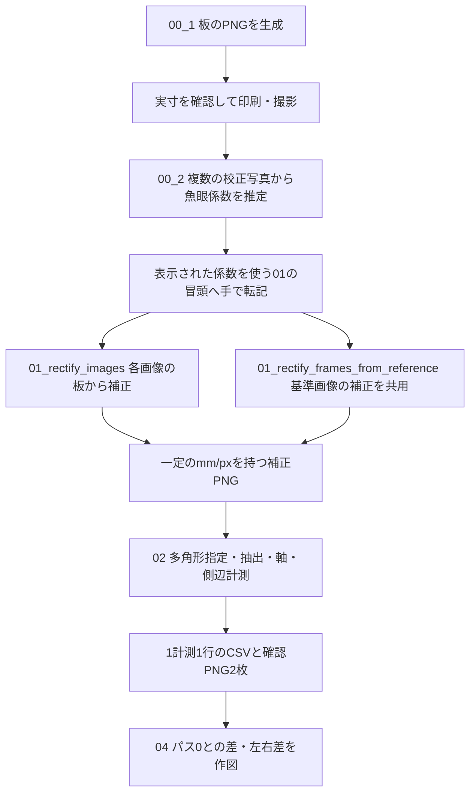

# 6本のコードを、Pythonの書き方から理解する

この文書は、プログラミングもPythonも学び始めた人が、対象のコードを自分で読み、変数の値を追い、必要な設定を変更するための解説です。「何のための処理か」「この記号は何か」「入力がどんな形に変わるか」を結び付けて説明します。

読む対象は、同じフォルダの6本です。解説を読みやすく分冊していますが、このページが全体の入口です。操作だけを調べる場合は [既存の実行手順](README.md) を参照してください。

先に重要な処理だけを一つの資料で押さえる場合は、[6本の根幹処理：コード抜粋と補足](docs/CORE_PROCESSING_GUIDE.md) を参照してください。板の生成から校正・補正・側辺計測・作図までをつなぎ、変数・単位・計算の意味を説明しています。

## 1. 読む順番と各章の内容

| 順番 | 解説 | 主に分かること |
| --- | --- | --- |
| 最初 | [Python・配列・ファイル・GUIの基礎](docs/python_basics.md) | 代入、インデント、関数、リスト、辞書、型注釈、NumPy、画像座標、例外、コールバック |
| 1 | [00_1：ChArUco板を作る](docs/00_1_generate_charuco_board.md) | mmからpxへの換算、板の生成、余白、PNG保存、印刷サイズ |
| 2 | [00_2：カメラを校正する](docs/00_2_calibrate_camera.md) | 角とID、現実の点と画像上の点の対応、魚眼係数、除外と再計算、再投影誤差 |
| 3 | [01：画像ごとに補正する](docs/01_rectify_images.md) | 魚眼歪み、ホモグラフィ、行列、出力範囲、一定のmm/px |
| 3の別方式 | [01：基準画像からフレームを補正する](docs/01_rectify_frames_from_reference.md) | 一度求めた補正の再利用、固定カメラの前提、画像サイズと出力先の検査 |
| 4 | [02：GUIで側辺を計測する](docs/02_measure_edge_lengths_gui.md) | 多角形、GrabCut、輪郭、長手軸、固定長区間、平滑化、長さ、画面イベント、保存 |
| 5 | [04：パスごとの指標を描く](docs/04_plot_pass_metrics.md) | CSV検証、実験回と区間の辞書、初回差、DR−OP差、Matplotlib、PNG保存 |

初めからすべてを覚える必要はありません。最初は基礎編の「コードの実行順」「変数」「関数」「リストと辞書」「画像座標」を読み、短い `00_1` へ進んでください。配列やGUIの項目は、各章で分からない記号に出会ったときに戻って読む使い方でも構いません。

実際のソースを横に開き、解説にある関数名を検索してください。行番号は編集により変わるので、各章は関数名・変数名・短い抜粋を目印にしています。

## 2. この解説が対象にする版

2026-10-22時点で、作業フォルダにある `src/` のコードを読み、その実装を説明しています。過去の提出版である `sandbox/submissions/` などは対象外です。コード自体の書き換えを目的とした文書ではありません。

**とくに `04_plot_pass_metrics.py` は、解説作成開始時点ですでに変更されていた作業中のファイルを対象としています。** このファイルは、実験回・区間IDごとの折れ線を描く版です。現在のREADMEや過去の検証記録にある「平均・標本SD」「600dpi」「英語ラベル」「論文向けの体裁」は、この作業中の `04` の動作とは異なります。

| 項目 | この文書が説明する `04` の実装 |
| --- | --- |
| 1系列の単位 | 実験回と区間IDの組。超過率図・初回差図ではさらにDR／OPに分かれる |
| 複数区間の平均・SD | 計算しない。区間ごとに別の線を描く |
| `FIGURE_SIZE` | `(10, 6)` インチ |
| `FONT_SIZE` / `SAVE_DPI` | `11` / `180` |
| 軸名・題目 | 日本語。図題・計測条件、補助線・0の水平線を表示する |

別の版を読むときは、手元の関数名や設定値と照合してください。この版の `04` には `summarize_measurements()` はありません。詳細は [04の章](docs/04_plot_pass_metrics.md) にまとめています。

## 3. 何を測るプログラムなのか

この題材が扱うのは、画像に写った試料の**外周の左右の側辺**です。画像の左をDR、右をOPとして扱います。進行方向に応じて左右の名前を自動で交換する処理はありません。

たとえば、試料の長手方向に100mm離れた2本の断面を考えます。その間の側辺が一直線なら長さは100mm程度です。凹凸をたどった長さが103mmなら、直線の目安から3mm長く、超過率は次のようになります。

```text
基準区間長 = 100 mm
DR側辺長 = 103 mm
超過率 = (103 / 100 - 1) × 100 = 3 %
```

基準区間長とは、長手軸に沿った上下断面の間隔です。側辺上の2点を直接結んだ距離や、画像の縦方向の差とは限りません。

この数値は輪郭の凹凸を含む長さの指標です。クラック1本ずつの本数・深さ・面積を直接検出しているわけではありません。画像に写る2次元の輪郭なので、面外の反りまで復元しているわけでもありません。

## 4. なぜ校正・補正・計測を分けるのか

写真の1pxが何mmかは、何も準備しなければ分かりません。また、写真の端の歪みや、斜めから見た遠近によって、同じ現実の長さでも写る長さが変わります。そこで段階を分けています。



1. **板生成**：寸法の分かった模様を作ります。PNGを出すだけなので、印刷の実寸確認は別に必要です。
2. **カメラ校正**：撮影した角の位置から、画素単位の焦点距離・主点・魚眼歪みの係数を推定します。主点は投影モデル上の基準点で、画像の幾何学的な中心と一致するとは限りません。カメラそのものの写り方を扱います。
3. **画像補正**：レンズ歪みを補正したうえで、板の平面を基準として遠近を補正し、mm/pxを揃えます。
4. **計測**：補正された画像の輪郭を取り出してpxで長さを求め、mmへ換算します。
5. **作図**：保存済みCSVを検証し、パス数ごとの指標を描きます。ここでは画像の抽出をやり直しません。

2本の `01` は、同じ入力へ順番にかける2段階の処理ではありません。各画像に板がある方式と、固定カメラで基準画像を共有する方式から、撮影方法に合う方を選びます。

## 5. ファイルが工程間をどう移動するか

既定の場所は、すべて `src/` を基準とします。以下のパスは説明のための相対表記です。

| 工程 | 主な入力 | 主な出力 |
| --- | --- | --- |
| `00_1` | 板の寸法・出力解像度の設定 | `output/charuco_board.png` |
| `00_2` | `input/camera_calibration/` 直下の校正写真 | `output/camera_detection/` の検出確認PNG、ターミナルの係数 |
| `01_rectify_images` | `input/` 直下の板付き写真と、転記した係数 | `output/rectified/` の補正PNG |
| `01_rectify_frames_from_reference` | `input/video_reference/reference.png`、`input/video_frames/` 直下のフレームと係数 | `output/rectified_frames/` の補正PNG、同フォルダの `reference/` に基準画像の補正PNG |
| `02` | GUIから選んだ補正PNG、手で指定した多角形・区間 | 選んだ名前のCSV、同じ語幹に `_initial.png` を付けた初期指定PNG、CSVと同じ語幹の結果PNG |
| `04` | 冒頭の `MEASUREMENTS` に指定したCSV | `output/pass_graphs/` のPNG3枚 |

実際の保存名の組み立ては各章で説明します。カメラ係数を保存した設定ファイルが自動で工程間を流れる構成ではありません。`00_2` が出した設定を、使う `01` へ手で貼り付けます。2本の `01` の係数は別々に設定します。

`02` の画像選択開始先は `RECTIFIED_DIRECTORY` です。基準画像方式の `rectified_frames/` を使うときは、そのフォルダへ自分で移動して選びます。

## 6. 先に知っておく共通設定と共通処理

対象6本は、単独ファイルだけで完結する構成ではありません。自作の補助ファイルを読み込みます。

| ファイル | 読む理由 |
| --- | --- |
| [workflow_settings.py](workflow_settings.py) | 入出力先・板・倍率・出力範囲を決める |
| [utils/file_io.py](utils/file_io.py) | 画像ファイルの列挙、読込、PNG化、拡張子・入力上書きの検査をする |
| [utils/measurement_csv.py](utils/measurement_csv.py) | 正の数の検証、計測CSVの書込・読込、長さと超過率の整合性確認をする |
| [utils/gui_parts.py](utils/gui_parts.py) | `02` が使う上部・左側・右側の画面領域を作る |

別のフォルダへ持ち出すときは、使うスクリプトに加え、`workflow_settings.py` と `utils/` を同じ版で揃えます。

共通設定の `MM_PER_PX = 0.25` は「1pxが0.25mm」という意味です。100mmは400pxに対応します。補正後の計測がこの値を前提にするため、値を変えたら補正PNGから作り直します。すでに保存されたPNGを読む `02` は、そのPNGを作ったときの倍率を画像から自動で判別しません。

`BOARD_SQUARES`・`SQUARE_MM`・`MARKER_MM` は、印刷した板・校正・補正で一致させます。カメラ係数についても、同じ撮影モード・画角・解像度を使うという前提があります。

## 7. 学習中の実行と変更の進め方

PowerShellで題材フォルダを作業場所にし、たとえば次のように実行します。

```powershell
uv sync
uv run src/00_1_generate_charuco_board.py
```

`uv run` は、この題材の依存ライブラリを使って、その後ろに書いたPythonファイルを実行するためのコマンドです。PowerShellのコマンド欄へ入力します。Pythonのコード内へ書き込むものではありません。動作環境は題材の `pyproject.toml` に従います。とくにPython 3.14の記法を使う箇所があるため、古いPythonへそのままコピーすると構文エラーになる場合があります。

学習では、次の順で値を確かめると混乱を減らせます。

1. 各章で入力・出力・単位を確認する。
2. まず設定を変えずに読み、`main()` から呼ばれる関数をたどる。
3. 値を観察したい場合は、保存したコピーや `sandbox/` の試作用コードで `print()` を加える。大きな配列は全要素ではなく `shape`・`dtype`・先頭数点を見る。
4. 変更は1か所ずつ行い、出力先も確認する。同名出力を上書きする処理があるので、残したい結果には別名・別フォルダを使う。
5. 数値と確認PNGを両方確かめる。計算が終了したことと、物理寸法が正しいことは別々に確認する。

各章の数値例は、式と変数の動きを理解するための例です。実験結果や、実画像に対する精度保証ではありません。

## 8. 文書作成時の確認範囲

本文は対象6本と、直接使われる共通設定・補助モジュールを照合しています。各章で、実装の確認と、実際に実行した確認を区別します。既存README末尾の検証履歴を、この文書を作成した今回の実行結果として読み替えないでください。

新規文書8本のローカル参照先・コードブロックの対応・Pythonとして示した192個の抜粋の構文を機械的に確認しました。対象6本の53関数は、各章に説明があることを確認し、計算や座標の説明も実コードと照合しました。抜粋の構文確認は、各抜粋を単独で実行して外部ファイルを読み書きしたという意味ではありません。

動作については、既存の校正テスト4件と基準画像補正テスト14件が成功しました。作業中の `04` については、合成CSVを一時フォルダへ作る独立した確認で、区間ごとの基準値と差分、PNG3枚の保存と画素数を照合しました。GUIの実操作は、この文書作成では再検証していません。

実カメラの校正、本番の圧延画像の寸法精度、測定者間の再現性は今回確認していません。各章末尾にも、確認した内容と未確認の内容を記載しています。

まずは [Pythonの基礎編](docs/python_basics.md) または [板生成の章](docs/00_1_generate_charuco_board.md) から読み進めてください。
