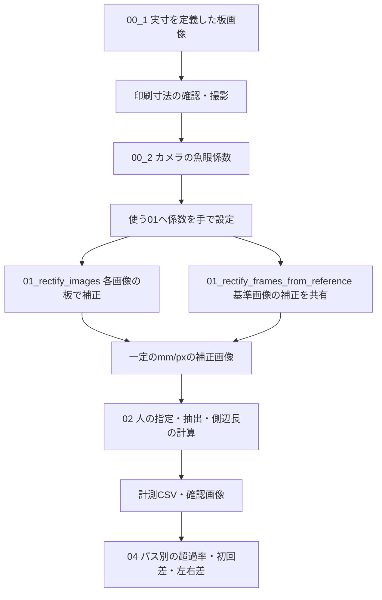

# 6本のスクリプトの根幹：重要コードの抜粋と補足

既存の詳しい解説から、**計測値がどのように作られるかを理解するために必要な処理**を選び、一つにつないだ資料です。プログラミングやPythonに不慣れな人が、重要な変数・単位・計算の意味を追い、実装の役割を説明できることを目指します。

対象は2026-10-23時点の6本です。GUIの部品配置、ファイル一覧の作成、保存ダイアログなどは省きます。コードは実ファイルからの抜粋で、前後にある読み込み・初期化・エラー処理のすべては掲載していません。抜粋だけをコピーして単独実行するための資料ではありません。

| 対象スクリプト | この資料で読む根幹 | 全体を詳しく読む場合 |
| --- | --- | --- |
| `00_1_generate_charuco_board.py` | 実寸から板画像を生成する | [板生成の解説](00_1_generate_charuco_board.md) |
| `00_2_calibrate_camera.py` | 実座標と検出点を対応付け、魚眼係数を求める | [校正の解説](00_2_calibrate_camera.md) |
| `01_rectify_images.py` | 歪み・遠近を補正し、一定のmm/pxへそろえる | [画像ごとの補正の解説](01_rectify_images.md) |
| `01_rectify_frames_from_reference.py` | 一度求めた補正を固定条件のフレームへ再利用する | [基準画像方式の解説](01_rectify_frames_from_reference.md) |
| `02_measure_edge_lengths_gui.py` | マスクから外周を得て、固定長区間の側辺を測る | [計測GUIの解説](02_measure_edge_lengths_gui.md) |
| `04_plot_pass_metrics.py` | 同条件の計測CSVからパス別の差を求める | [作図の解説](04_plot_pass_metrics.md) |

## 1. 最初に押さえる、処理のつながりと単位

この題材の中心のテーマは、圧延パスに伴うクラックの変化を何らかの数値で捉えることです。現行コードが直接測っているのは、**画像に写る試料の外周側辺の長さと、その超過率**です。個々のクラックの本数や深さを直接測る実装ではありません。



2本の `01` は用途に応じて選ぶ別方式です。同じ画像へ順番に両方かけるものではありません。校正係数も自動で転記されず、使う `01` に人が設定します。

| 名前・値 | 意味 | 混同しないこと |
| --- | --- | --- |
| 板上の座標 `[X, Y, Z]` | 実際の板に対する位置。この設定ではmm | 写真上の画素座標ではない |
| 画像上の座標 `[x, y]` | 横・縦の位置。単位px | 画像配列の添字は `image[y, x]` の順 |
| `PIXELS_PER_MM = 10` | 印刷用の板PNGを描く細かさ。10px/mm | 計測画像の倍率とは別 |
| `MM_PER_PX = 0.25` | 補正画像の1pxを0.25mmとして扱う | `mm → px` は割算、`px → mm` は掛算 |

`100 / 0.25 = 400` なので、現行の倍率では100mmが400pxに相当します。`MM_PER_PX` を変える場合は補正画像から作り直します。`02` はPNGを読み込んでも、その画像を作った時の倍率を自動判別しません。

## 2. `00_1`：実寸の分かった板を画像にする

元コード：[00_1_generate_charuco_board.py](../00_1_generate_charuco_board.py) の `main()`。

```python
dictionary = cv.aruco.getPredefinedDictionary(cv.aruco.DICT_4X4_50)
board = cv.aruco.CharucoBoard(BOARD_SQUARES, SQUARE_MM, MARKER_MM, dictionary)
board_width_mm = BOARD_SQUARES[0] * SQUARE_MM
board_height_mm = BOARD_SQUARES[1] * SQUARE_MM
board_width_px = int(board_width_mm * PIXELS_PER_MM)
board_height_px = int(board_height_mm * PIXELS_PER_MM)
board_image = board.generateImage((board_width_px, board_height_px))
```

根幹は、**板の実際の寸法を先に決め、その模様を指定した画素数で描く**ことです。

- `dictionary` は識別マーカーの模様と番号の規則です。板を生成する側と、後で読み取る側で一致させます。
- `CharucoBoard(...)` は板の設計情報を作ります。この行だけでは画像ファイルはまだ生成されません。
- `BOARD_SQUARES[0]` は横のマス数、`[1]` は縦のマス数です。Pythonの添字は0から始まります。
- `int(...)` は画素数を整数にします。`generateImage(...)` が、その幅・高さの画像配列を作ります。

共通設定は横7マス・縦5マス、1マス30mmなので、板本体は210mm×150mmです。10px/mmで描くと、本体画像は2100px×1500pxになります。その後、周囲に白い余白を加えてPNGへ保存します。

**この工程で重要なのは、印刷した板の寸法と、コードの板定義を一致させることです。** PNGの画素数が正しくても、印刷時に拡大・縮小されると実寸が変わります。印刷後に1マスと縦横の寸法を実測します。

説明するなら：「後の校正で現実の長さの基準になるように、実寸を定義した板の画像を作っています。」

## 3. `00_2`：同じ点の実座標と写真上の位置からカメラを校正する

元コード：[00_2_calibrate_camera.py](../00_2_calibrate_camera.py) の `calibrate()`。

### 3.1 点を見つけ、番号で対応付ける

板の設計から全交点の実座標 `all_board_points` を作り、写真ごとに次を実行します。

```python
corners, ids, markers, marker_ids = detector.detectBoard(image)
```

`corners` は写真内で見つかった交点の位置、`ids` はその交点の番号です。`marker_ids` は識別マーカーの番号で、ここから先の交点の対応付けには `ids` を使います。

使用できる写真について、次のように点を蓄積します。

```python
board_points = all_board_points[ids.astype(np.int32).ravel()]
# OpenCV 5の魚眼校正へ、1行に全点を並べた形で渡す。
detected_points = np.array(corners, dtype=np.float64).reshape(1, -1, 2)
object_points.append(board_points.reshape(1, -1, 3))
image_points.append(detected_points)
used_indices.append(index)
```

ここで最も大切なのは、**実座標と写真上の座標が、同じ点・同じ順番になること**です。

例えば `ids` が `[2, 5]` なら、板の2番・5番の実座標をこの順で取り出し、`corners` の1個目・2個目と対応させます。全点が写るとは限らないため、板の点を先頭から順に渡すだけでは対応がずれます。

| 書き方 | この箇所で行うこと |
| --- | --- |
| `astype(np.int32)` | 番号を整数として扱う |
| `ravel()` | 番号の配列を1次元配列にする |
| `all_board_points[番号の配列]` | 指定された番号の点を、その順に取り出す |
| `reshape(1, -1, 3)` | 「1組・点数は自動計算・1点は3座標」の形に整える |
| `append(...)` | 写真1枚分の点群をリストへ追加する |

板上の点は `[X, Y, Z]`、単位はmmで、平面の板なので `Z=0` です。写真上の点は `[x, y]`、単位はpxです。`reshape()` は座標の値を変換するのではなく、校正APIが受け取る配列の形に整えています。

### 3.2 複数写真を魚眼モデルへ当てはめる

```python
rms, matrix, distortion, rotations, translations = cv.fisheye.calibrate(
    object_points,
    image_points,
    image_size,
    matrix,
    distortion,
    flags=flags,
    criteria=(cv.TERM_CRITERIA_EPS + cv.TERM_CRITERIA_MAX_ITER, 100, 1e-8),
)
```

`object_points` と `image_points` が、複数写真分の対応点です。`image_size` は `(幅, 高さ)` です。事前に用意した係数の初期配列を渡し、写真での写り方を説明できる係数を反復計算で求めます。

- `matrix`：カメラ行列。画素単位の焦点距離 `fx`・`fy` や主点を含む3×3の配列です。
- `distortion`：魚眼モデルの4個の歪み係数です。
- `rotations`・`translations`：各写真での板の姿勢・位置です。
- `rms`：検出した角と、モデルが予測する角の位置のずれをまとめた値です。単位はpxです。

`criteria` の100は最大反復回数、`1e-8` は収束判定に使う値です。寸法誤差を `1e-8 mm` にする指定ではありません。

**校正で求めるのはカメラの写り方です。** 計測画像の1pxを何mmにするかは、次の平面補正と `MM_PER_PX` で決めます。`rms` も、メジャーとの寸法照合で求める誤差率とは別です。

次工程へ渡すのは、画像サイズの `CALIBRATION_SIZE`、`matrix` を表示した `CAMERA_MATRIX`、`distortion` を表示した `DIST_COEFFS` の3設定です。

角が不足・一直線上・解像度不一致などの写真は使いません。また、校正APIが特定の写真の数値的不安定さを報告した場合は、その写真を除いて再計算します。再投影誤差が大きい写真を一律のしきい値で自動除外する処理ではありません。

説明するなら：「板の同じ交点について、現実の位置と写真上の位置をそろえ、カメラの係数を求めています。出力した3設定を、使う補正スクリプトへ手で反映します。」

## 4. `01_rectify_images`：画像を一定のmm/pxへ補正する

元コード：[01_rectify_images.py](../01_rectify_images.py) の `rectify_image()`。

### 4.1 先にレンズの歪みを補正する

```python
new_matrix = cv.fisheye.estimateNewCameraMatrixForUndistortRectify(
    matrix, distortion, (width, height), np.eye(3), balance=1.0
)
undistorted = cv.fisheye.undistortImage(
    image, matrix, distortion, Knew=new_matrix, new_size=(width, height)
)
```

`matrix` と `distortion` は校正結果です。`new_matrix` は歪み補正後の画像に使うカメラ行列で、`undistorted` が歪み補正した画像です。`np.eye(3)` は3×3の単位行列で、この呼び出しでは追加の回転を与えていません。

レンズの歪みと、斜めから撮ったための遠近の違いは、別の処理として扱います。この後の板の検出には、元画像ではなく `undistorted` を使います。

### 4.2 画像のpx座標から板のmm座標への変換を求める

歪み補正後の画像から角を検出し、校正と同様にIDで対応をそろえます。

```python
all_board_points = np.array(board.getChessboardCorners(), dtype=np.float32)
board_xy = all_board_points[ids.astype(np.int32).ravel(), :2]
detected_xy = corners.reshape(-1, 2)
# 板のmm座標へ写す。試料の形を基準に変形すると伸びを消すため、使わない。
homography, _ = cv.findHomography(detected_xy, board_xy)
```

`board_xy` は板の `[X, Y, Z]` から先頭2座標を取り出したものです。`[:, :2]` は「すべての点について、先頭2列」を意味します。

`findHomography(変換前の点, 変換後の点)` は、対応点から平面上の変換を求めます。ここでは、**歪み補正後の画像px → 板の平面のmm**という向きです。`homography` はその対応を表す3×3の行列です。`_` には、この箇所では使わない戻り値を受けています。

試料を四角形などの理想形へ変形するのではなく、寸法の分かる板を基準にします。試料の輪郭を基準に形を整えてしまうと、評価したい試料の変形まで消してしまうためです。

### 4.3 mmを保存画像のpxへ換算し、実際の画像を作る

```python
world_to_pixels = np.array(
    [[1 / MM_PER_PX, 0, -minimum[0]], [0, 1 / MM_PER_PX, -minimum[1]], [0, 0, 1]],
    dtype=np.float64,
)
transform = world_to_pixels @ homography
corrected = cv.warpPerspective(
    undistorted, transform, (output_width, output_height), flags=cv.INTER_LINEAR
)
```

ここまでの前処理で、写真内の板の向きを保つ回転も `homography` へ合成しています。また、設定した出力範囲の四隅を変換し、必要な出力サイズと `minimum` を求めています。

- `1 / MM_PER_PX`：mmを保存画像のpxへ換算します。0.25mm/pxなら、1mmを4pxへ変換します。
- `-minimum[0]`・`-minimum[1]`：変換した範囲が保存画像内に入るよう、左上の位置をずらします。
- `@`：行列の掛算です。右側の「画像px → 平面mm」を適用し、続いて左側の「平面mm → 出力px」を適用する変換を作ります。
- `warpPerspective(...)`：計算した対応を使い、出力画像の画素を作ります。変換行列を求めるだけでは画像ファイルは変わりません。

この方式は、各入力画像で板を検出します。板と計測対象が同じ平面にあることが前提です。板の読み取り不足や、板の再投影誤差が2pxを超える場合などには処理を止めますが、この検査だけで試料全域の寸法精度を保証するものではありません。

説明するなら：「カメラの歪みを補正し、板の実寸を使って遠近を直し、どの補正画像も同じ倍率で測れる形にしています。」

## 5. `01_rectify_frames_from_reference`：補正を一度求めて再利用する

元コード：[01_rectify_frames_from_reference.py](../01_rectify_frames_from_reference.py) の `prepare_rectification()`・`rectify_frame()`・`main()`。

数学的な中心は前節と同じです。違うのは、**基準画像で変換を一度求め、その結果を各フレームへ渡す**ことです。

`main()` で最初に次を行います。

```python
reference_image = read_image(reference_path)
correction = prepare_rectification(reference_image)
corrected_reference = rectify_frame(reference_image, correction)
```

`correction` は設定と計算結果をまとめた辞書です。カメラ行列、歪み係数、補正後の行列、平面変換、入力サイズ、出力サイズなどを保持します。

以降のフレームは `rectify_frame(image, correction)` に渡し、同じ補正を使います。

```python
undistorted = cv.fisheye.undistortImage(
    image,
    correction["matrix"],
    correction["distortion"],
    Knew=correction["new_matrix"],
    new_size=correction["input_size"],
)
corrected = cv.warpPerspective(
    undistorted,
    correction["transform"],
    correction["output_size"],
    flags=cv.INTER_LINEAR,
)
```

`correction["transform"]` は辞書から名前で変換行列を取り出す書き方です。フレームごとに板の角を探して変換を求め直してはいません。そのため、各フレームに板が写っていなくても補正できます。

ただし、カメラ位置・向き・撮影モード・画角と計測面を固定する必要があります。解像度の一致はコードで検査しますが、カメラが動いたことや試料が面外へ反ったことまで自動検出する処理ではありません。

説明するなら：「撮影条件が固定なら、一度求めた画像補正を使い回せるため、動作中の各フレームに板を置き続けずに処理できます。」

## 6. `02`：外周を抽出し、固定長区間の側辺を測る

元コード：[02_measure_edge_lengths_gui.py](../02_measure_edge_lengths_gui.py)。ここが側辺長そのものを作る中心です。入力は補正済み画像で、校正や遠近補正はこのスクリプト内では行いません。

### 6.1 人の指定を、画素ごとの分類へ変える

`initial_mask()` の抜粋です。

```python
height, width = image.shape[:2]
labels = np.full((height, width), cv.GC_PR_BGD, np.uint8)
for label in (cv.GC_PR_FGD, cv.GC_BGD, cv.GC_FGD):
    for polygon in regions[label]:
        pixels = polygon_pixels(polygon, width, height)
        cv.fillPoly(labels, [pixels], label)
```

`labels` は、元画像と同じ縦横サイズを持つ、分類番号の2次元配列です。色画像ではありません。`np.full(...)` で全画素を背景候補にし、人が描いた多角形の内側を `fillPoly(...)` で上書きします。

| 分類 | 意味 |
| --- | --- |
| `GC_BGD` | 確実な背景 |
| `GC_FGD` | 確実な前景＝試料 |
| `GC_PR_BGD` | 背景候補 |
| `GC_PR_FGD` | 前景候補 |

重なった領域は、コードにある「前景候補 → 確実な背景 → 確実な前景」の順で上書きされます。多角形はGrabCutへの手掛かりです。その多角形の辺を、そのまま側辺長として測るわけではありません。

### 6.2 GrabCutで分類を更新し、外周を取り出す

`extract_specimen()` の抜粋です。前景指定の周囲に余裕を持たせて画像を切り出し、`working_image` として処理します。分類用の内部作業配列は、抜粋より前で準備しています。

```python
labels, _, _ = cv.grabCut(
    working_image,
    labels,
    (0, 0, 0, 0),
    background_model,
    foreground_model,
    ITERATIONS,
    cv.GC_INIT_WITH_MASK,
)
extracted_foreground = (labels == cv.GC_FGD) | (labels == cv.GC_PR_FGD)
raw_mask = np.zeros(labels.shape, np.uint8)
raw_mask[extracted_foreground] = 255
contours, _ = cv.findContours(raw_mask, cv.RETR_EXTERNAL, cv.CHAIN_APPROX_NONE)
```

- `GC_INIT_WITH_MASK`：先ほどの分類マスクを初期指定に使います。この呼び方では四角形の引数 `(0, 0, 0, 0)` を初期領域としては使いません。
- `labels == ...`：各画素がその分類かを調べます。`|` は画素ごとの「または」で、2種類の前景を両方採用します。
- `raw_mask`：前景を白255、その他を黒0にした画像です。GrabCutの4分類の配列とは役割が違います。
- `RETR_EXTERNAL`：外周を取り出します。内部の割れを一つずつ検出する指定ではありません。
- `CHAIN_APPROX_NONE`：輪郭点を間引かずに保持します。

輪郭が得られた後、最大面積のものを採用し、元画像の座標へ戻します。

```python
contour = contours[0]
largest_area = cv.contourArea(contour)
for candidate in contours[1:]:
    area = cv.contourArea(candidate)
    if area > largest_area:
        contour = candidate
        largest_area = area
points = contour.reshape(-1, 2).astype(np.float64)
points += (left, top)
```

`contour` は境界を順番にたどった点列です。`points += (left, top)` で、切り出した画像内の位置へ切り出し開始位置を足し、元画像内の位置に戻します。

最大領域が本当に試料か、反射したローラーなどが混ざっていないかは人が確認します。丁寧なマスク指定で改善できる画像があっても、誤抽出を自動で判定・修正できたことにはなりません。

### 6.3 長手方向を求め、同じ100mmの区間を置く

軸は「原点」と「長さ1の方向ベクトル」の組です。方向ベクトルは、どちらへ進むかを表す2個の値で、長さ1にしておくと、掛けた数値がそのまま進む画素数になります。

`estimate_axis()` は、区間内の断面で左右の最外点を求め、その中点群へ直線を当てはめます。

```python
edges = section_edges(contour, bounds, axis, positions, outermost=True)
origin, direction = axis
normal = np.array([direction[1], -direction[0]])
midpoints = (
    origin
    + positions[:, None] * direction
    + edges.mean(axis=1)[:, None] * normal
)
vx, vy, x, y = cv.fitLine(
    midpoints.astype(np.float32), cv.DIST_L2, 0, 0.01, 0.01
).ravel()
```

`direction` は長手方向、`normal` はそれと直角の方向です。`edges.mean(axis=1)` は各断面の左右位置の平均、つまり中央を求めます。`[:, None]` は、各断面の値を2座標へ掛けられるよう配列の形を整える指定です。`fitLine(...)` が中点群の向きに合う直線を求めます。実装では軸と区間を置き直しながら3回繰り返します。

その軸を使い、`fixed_interval_points()` で区間の両端を作ります。

```python
length_px = length_mm / MM_PER_PX
if not math.isfinite(length_px) or length_px < 1:
    raise ValueError("基準区間長は画像上で1px以上の長さにしてください")
half_interval = axis[1] * length_px / 2
return np.array([center - half_interval, center + half_interval])
```

100mm、0.25mm/pxなら区間は400pxです。中心から軸方向へ200pxずつ進んだ位置に、軸と直角の断面を置きます。方向が `(0.6, 0.8)` なら、中心から片側へ `(120, 160)` px、反対側へ `(-120, -160)` px移動します。縦方向だけに400pxを取る方法ではないため、傾いた軸でも区間長を保てます。

自動軸が合わなければ人が2点で方向を指定できます。この2点間距離を基準区間長にするのではなく、中心と入力したmmを保って方向を変えます。

### 6.4 外周の順序を保ち、断面間の側辺を2本切り出す

**軸推定で使った最外点を、そのままつないで側辺長を測るわけではありません。** `side_chains()` が、元の外周を順番にたどり、2本の断面の間に入る線分を残します。

その中心となる、線分を区間境界で切る計算です。

```python
clipped_start = point + enter * (next_point - point)
clipped_end = point + leave * (next_point - point)
```

`point` と `next_point` は隣り合う輪郭点です。`enter`・`leave` は、線分上のどの位置からどの位置までを残すかを、0〜1で表します。0が始点、1が終点、0.5が中間です。これらは直前の処理で、線分と上下断面の関係から求めています。

例えば `(0, 0)` から `(10, 0)` の線分のうち、0.2〜0.8を残すなら、切った両端は `(2, 0)` と `(8, 0)` です。

残した線分を、元の輪郭とつながる順番で点列へまとめます。このため、内側へ入り込む凹凸や折り返しも経路として残ります。断面ごとの最も外側の点だけを結ぶと、このような形状を飛び越える場合があります。

実装は、上下断面を結ぶ側辺が2本得られること、処理範囲の端で切れていないことなどを検査し、上から下・DRからOPの順へそろえます。対応が取れない場合は計測を止めます。DR・OPは画像上の左右として扱い、圧延方向から自動で名前を交換する処理はありません。

### 6.5 側辺に沿って評価点を置き、局所直線で平滑化する

`smoothed_sides()` の、評価点を置く処理です。

```python
step = EVALUATION_INTERVAL_MM / MM_PER_PX
half_window = SMOOTHING_WIDTH_MM / MM_PER_PX / 2
origin, direction = axis
start, end = interval_positions(interval_points, axis)
sides = []
for chain in side_chains(contour, bounds, interval_points, axis):
    raw_steps = np.linalg.norm(np.diff(chain, axis=0), axis=1)
    distances = np.concatenate(([0.0], np.cumsum(raw_steps)))
    positions = np.append(np.arange(0, distances[-1], step), distances[-1])
```

ここでは「生の側辺を先頭から何pxたどったか」を計算しています。

1. `np.diff(chain, axis=0)`：隣り合う点の座標の差を求めます。
2. `norm(..., axis=1)`：各座標差の長さを求めます。
3. `cumsum(...)`：長さを順に足し、先頭からの累積距離にします。
4. `arange(...)`：指定した間隔で評価位置を置きます。最後の端点も追加します。

例として `(0, 0) → (3, 4) → (6, 4)` なら、隣接点間の距離は5px・3px、累積距離は0px・5px・8pxです。画像の縦座標ではなく、この**側辺に沿った距離＝弧長**を基準にします。

現行の設定は評価間隔1mm、平滑化幅2mmです。0.25mm/pxでは、評価間隔は4px、平滑化の半幅は4pxとなります。平滑化は生の弧長で前後1mmの範囲を使います。

近傍の点を補間で用意した後、局所直線を当てはめます。

```python
offsets = dense_positions[nearby] - position
matrix = np.column_stack((np.ones(len(offsets)), offsets))
# 端では窓を区間内に切り詰め、直線の方向を保つ局所直線を使う。
coefficients, _, _, _ = np.linalg.lstsq(
    matrix, dense_points[nearby], rcond=None
)
points[index] = coefficients[0]
```

`offsets` は注目位置からの距離で、注目位置が0です。周囲の点について「座標＝切片＋傾き×距離」という直線を、x・yそれぞれに当てはめます。`lstsq(...)` はずれの2乗の合計が小さくなる係数を求めます。`coefficients[0]` は距離0での推定座標、つまり平滑化した評価点です。

平滑化幅が0、または近傍点が3点未満の場合は、その点では直線による平滑化をせず補間を使います。また、平滑化後も両端点を元の上下断面上へ戻し、評価区間を保ちます。

画素の階段状の形が長さへ混ざるのを抑える一方、小さな本物の凹凸も弱め得ます。比較するパスでは評価間隔・平滑化幅をそろえます。クラックだけを選んで残す処理ではありません。

### 6.6 折れ線の長さを足し、mmと超過率にする

`measure_contour()` では、まず基準区間長を求めます。

```python
sides = smoothed_sides(contour, bounds, interval_points, axis)
start, end = interval_positions(interval_points, axis)
interval_mm = (end - start) * MM_PER_PX
```

`sides` が左右の平滑化後の点列です。`end - start` は長手軸に沿う断面間隔で、側辺をたどった長さとは別です。計測条件を `row` という辞書に入れ、次を実行します。

```python
for side, name in ((0, "left"), (1, "right")):
    steps = np.diff(sides[side], axis=0)
    length_px = float(np.linalg.norm(steps, axis=1).sum())
    row[f"{name}_px"] = length_px
    row[f"{name}_mm"] = length_px * MM_PER_PX
    row[f"{name}_excess_percent"] = (length_px * MM_PER_PX / interval_mm - 1) * 100
```

隣接点間の距離を足してpx単位の側辺長を求め、`MM_PER_PX` を掛けてmmにします。`side=0` はDR、`side=1` はOPです。`f"{name}_mm"` は、`name="left"` のとき `"left_mm"` という項目名を作る書き方です。

```text
長手軸に沿う基準区間長：100 mm
平滑化後の側辺長：412 px × 0.25 mm/px = 103 mm
超過率：(103 / 100 - 1) × 100 = 3 %
```

分子は側辺に沿う長さ、分母は軸に沿う区間長です。超過率3%は材料が3%伸びたことや、クラックが3%増えたことを意味しません。`total_mm` はDR・OPの合計で、全周長や複数区間の平均ではありません。

説明するなら：「人の指定から外周を取り出し、長手方向に同じ長さの区間を作ります。その区間の連続した左右側辺を平滑化してたどり、実寸の長さと超過率へ変換しています。」

## 7. `04`：同条件の計測値を、パスごとに比較する

元コード：[04_plot_pass_metrics.py](../04_plot_pass_metrics.py) の `read_pass_measurements()`・`create_graphs()`。画像を再処理するのではなく、`02` が保存したCSVの値を使います。

### 7.1 比較条件が一致するかを確認する

CSVを読む `read_lengths()` は共通処理で、必要列・数値・長さと超過率の整合などを確認します。その後、`04` は全CSVで次の4条件が一致するかを調べます。

```python
if reference_measurement is None:
    reference_measurement = measurement
for column in (
    "interval_length_mm",
    "mm_per_px",
    "evaluation_interval_mm",
    "smoothing_width_mm",
):
    if not math.isclose(
        measurement[column],
        reference_measurement[column],
        rel_tol=1e-8,
        abs_tol=1e-8,
    ):
        raise ValueError(
            f"計測条件が一致しません: {column}: {measurement_path.name}"
        )
```

`reference_measurement` は最初に読んだCSVです。ここでは計測条件の照合に使い、必ずしもパス0の値ではありません。`math.isclose(...)` は小数のごく小さいずれを許す比較です。許容値は実寸精度を表しません。

### 7.2 実験回・区間ごとに、パスを対応付ける

入力の `MEASUREMENTS` には「実験回、パス番号、区間ID、CSV名」を人が設定します。現行版はパス番号に0以上の偶数整数を要求し、各実験回・区間にパス0が必要です。

```python
groups = {}
for row in rows:
    key = (row["experiment_id"], row["section_id"])
    if key not in groups:
        groups[key] = {}
    groups[key][row["pass_number"]] = row
    passes.add(row["pass_number"])
```

`groups` は辞書の中に辞書を入れたものです。外側で実験回と区間を選び、内側でパスを選びます。

```text
groups[("run01", "a")][0] → 実験run01・区間a・パス0の計測
groups[("run01", "a")][2] → 実験run01・区間a・パス2の計測
groups[("run01", "b")][0] → 実験run01・区間b・パス0の計測
```

区間aの初回差は区間aのパス0から計算し、区間bの基準を流用しません。ただし、同じ区間IDを付けたことだけでは、圧延前後で同じ材料部分を追跡できたことにはなりません。

### 7.3 超過率・初回差・左右差を計算する

同じ実験回・区間のデータを `group` とし、パス順に次を実行します。

```python
for edge, side, color in (
    ("left", "DR", DR_COLOR),
    ("right", "OP", OP_COLOR),
):
    values = []
    changes = []
    initial = group[0][f"{edge}_excess_percent"]
    for pass_number in pass_numbers:
        excess = group[pass_number][f"{edge}_excess_percent"]
        values.append(excess)
        changes.append(excess - initial)
```

`values` は超過率そのもの、`changes` はその側のパス0を引いた値です。`group[0]` の0は、ここではリストの先頭という意味ではなく、辞書の鍵であるパス番号0です。

左右差は同じ区間・同じパスのDRからOPを引きます。

```python
differences = []
for pass_number in pass_numbers:
    row = group[pass_number]
    differences.append(row["left_excess_percent"] - row["right_excess_percent"])
```

次は説明用の計算例で、実験結果ではありません。

| 指標 | パス0 | パス2 | パス4 |
| --- | ---: | ---: | ---: |
| DR超過率 | 1% | 3% | 5% |
| OP超過率 | 2% | 4% | 8% |
| DR初回差 | 0ポイント | 2ポイント | 4ポイント |
| OP初回差 | 0ポイント | 2ポイント | 6ポイント |
| DR−OP差 | −1ポイント | −1ポイント | −3ポイント |

百分率同士を引く初回差・左右差の単位はパーセントポイントです。左右差が負ならOP側の超過率が大きいことを示します。差の線が下がることと、値が負であることは区別します。

実験でパス0を両側0%へ手動設定した場合、`excess - initial` は `excess - 0` なので、初回差図と超過率図は同じ数値になります。コードが自動で理想値へ設定するのではなく、与えた基準値から計算しています。

**現行の `04` は実験回・区間IDごとの線を描き、複数区間の平均・SDは計算しません。** パス別の図から人が傾向を比較する段階で、クラックが発生したパスや統計的な変化点の自動判定は行いません。

説明するなら：「計測条件を確認したCSVを実験回・区間・パスで整理し、超過率、その区間の初回との差、同じパスでの左右差を図にしています。」

## 8. 重要処理を説明するときに残す、役割と前提

| 段階 | 人が用意・確認すること | プログラムが処理すること |
| --- | --- | --- |
| 板と校正 | 板の実寸、校正写真、検出結果、撮影モード・画角・解像度 | 板画像の生成、角の検出、点の対応、魚眼係数の推定 |
| 画像補正 | 係数の設定、計測面と板の対応、固定基準方式ではカメラ・計測面の固定 | 歪み補正、平面変換、一定のmm/pxでの画像生成 |
| 試料と区間 | マスク、中心と区間長、輪郭・軸の妥当性 | GrabCut、軸推定、側辺切出し、平滑化、長さと超過率の計算 |
| 記録と比較 | 保存先、CSVとパス・区間の対応、基準値、結果の解釈 | CSV・確認画像の生成、指標の差の計算と作図 |

今回の仕組みは、人が指定・確認した後の数値処理と記録・比較をプログラムで進める半自動の手順です。反射や隠れで境界そのものを判断できない画像まで、マスク指定だけで復元できるわけではありません。抽出線と元画像の対応を確認できる区間を使います。

また、ボードと計測対象は同じ平面、つまり高さ・傾きが対応することが前提です。2次元の補正だけで面外の反りを補償したり、同じクラックを追跡したりする実装ではありません。数値を出せる条件と、その数値が実際のクラック量を正しく表すことは、別々に検証する必要があります。

本資料は実コードの抜粋と説明用の計算を照合したものです。実カメラの校正・実験画像の計測・GUI実操作を改めて実行した記録ではありません。細かな構文や例外処理は、各節の個別解説、または [Pythonの基礎編](python_basics.md) へ戻って確認してください。
