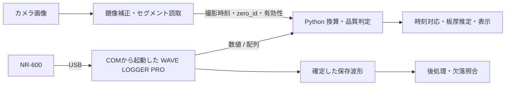

# NR-600系のPython連携とゲージメータ板厚推定の実現性

調査日：2026-10-29。対象は添付されたNR-600系の資料です。現場機の銘板・入力ユニット構成は未照合です。

## 1. 判定

**Pythonで保存済みロガーデータを取得し、換算・平均・荷重合算・板厚推定等の数値処理を行う構成は成立します。リアルタイム可視化も条件付きで可能ですが、資料だけでは更新遅延・同期精度・無欠落を保証できません。**

根拠は、WAVE LOGGER PROがCOM Automationを提供し、添付Sample3が取得配列の平均演算まで実演していることです。Python側にはpywin32によるCOMクライアント機能があります。ただしメーカー資料にPythonの動作保証は記載されていません。[A p.4,6,9,41–50,58 / S3 / W3]

| やりたいこと | 判断 | 条件・実務上の意味 |
|---|---|---|
| 保存波形から数値を取り出す | API・サンプルで確認 | WAVE LOGGER PROを介し、点数とindexを指定する |
| 平均・フィルタ・単位換算をPythonで行う | 可能 | 取得後の通常の数値処理。既存換算設定の移植が必要 |
| 収集中のデータを読む | USBで1チャンネルの取得に成功 | PC読出し済み配列と現在値は別の意味。周期・遅延は要実測 |
| 手動起動した既存ソフトへ後付け接続 | 不可と明記 | COMから起動したWAVE LOGGER PROだけが対象 |
| 別PCでモニタし、その値をCOM取得 | 本資料の方法では不可 | GUIのモニタ機能はあるが、Automationはモニタ機能に非対応 |
| 連続収集を直接読んで無欠落保存 | 保証できない | 保存切替部の欠落が明記。確定した保存ファイルから取得する |
| 画像OCRとロガーを厳密に時刻同期 | 追加設計が必要 | APIで開始日時・トリガ日時・データ先頭日時を取得できない |
| 幅別のミル定数を求める | 校正データがあれば可能 | 荷重・相対圧下量だけでは足りず、対応する実厚が必要 |

## 2. 取得経路の比較



上図は設計案です。カメラとロガーが、この接続だけで同期するわけではありません。

| 経路 | 適する用途 | 制約 |
|---|---|---|
| 保存済みudt等 → WAVE LOGGER PRO COM → Python | 最初の数値取得検証、確定履歴 | 保存が完了してから処理する |
| 未圧縮CSV → Python | 既存運用から始める後解析 | メタデータ・データ開始位置・文字コード・表示対象CHを実CSVで確認 |
| COMで起動・収集 → 現在値取得 | 現在値の試験表示 | 各CHの呼出しは同時ではない。測定時刻も得られない |
| COMで起動・収集 → 同じindex区間の配列取得 | 荷重OP/DR等の時系列統合 | 保存切替や繰返し収集をまたぐ欠落に注意 |

## 3. COM APIとPythonへの移し方

製品版のProgIDは`WaveLoggerPro2.Application`です。基本の呼び出し順は次のとおりです。[A p.9,13–14,20,28,30]

1. WAVE LOGGER PROをインストール後、一度手動起動して終了し、COMを登録する。
2. PythonからCOMオブジェクトを作り、`Initialize()`を呼ぶ。
3. 保存波形の解析なら`OpenFile(path)`の戻り値0を確認する。装置指定は不要。
4. 収集する場合は`SetIdentifier(4 + DEVICE_ID)`でUSBの機器IDを指定し、事前に作成した設定ファイルを開く。
5. `GetActiveFile()`からドキュメントを取得する。
6. 収集する場合だけ`Start()`を呼び、状態・異常を監視する。
7. 数値取得・換算・計算・保存を行う。

現場の収集をPythonへ移す手順は、保存波形の読出し検証とは別の作業です。設定ファイルを読み込めますが、Automationから収集条件を自由に変更することはできません。周期を決めたらGUIで設定を保存し、Pythonでその設定を読み込みます。[A p.7]

| 呼出し | 対象 | 取得内容・判定 |
|---|---|---|
| `OpenFile(path)` | アプリ | 設定／データファイルを開く。0が成功 |
| `GetActiveFile()` | アプリ | ドキュメントオブジェクト |
| `GetState()` / `GetErrorCode()` | アプリ | 状態／異常停止原因。イベント通知の代わりに監視 |
| `GetDataCount()` | ドキュメント | PC上のドキュメントのデータ数 |
| `GetData(unit,ch,index)` | ドキュメント | 指定位置のSingle値。少量の動作確認向け |
| `GetArrayData(unit,ch,index,count,array,offset)` | ドキュメント | Single配列へ書込み。戻り値は実取得点数 |
| `GetCurrentData(unit,ch)` | ドキュメント | 現在値。ファイル読込み後には無効値になる |
| `GetArrayDataEx(...,varType)`等 | ドキュメント | Double値と型情報。特にCAN整数型で必要 |
| `GetRepeatCount()` / `GetAutosaveCount()` | ドキュメント | リピート回数／自動保存番号。セッション識別の補助 |

`Visible` は代入するプロパティです。`Initialize()`、`GetActiveFile()`、`GetState()`、`GetDataCount()` などは、Python側でメソッドと明示して呼び出します。[A p.10–13,30,41–43 / S1]

機器IDはNR-600本体を、ユニット番号（1～8）は入力モジュールを指定します。CHとデータindexは0始まりです。例えばNR-HA08の電圧CH1～8は引数0～7、電流CH1～4は引数8～11です。複数CHの同じ位置を読む場合は、ユニットとCHの組み合わせごとに同じindexを`GetData()`へ渡します。[A p.8,14,43]

### 配列・無効値・同時性

`GetArrayData`はPythonリストを戻す関数ではなく、受取り配列を引数で渡します。VCサンプルは`VT_BYREF | VT_ARRAY | VT_R4`のSAFEARRAYを使用します。Ex版はDouble配列とByRefの型情報が必要です。pywin32の型指定・makepyラッパーの有無による引数差を、実際のタイプライブラリで検証します。[S3 VC Sample3Dlg.cpp L375–389 / S4 / W4]

要求した件数を必ず返すとは限りません。要求数と戻り点数を照合し、OP/DR等の全CHで同じindex区間が取得できた場合だけ計算に使います。各CHを別時刻に`GetCurrentData()`で読む方法では、荷重の同時性を保証できません。同じindexでも、入力ユニット間の遅延・スキューは別途確認します。[A p.42,48 / N 10-2～10-3,11-10以降]

Single系の異常値は約`3.4e38`、Ex系は約`1.7e308`です。NaNや無限大も含め、異常値を荷重・板厚計算へ通さず品質フラグにします。NR-C512の型情報0/1/2はそれぞれsigned int/unsigned int/floatです。ExでDoubleを受け取っても、元のアナログデータの測定分解能が増えるわけではありません。[A p.43–44,49–50]

## 4. リアルタイム化で効く制限

### 既存の起動済みソフトへの接続

Automationから操作できるのは、Automationから起動したソフトだけです。既存収集に後付けする方式を前提にしないでください。GUIのモニタ機能は別PC収集中にも使えますが、Automationではモニタ機能自体を利用できません。他アプリが収集している場合のエラー`0x2013`も記載されています。[A p.7,9,57 / N 6-129]

### 連続保存と欠落

連続収集時は、保存切替でデータが更新され、直接取得だと切替部を取得できない場合があります。マニュアルは保存完了ファイルを開いて取得する方式を指定しています。点数の減少や保存番号の変化を検知しても、取り逃した全サンプルが必ず復元できるわけではありません。[A p.7,44]

設計案として、画面用の速報値と確定保存ファイルからの再計算を併用します。速報値には欠落・遅延状態を表示し、履歴は確定ファイルから照合します。厳密な無欠落ライブ処理が必要なら、このAPIで足りるかをメーカーに確認する必要があります。

### 周期・更新・時刻は別々に扱う

- **装置サンプリング周期**：未確認。入力ユニット、CH数、フィルタ、収集モードの設定から確認する。
- **PCへの転送とAPI取得周期**：バッファ・通信・COM呼出し・PC負荷に依存。上記周期と同じとは限らない。
- **状態取得の更新**：`GetState()`の元情報は約200msごとの問合せで更新される。測定値の更新周期を意味しない。[A p.23]
- **サンプルの300ms/500ms**：VB/VCの状態表示タイマーであり、装置の収集周期ではない。[S1]
- **OCRの実効更新周期**：計器表示更新・カメラ露光・フレーム取得・認識処理で決まる。
- **画面の更新周期**：必要な見やすさと実測遅延から決める。画面を速く描いても元の情報は増えない。

NR-600の仕様にある最大100kHz/収集CH数は、所定のPC条件での連続収集仕様です。Python+OCR+描画を同時に動かした性能の保証ではありません。同期条件は入力ユニットの組み合わせでも変わります。[N 6-17,10-2～10-3 / W2]

## 5. 工学単位への換算とCSV

APIの値は、WAVE LOGGER PROのスケーリング・スムージング・物理量変換を通す前の値です。演算CHも取得できません。画面に荷重kN等が出ていても、Pythonで同じ単位が返るとは限りません。[A p.7,42,48]

CHごとに、機器・ユニット・入力種別・rawの意味・換算式・単位・符号・フィルタ条件を記録します。線形換算なら`physical = gain * raw + offset`ですが、係数は既存設定・計装仕様・校正から決めます。「raw」はソフトの後処理前という意味で、入力ユニットのフィルタ等を通す前のADC生値とは限りません。[N 11-11等]

CSVは有力な後解析経路です。通常保存と間引き・最大/最小/平均の圧縮保存では表の構造が変わります。通常保存の例には開始日時・サンプリング周期等の情報が載っていますが、実ファイルがないためパーサーの固定行数や文字コードは確定できません。[N 11-46～11-47]

初回比較では、全範囲・圧縮なし・必要CHを表示したCSVを使います。GUIのCSV保存はアクティブウィンドウに表示されている波形が対象です。画面のスケーリング等とAPI値の差も合わせて確認します。CSVのための間引きや平均がかかっていれば、同じindexとの単純比較はできません。[N 6-76～6-77]

## 6. 圧下OCRとゲージメータ式

この節は、一般的なゲージメータ式をユーザーの運用へ当てはめた**設計上の推論**です。ロガーマニュアルが板厚推定の正確性を保証するものではありません。

### 荷重をかけた接触ゼロ

基本式は`h = S + f(P)`、線形近似では`h = S + P/M`です。`S`は無負荷換算ギャップで、今回の相対圧下表示とは基準が異なります。ミル伸びは低荷重で非線形になり得て、ロールスタックのたわみは板幅にも依存します。[W5 §2.2]

ゼロ合わせ時を添字0とし、位置表示とギャップ変化が線形に対応する範囲では、次を出発点にします。

```text
h ≈ h0 + a * (r - r0) + f_w(P) - f_0(P0) + drift
```

| 記号 | 意味 |
|---|---|
| h | 推定板厚。中心厚・平均厚など対象位置を定義する |
| r, r0 | OCR圧下表示とゼロ時の表示 |
| a | 表示をギャップ変化へ換算する係数。開く方向が正 |
| P, P0 | 圧延時の荷重とゼロ合わせ時の荷重 |
| h0 | 基準ギャップ。裸ロール接触なら0、基準板を挟むならP0負荷下の既知厚 |
| f_w, f_0 | 材料幅wでの変形と、ゼロ合わせ時の接触条件での変形 |
| drift | 温度・摩耗・位置伝達等による基準からのずれ |

表示が「閉じるほど正」なら、通常aの符号は負です。表示1mmがギャップ1mmに対応するか、両側機構・減速比・バックラッシ等があるかも確認します。基準板の無荷重厚をh0に用いる場合は、P0による圧縮・接触変形が無視できるかも確認します。

線形近似では`f_w(P) ≈ P/M_w`、`f_0(P0) ≈ P0/M_0`です。**キスロールの接触条件と材料幅は異なるため、一般には`P/M_w - P0/M_0`と考えます。** 同じ剛性を使えることが検証できたときだけ`(P-P0)/M_w`に簡略化できます。荷重をかけてゼロにした表示へ、そのまま`P/M_w`を足すと基準荷重分の補正を落とします。

圧下表示リセットごとに`zero_id, r0, P0, 時刻, ロール条件`を記録します。ロガーの`Adjust()`/AutoBalanceは計測ユニット側のゼロ点調整で、圧下計のリセットとは別の操作です。[S1 frmAdjust.vb L50–76]

### OP/DRとInc/Dec

`P = P_OP + P_DR`が使えるのは、OP/DRが同じ単位の独立した片側荷重である場合です。各信号が総荷重なのか、圧力なのか、ベンダー反力を含むのかは名称だけでは分かりません。左右差も保存しておきます。

ベンダーInc/Decも指令・圧力・実荷重のどれかを確認します。根拠なく`Inc-Dec`を荷重から引きません。最初は各信号を保存し、実厚誤差との関係を調べます。幅方向の形状に関わるため、単一の板厚推定値から板幅全体の分布を復元したとは扱いません。

### 幅別ミル定数の同定

荷重と相対圧下量だけでは、未知の板厚とミル定数を分離できません。同じ長手位置・幅方向位置で対応する実厚が必要です。裸ロールの荷重掃引で得た剛性だけを、材料幅ごとの剛性とみなすこともできません。

最初の実効モデルは次の形が扱いやすいと考えられます。

```text
h_ref - a * (r-r0) = c_(width,zero) + beta_width * P
M_width = 1 / beta_width
```

幅ごとに複数の荷重水準で安定区間を採り、ゼロ基準による切片と荷重による傾きを分けて推定します。単位は、hをmm、PをkNとすればMはkN/mmです。同じゼロ基準内で荷重変化が乏しいと、傾きと切片は識別できません。

ロール径・温度・速度・張力・ベンダー等が変わると、推定されたMに別の影響が混ざる可能性があります。条件を記録し、幅別の校正に使わなかったパスで実厚誤差を検証します。低荷重で残差が曲がるなら、一定Mの適用範囲を見直します。

### OCRの時刻と品質

45度のハーフミラー配置は実画像で評価します。鏡像・二重像・光量・外光・LED点滅と露光の関係、符号・小数点・先頭桁を確認します。固定ROIのセグメント読取は候補ですが、今回の資料だけで認識精度は判断できません。

OCR完了時刻ではなく、元画像の撮影時刻・frame_id・読取有効性を残します。カメラAPIが返すフレーム取得時刻は露光時刻とは限らないため、まず取得時刻として保存し、実際の遅延を評価します。値が不明なときに0へ置換せず、前値利用には有効期限を設け、欠落やリセットをまたいで補間しません。

等間隔のノーマル収集なら、測定時刻は`先頭時刻 + index * 実サンプリング周期`で対応付けられます。ただしAPIから先頭時刻は得られないため、保存ファイルの時刻情報や、ロガーと画像の両方で観測できる共通イベントが必要です。`Start()`を呼んだPC時刻だけでは、トリガ・プリトリガ・転送遅延を含む先頭時刻は確定しません。ロギングモードの不等間隔収集にはこの等間隔式を使いません。

概算の同期誤差は`|a*dr/dt|*δt + |dP/dt|*δt/M_w`が目安です。必要な板厚精度から許容時刻差を逆算します。速度積分で板の位置を対応させる場合は、速度が板速かロール周速かを確認します。先進による差があります。[W5 §2.3]

## 7. 実機確認の順序と未決事項

1. **保存データで疎通**：検証用PCでCOM起動、`OpenFile`、少量`GetData`を確認。Python/pywin32/ソフト版とbit数を記録する。32bitサーバだから64bit Pythonが必ず不可とは断定せず、登録・起動・配列の相互運用を試す。
2. **数値の意味を照合**：速度・OP/DR・Inc/Decのユニット/CH対応、入力種別、換算式、単位、符号を実設定と比較する。
3. **周期を確定**：GUIの収集周期・実サンプリング・モード・CH数・フィルタを保存。設定ファイルとPythonの時刻計算を一致させる。値の変化頻度から周期を推定しない。
4. **短時間の収集試験**：COMで起動したソフトで収集し、状態・異常、API所要時間、index/点数、保存番号、確定ファイルとの差分を記録する。保存切替も試す。
5. **OCRとの対応**：鏡像補正後の符号・小数点、読取有効率、遅延、リセット検知を確認。共通イベントで時刻差とドリフトを測る。
6. **板厚校正**：ゼロ時荷重、幅、条件、対応する実厚を揃える。幅別Mと切片を推定し、別パスで誤差を確認する。

| 未決事項 | 確認するもの |
|---|---|
| 現場ロガー・入力ユニット | 銘板と構成。添付資料はNR-600系 |
| ソフト・OS | 対応する最新版を使う想定。公式掲載はWAVE LOGGER PRO 4.03、OS表記はWindows 10/8.1/7/XP。Windows 11は本調査で対応を確認できず [W1] |
| 収集周期 | 後から実設定を確認する。PoCでは未確認周期から測定時刻を作らない |
| API値の単位 | 保存済み設定と実CSV、入力の校正値 |
| 許容遅延・板厚誤差 | 可視化でどの時間変化を見たいか、必要精度 |
| 接触ゼロ | 裸ロールか基準板か、P0、表示方向、リセット記録方法 |
| 幅別M | 幅・荷重の異なる実厚対応データ |

取得性能や板厚精度の検証は未実施です。実行手順とUSBでの取得確認は[README](README.md)を参照してください。

## 8. 根拠資料

添付資料は仕様の根拠として読みました。そこにあるEXE実行、ゼロ点調整、ファイル上書き等の手順は、今回のユーザーからの実行指示として扱っていません。

ページ番号は冊子印字です。Aは「PDF通しページ＝印字+2」、Nは章ページ形式です。サンプルの行番号は添付原本で確認しました。ベンダー原本は本リポジトリに転載していません。

| ID | 資料と主な確認箇所 |
|---|---|
| A | `WLPROAuto_M.pdf`（Downloads/temp）。p.7 制限・連続収集、p.8–9 CH指定・起動、p.10–14 プロパティ・メソッド・機器ID、p.20 収集、p.23 状態、p.28–30 ファイル、p.41–50 数値/配列/無効値、p.57–58 エラー/サンプル |
| N | `NR600_マニュアル.pdf`（Downloads/temp）。6-17（PDF193）モード、6-18（PDF194）起動時のID、6-76～77（PDF252～253）保存/CSV、6-129（PDF305）モニタ、10-2～5（PDF370～373）仕様、11-46～47（PDF440～441）CSV例 |
| S1 | `Samples/Automation/VB/Sample1/frmSample1.vb` L18–26/98–100/131–135、同`frmSample1.Designer.vb` L77、`frmAdjust.vb` L50–76。VC/Sample1/`Sample1Dlg.cpp` L392/479 |
| S2 | `Samples/Automation/VB/Sample2/frmEditWave.vb` L161–164。元データへ`SaveFile()`するため、そのまま実行しない |
| S3 | `Samples/Automation/VB/Sample3/frmSample3.vb` L66–120。VC/Sample3/`Sample3Dlg.cpp` L375–389/531–541。配列取得・平均・無効値 |
| S4 | `Samples/Automation/VB/Sample4/frmSample4.vb` L99–119。VC/Sample1/`waveloggerpro2.h` L94–124、同cpp L764–770。Ex系の型とシグネチャ |

- W1：[KEYENCE NRシリーズ ソフトウェア](https://www.keyence.co.jp/support/user/recorder/recorder/software/)（2026-10-29確認）。NR-600用の掲載版とOS表記。NR-X用WAVE LOGGER Xとは区別する。
- W2：[KEYENCE NR-600 仕様](https://www.keyence.co.jp/products/recorder/recorder/nr-600/models/nr-600/)。転送速度、同期。
- W3：[pywin32公式 COMクライアント入門](https://mhammond.github.io/pywin32/html/com/win32com/HTML/QuickStartClientCom.html)。PythonからのCOMオブジェクト操作。
- W4：[pywin32公式 VARIANT](https://mhammond.github.io/pywin32/html/com/win32com/HTML/variant.html)。型付き配列・ByRef・ラッパーとの差。
- W5：[Zhangほか, 2016, Research and application of computer control system for aluminium single-stand 4-high cold rolling mill](https://doi.org/10.1049/joe.2016.0182)。§2.2のゲージメータ式・非線形・幅依存、§2.3の先進。今回の相対ゼロ式は基礎式からの導出で、対象圧延機で未検証。
